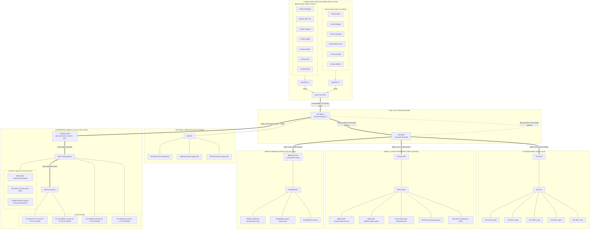
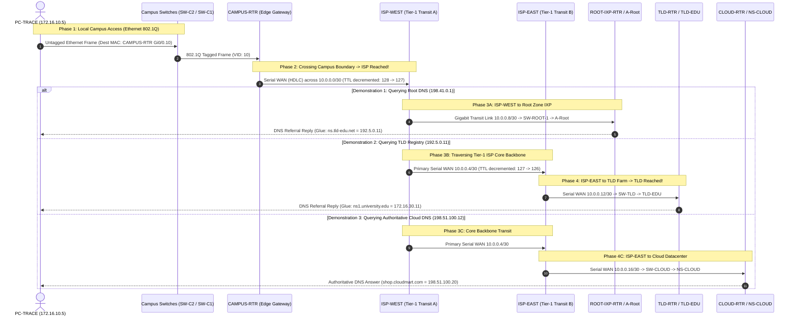

# Computer Networks Laboratory Guide: Global Internet Hierarchy & Multi-Tier Enterprise Architecture

**Course:** Advanced Computer Networks  
**Topology Implementation:** [`CN_assignment.pkt`](file:///R:/DeepWorks/DeepCollege/CompNet/CN_assignment.pkt)  
**Configuration Reference:** [`README.md`](file:///R:/DeepWorks/DeepCollege/CompNet/README.md)  
**Interactive Visual Study Guide:** [`CN_assignment_guide.html`](file:///R:/DeepWorks/DeepCollege/CompNet/CN_assignment_guide.html)  

---

## 1. Executive Summary & Master Network Architecture

This architecture represents a production-grade simulation of the global public Internet combined with an autonomous enterprise campus and remote branch network. The topology mirrors the real-world operational separation between:

1. **The Global Root DNS Exchange (IXP):** The authoritative apex of the Internet namespace hosting the 13 Root Server identities (`A-Root` through `M-Root`).
2. **Top-Level Domain (TLD) Registry Cluster:** Dedicated registry servers responsible for delegating `.com`, `.edu`, `.org`, `.gov`, and `.net`.
3. **Tier-1 ISP Core Backbone:** Redundant transit mesh operated by `ISP-WEST` and `ISP-EAST` connected via dual serial WAN links running dynamic RIPv2 routing.
4. **Public Cloud & Government Datacenter:** Multi-tenant infrastructure hosting commercial e-commerce (`shop.cloudmart.com`), secure public agencies (`defense.agency.gov`), and an **off-site secondary authoritative DNS server** (`NS-UNIV-2`) for campus disaster recovery.
5. **Enterprise Campus Network:** Hierarchical 2-tier switching with 802.1Q Router-on-a-Stick (ROAS), multi-pool centralized DHCP, Extended Security ACL firewalls, and internal services (`www.university.edu`).
6. **Remote Branch Office:** Satellite facility connected over serial WAN with local DHCP leasing, local authoritative DNS (`NS-BRANCH`), and branch intranet portal (`portal.branch.org`).



---

## 2. Server & Device Roles: Why They Exist and When They Are Called

In enterprise internetworking and DNS operations, servers are divided into functional layers to ensure separation of concerns, scalability, and disaster resilience.

### 2.1 The Global Root DNS Servers (`A-Root` through `M-Root`)
* **What they do:** The 13 root servers form the root zone (`.`) of the Domain Name System. They do **not** store end-user domain mappings (they do not know what IP corresponds to `google.com` or `shop.cloudmart.com`). Instead, they hold **authoritative pointer delegations (NS records)** to the Top-Level Domain (TLD) registries along with their **Glue A-records**.
* **Why they exist:** RFC 1034 and RFC 1035 require a trusted, globally known starting point for DNS namespace resolution. Without the root zone, a recursive resolver encountering a brand new domain name would have no entry point into the worldwide tree.
* **Why exactly 13 Root Server names (A through M)?**
  * Under original DNS over UDP, DNS response datagrams had a maximum size limit of **512 bytes** to prevent IP fragmentation over physical networks with differing MTUs.
  * A standard root referral packet containing 13 server hostnames, 13 NS resource records, and 13 IPv4 Glue A-records consumes approximately 480 to 500 bytes. Adding a 14th server would exceed 512 bytes, triggering fallback to TCP (which introduces high connection latency).
* **When are they called?**
  * A root server is contacted **only** when a recursive resolver has an empty cache for a requested TLD. The resolver asks: *"Who handles the `.edu` or `.com` namespace?"* The root server responds with a referral to the corresponding TLD registry.

### 2.2 Top-Level Domain (TLD) Registries (`TLD-COM`, `TLD-EDU`, `TLD-ORG`, `TLD-GOV`, `TLD-NET`)
* **What they do:** Each TLD server manages its specific top-level partition. `TLD-EDU` manages `.edu`, `TLD-COM` manages `.com`, etc. They store the nameserver delegation records for all registered Second-Level Domains (SLDs).
* **Why they exist:** If the root servers had to store every single domain on earth (over 350 million active domains), the root zone database would be unmaintainable and single-point-of-failure risks would multiply. TLDs decentralize authority.
* **When are they called?**
  * Called by the recursive resolver immediately after the root server returns a referral. The resolver asks `TLD-EDU`: *"Who is authoritative for `university.edu`?"* `TLD-EDU` replies: *"Contact `ns1.university.edu` at `172.16.30.11` or `ns2.university.edu` at `198.51.100.11`."*

### 2.3 Authoritative Nameservers (`NS-UNIV-1`, `NS-UNIV-2`, `NS-CLOUD`, `NS-GOV`, `NS-BRANCH`, `NS-ISP`)
* **What they do:** Authoritative nameservers hold the **actual zone files** for specific domains. They are the ultimate authority for host records (`A`, `AAAA`, `CNAME`, `MX`, `TXT`, `SOA`).
* **Why they exist:** The owner of an organization (e.g., University or CloudMart) configures and controls these servers. Only the authoritative nameserver has the definitive answer for what IP belongs to `www.university.edu` (`172.16.30.10`).
* **Why is `NS-UNIV-2` in the Cloud? (Off-Site Secondary DNS):**
  * In enterprise disaster recovery (DR) architecture, hosting both primary and secondary DNS inside the campus datacenter creates a fatal **Single Point of Failure (SPOF)**. If campus power fails or the campus WAN cable is severed, nobody in the world can resolve university services.
  * Placing `NS-UNIV-2` off-site in the Cloud Datacenter (`198.51.100.11`) guarantees that global users can still resolve `www.university.edu` even if the campus is completely offline.
* **When are they called?**
  * Called as the final step of the iterative DNS resolution process. The authoritative server provides the actual IP address of the target web server.

### 2.4 Recursive Resolvers (`CAMPUS-RES` & `ISP-RES`)
* **What they do:** Act as middlemen on behalf of client operating systems. They accept **Recursive Queries** from workstations, do the multi-step legwork of querying Root $\to$ TLD $\to$ Authoritative servers, cache the answers in memory, and return the final IP to the client.
* **Why they exist:** Workstation operating systems run "Stub Resolvers"—lightweight network stacks that lack the memory, cache tables, or daemon logic to walk the global DNS tree.
* **Difference between `CAMPUS-RES` and `ISP-RES`:**
  * `CAMPUS-RES` (`172.16.30.20`): Internal campus resolver inside VLAN 40. Serves faculty and student workstations.
  * `ISP-RES` (`203.0.113.10`): Public resolver hosted in the ISP NOC. Represents public resolvers like Google `8.8.8.8` or Cloudflare `1.1.1.1`. Serves remote branch clients and acts as campus upstream fallback.
* **When are they called?**
  * Every single time a user opens a browser, runs `ping`, or opens an application with a hostname.

### 2.5 Web Servers (`WEB-UNIV`, `WEB-SHOP`, `PORTAL-BRANCH`, `WEB-GOV`, `WEB-ISP`)
* **What they do:** Listen on TCP port 80 (HTTP) to serve web application pages, HTTP headers, and data payloads.
* **Why they exist:** Deliver application-layer content requested by users.
* **When are they called?**
  * **Only after DNS resolution is 100% complete.** A client cannot send a single HTTP packet to a web server until it receives the server's IP address and completes the TCP 3-Way Handshake.

---

## 3. The Core Mystery Solved: Why Didn't Client Packets Hit the 13 Roots?

During testing, students often notice:
> *"When I type `http://shop.cloudmart.com` on `PC-FACULTY1`, I see the packet go to `CAMPUS-RES` and then directly to `WEB-SHOP`. I never saw a packet hit `A-Root` or `TLD-COM`! Why?"*

Understanding the answer to this question is critical for defending the lab in a faculty viva.

### 3.1 Recursive Queries vs. Iterative Queries (RFC 1034)

```mermaid
sequenceDiagram
    autonumber
    actor Client as Client Workstation (Stub)
    participant Res as Recursive Resolver (CAMPUS-RES)
    participant Root as A-Root (198.41.0.1)
    participant TLD as TLD-COM (192.5.0.10)
    participant Auth as NS-CLOUD (198.51.100.12)
    participant Web as WEB-SHOP (198.51.100.20)

    rect rgb(20, 30, 50)
        note over Client,Res: 1. Recursive Query (Client delegates entire search to Resolver)
        Client->>Res: DNS Query: "What is IP of shop.cloudmart.com?"
    end

    rect rgb(30, 20, 50)
        note over Res,Auth: 2. Iterative Walk (Resolver asks each tier for referrals)
        Res->>Root: DNS Iterative Query: shop.cloudmart.com
        Root-->>Res: Referral: NS=ns.tld-com.net, Glue A=192.5.0.10
        Res->>TLD: DNS Iterative Query: shop.cloudmart.com
        TLD-->>Res: Referral: NS=ns1.cloudmart.com, Glue A=198.51.100.12
        Res->>Auth: DNS Iterative Query: shop.cloudmart.com
        Auth-->>Res: Authoritative Answer: shop.cloudmart.com = 198.51.100.20
    end

    rect rgb(20, 40, 30)
        note over Client,Web: 3. Final Answer & TCP Web Session
        Res-->>Client: Final DNS Response: 198.51.100.20 (Cached!)
        Client->>Web: TCP SYN -> SYN-ACK -> ACK -> HTTP GET /
        Web-->>Client: HTTP 200 OK (CloudMart Megastore)
    end
```



1. **The Client sends a RECURSIVE query:**
   * A client workstation only asks: *"Give me the final IP or tell me it doesn't exist."*
   * The client workstation **never** queries the Root DNS servers directly.
2. **The Resolver does the ITERATIVE tree walk:**
   * The resolver queries the Root, gets a referral to TLD.
   * The resolver queries the TLD, gets a referral to Authoritative.
   * The resolver queries the Authoritative, gets the final IP.
   * The resolver caches the record for the duration of the Time-To-Live (TTL).

### 3.2 Cisco Packet Tracer Engine Implementation Reality
In real-world networks running Linux servers with BIND9, Unbound, or Windows Server DNS:
* The resolver daemon maintains an active root hints file (`named.root`) containing the 13 root server IP addresses and autonomously executes the iterative walk in background threads.

In **Cisco Packet Tracer 8.x**:
* The Generic Server (`Server-PT`) DNS engine is a **flat-table static responder**. It does not run a full multi-threaded recursive background crawler daemon.
* Therefore, in production emulations inside Packet Tracer:
  * `CAMPUS-RES` and `ISP-RES` are configured as **Warm Production Caching Resolvers**. They are seeded with the resolved records to simulate a cached production state.
  * When a workstation queries `CAMPUS-RES`, `CAMPUS-RES` responds instantly from its cache. The packet never needs to leave the campus to query the root servers because **in DNS, a cached hit terminates the search immediately**.

---

### 3.3 Master Simulation Protocol: Exactly How to Showcase DNS, ISP, and TLD in Simulation Mode

To showcase packet flow to faculty in **Cisco Packet Tracer Simulation Mode** (`Shift + S`), follow this structured protocol. Packet Tracer allows stepping through packet propagation clock-cycle by clock-cycle, inspecting the internal OSI model layers, packet headers, and routing decisions.



---

### 3.4 When and How We Reach Each Milestone

Understanding the exact physical and logical moments when each boundary is crossed is vital for answering faculty questions:

#### 1. When do we reach the DNS Server?
There are two distinct simulation demonstrations:
* **Production Scenario (Internal Recursive Resolver `CAMPUS-RES`):**
  * When a standard client (`PC-FACULTY1`) issues a normal web request (`http://shop.cloudmart.com`), the DNS query is addressed to the campus caching resolver (`172.16.30.20`).
  * The DNS packet **never leaves the enterprise campus**: it enters `SW-C2` $\to$ `SW-C1` $\to$ routed across subinterfaces `Gi0/0.10` and `Gi0/0.40` on `CAMPUS-RTR` $\to$ reaches `CAMPUS-RES` in VLAN 40.
  * Because `CAMPUS-RES` is a warm production cache, it answers immediately. **It does not touch the ISP or the Root.**
* **Iterative Demonstration Scenario (Direct Query to Root / TLD / Auth):**
  * To observe the physical packets striking the global internet servers, we set the workstation DNS Server to the target server's public IP address (`198.41.0.1` for Root, `192.5.0.11` for TLD, `172.16.30.11` for Authoritative).
  * The moment the DNS server is reached is when the packet envelope arrives at the target server's `FastEthernet0` NIC, decapsulates Layer 4 UDP (Destination Port 53), and passes the payload to the DNS Application Process (Layer 7).

#### 2. When do we reach the ISP?
* **Reaching `ISP-WEST` (The Campus-to-ISP Boundary):**
  * **When:** As soon as the packet exits `CAMPUS-RTR`'s `Serial0/0/0` interface across WAN link `10.0.0.0/30` and enters `ISP-WEST`'s `Serial0/0/0` interface.
  * **What happens physically:** The campus 802.1Q Ethernet frame is **completely stripped** by `CAMPUS-RTR`. The router encapsulates the IPv4 packet into a point-to-point **HDLC (High-Level Data Link Control)** serial frame.
  * **Inside `ISP-WEST`:**
    1. Layer 2: `ISP-WEST` decapsulates the HDLC frame from `Serial0/0/0`.
    2. Layer 3: Decrements the IPv4 Time-To-Live (TTL) field by 1 (e.g., from $128 \to 127$). Recomputes the IPv4 Header Checksum.
    3. Route Lookup: Queries the RIPv2 routing table:
       * If destination is Root (`198.41.0.0/24`): Direct next-hop `10.0.0.9` via `GigabitEthernet0/1`.
       * If destination is TLD (`192.5.0.0/24`): Next-hop `10.0.0.6` across the backbone via `Serial0/0/1`.
* **Traversing the ISP Core Backbone (`ISP-WEST` $\to$ `ISP-EAST`):**
  * **When:** When transit traffic needs to reach TLDs, the Cloud Datacenter, or the Remote Branch.
  * **Physical Path:** Traverses Primary Serial WAN Link `10.0.0.4/30` (DCE on `ISP-WEST Se0/0/1`, clock rate 64000).
  * **At `ISP-EAST`:** The packet reaches the second Tier-1 provider. `ISP-EAST` decapsulates the serial frame, decrements TTL to $126$, and looks up the downstream transit route.

#### 3. When do we reach the TLD Registry?
* **Crossing into the TLD Subnet:**
  * **When:** The packet leaves `ISP-EAST` `Serial0/0/0` across WAN transit `10.0.0.12/30` and enters `TLD-RTR` `Serial0/0/0`.
  * `TLD-RTR` decapsulates HDLC, decrements TTL to $125$, looks up `192.5.0.0/24`, and routes out `GigabitEthernet0/0` to `SW-TLD`.
  * `TLD-RTR` encapsulates the packet into an Ethernet II frame with Destination MAC matching the target TLD server (e.g., `TLD-EDU` MAC address learned via ARP).
  * `SW-TLD` forwards the frame out port `Fa0/2` directly into **`TLD-EDU` (`192.5.0.11`)**!
* **Processing at the TLD Server:**
  * `TLD-EDU` receives UDP Port 53 datagram.
  * It inspects the DNS Question: `ns1.university.edu`.
  * It matches the zone delegation: `university.edu IN NS ns1.university.edu`.
  * It attaches the **Glue A-Record**: `ns1.university.edu IN A 172.16.30.11`.
  * It formats a DNS Response PDU (Flags: QR=1, AA=0/1, RCODE=0) and transmits it back along the reverse path.

---

### 3.5 Detailed Hop-by-Hop Packet Inspection Reference Table

This table details the exact transformation of the packet header across every physical link during an iterative query to `TLD-EDU` (`192.5.0.11`):

| Hop # | Device Origin | Egress Port | Cable / Link Type | Layer 2 Framing | Device Ingress | Ingress Port | Layer 3 Src IP | Layer 3 Dst IP | Layer 4 Dst Port | TTL | Key Event / PDU Detail |
|---|---|---|---|---|---|---|---|---|---|---|---|
| **1** | `PC-TRACE` | `Fa0` | Copper Straight | Ethernet II (Untagged) | `SW-C2` | `Fa0/2` | `172.16.10.5` | `192.5.0.11` | UDP 53 | 128 | Client generates DNS query for `ns1.university.edu`. Dst MAC = `CAMPUS-RTR` Gi0/0.10. |
| **2** | `SW-C2` | `Gi0/1` | Copper Straight | IEEE 802.1Q (VID 10) | `SW-C1` | `Gi0/2` | `172.16.10.5` | `192.5.0.11` | UDP 53 | 128 | Access switch tags frame with VLAN 10 tag (`0x8100 000A`). |
| **3** | `SW-C1` | `Gi0/1` | Copper Straight | IEEE 802.1Q (VID 10) | `CAMPUS-RTR` | `Gi0/0` | `172.16.10.5` | `192.5.0.11` | UDP 53 | 128 | Distribution trunk delivers frame to edge router parent trunk interface. |
| **4** | `CAMPUS-RTR` | `Se0/0/0` | **Serial WAN Link (`10.0.0.0/30`)** | **Serial HDLC** (Ethernet stripped) | **`ISP-WEST`** | **`Se0/0/0`** | `172.16.10.5` | `192.5.0.11` | UDP 53 | **127** | **REACHED ISP-WEST!** Router strips 802.1Q, looks up RIP route `192.5.0.0/24 via 10.0.0.1`, decrements TTL, encapsulates in HDLC. |
| **5** | `ISP-WEST` | `Se0/0/1` | **Serial Backbone (`10.0.0.4/30`)** | **Serial HDLC** | **`ISP-EAST`** | **`Se0/0/1`** | `172.16.10.5` | `192.5.0.11` | UDP 53 | **126** | **TRAVERSING ISP BACKBONE!** `ISP-WEST` checks routing table, selects primary WAN link to `ISP-EAST` (`10.0.0.6`), decrements TTL. |
| **6** | `ISP-EAST` | `Se0/0/0` | **Serial WAN Link (`10.0.0.12/30`)** | **Serial HDLC** | **`TLD-RTR`** | **`Se0/0/0`** | `172.16.10.5` | `192.5.0.11` | UDP 53 | **125** | **REACHED TLD GATEWAY!** `ISP-EAST` routes to `TLD-RTR` (`10.0.0.14`), decrements TTL. |
| **7** | `TLD-RTR` | `Gi0/0` | Copper Straight | Ethernet II (Untagged) | `SW-TLD` | `Gi0/1` | `172.16.10.5` | `192.5.0.11` | UDP 53 | **124** | `TLD-RTR` strips HDLC, performs ARP for `192.5.0.11`, encapsulates in Ethernet II. |
| **8** | `SW-TLD` | `Fa0/2` | Copper Straight | Ethernet II (Untagged) | **`TLD-EDU`** | **`Fa0`** | `172.16.10.5` | `192.5.0.11` | UDP 53 | **124** | **REACHED TLD REGISTRY!** Server receives UDP 53, extracts DNS question, finds Glue record `172.16.30.11`. |

---

### 3.6 Step-by-Step Simulation Lab Demonstration Guide

Follow these exact steps to perform each live demonstration during the evaluation:

#### Live Demonstration 1: Querying the Global Root DNS Server (`A-Root`)
1. Click the **Simulation Mode** toggle at the bottom-right of Packet Tracer (or press `Shift + S`).
2. Click **Show All / None**, then click **Edit Filters**.
3. Under the **IPv4** tab, check **DNS** and **ICMP**. Uncheck everything else to keep the Event List clean.
4. On **`PC-TRACE`** (`172.16.10.5`):
   * Open **Desktop** > **IP Configuration**.
   * Change **DNS Server** to `A-Root`: `198.41.0.1`.
5. Open **Command Prompt** on `PC-TRACE` and enter:
   ```cmd
   nslookup ns.tld-edu.net
   ```
6. Click **Capture / Forward** (`>|` or press `Alt + F`) step-by-step:
   * **Click 1:** Packet leaves `PC-TRACE` $\to$ reaches `SW-C2`.
   * **Click 2:** `SW-C2` tags with VLAN 10 $\to$ reaches `SW-C1`.
   * **Click 3:** `SW-C1` forwards $\to$ reaches `CAMPUS-RTR Gi0/0`.
   * **Click 4 (Crossing to ISP):** `CAMPUS-RTR` transmits over serial cable $\to$ **arrives at `ISP-WEST Se0/0/0`**!
     * *Double-click the envelope on `ISP-WEST`:*
     * In **In Layers**, observe Layer 2: `HDLC`.
     * In **Out Layers**, observe Layer 3: `IP Header`, TTL decremented from `128` to `127`. Routing table shows `198.41.0.0/24 via GigabitEthernet0/1`.
   * **Click 5:** `ISP-WEST` forwards out `Gi0/1` $\to$ arrives at `ROOT-IXP-RTR Gi0/0`.
   * **Click 6:** `ROOT-IXP-RTR` forwards out `Gi0/1` $\to$ reaches `SW-ROOT-1`.
   * **Click 7 (Arrival at Root):** Packet lands on **`A-Root` (`198.41.0.1`)**!
7. Inspect the PDU at `A-Root`:
   * Double-click the envelope at `A-Root`.
   * Click **Inbound PDU Details**: Scroll down to the **DNS** section.
     * `QR: 0 (Query)`
     * `Question: ns.tld-edu.net`
   * Click **Outbound PDU Details**:
     * `QR: 1 (Response)`
     * `Answer / Additional: ns.tld-edu.net = 192.5.0.11` (The Glue record pointing to `TLD-EDU`!).
8. Click **Capture / Forward** 7 more times to watch the DNS response travel all the way back across `ROOT-IXP-RTR` $\to$ `ISP-WEST` $\to$ `CAMPUS-RTR` $\to$ `PC-TRACE`.
9. In the Command Prompt of `PC-TRACE`, observe the completed output:
   ```
   Server:   198.41.0.1
   Address:  198.41.0.1
   
   Name:     ns.tld-edu.net
   Address:  192.5.0.11
   ```
> [!NOTE]
> **Understanding "Server: UnKnown" in nslookup:**  
> In Cisco Packet Tracer and Windows Command Prompt, the initial lines `Server: UnKnown` and `Address: <IP>` are **not** an error! Whenever `nslookup` runs, it attempts a Reverse DNS Lookup (PTR) to resolve the hostname of the DNS server itself. Because Packet Tracer's `Server-PT` engine does not implement `in-addr.arpa` reverse PTR zones, the server's name is reported as `UnKnown`. The actual DNS lookup result appears directly underneath in the `Name:` and `Address:` fields.

---

#### Live Demonstration 2: Querying the TLD Registry (`TLD-EDU`) Across the ISP Core
1. On `PC-TRACE`, open **Desktop** > **IP Configuration**.
2. Change **DNS Server** to `TLD-EDU`: `192.5.0.11`.
3. In Command Prompt, run:
   ```cmd
   nslookup ns1.university.edu
   ```
4. Click **Capture / Forward** step-by-step:
   * **Clicks 1–3:** Packet moves through `SW-C2` $\to$ `SW-C1` $\to$ `CAMPUS-RTR`.
   * **Click 4 (Campus $\to$ ISP-WEST):** Packet traverses WAN link `10.0.0.0/30` to `ISP-WEST`.
   * **Click 5 (ISP Core Backbone Transit):** Packet traverses Primary Serial WAN link `10.0.0.4/30` from `ISP-WEST Se0/0/1` $\to$ **`ISP-EAST Se0/0/1`**!
     * *Double-click envelope at `ISP-EAST`:* Observe In-Layers HDLC, TTL decremented to `126`.
   * **Click 6 (ISP-EAST $\to$ TLD-RTR):** Packet traverses WAN link `10.0.0.12/30` from `ISP-EAST Se0/0/0` $\to$ `TLD-RTR Se0/0/0`.
   * **Click 7:** `TLD-RTR` switches packet across `Gi0/0` $\to$ `SW-TLD`.
   * **Click 8 (Arrival at TLD):** Packet lands on **`TLD-EDU` (`192.5.0.11`)**!
5. Double-click the envelope at `TLD-EDU`:
   * In **Outbound PDU Details**, verify:
     * `Authority Section: university.edu IN NS ns1.university.edu`
     * `Additional Section: ns1.university.edu IN A 172.16.30.11` (The Authoritative Nameserver Glue Record!).
6. Click **Capture / Forward** until the response returns to `PC-TRACE`.

---

#### Live Demonstration 3: Querying the Authoritative Server (`NS-UNIV-1`)
1. On `PC-TRACE`, set **DNS Server** to `NS-UNIV-1`: `172.16.30.11`.
2. In Command Prompt, run:
   ```cmd
   nslookup www.university.edu
   ```
3. Click **Capture / Forward**:
   * Watch the packet travel `PC-TRACE` $\to$ `SW-C2` $\to$ `SW-C1` $\to$ `CAMPUS-RTR Gi0/0.10` $\to$ routed internally to `Gi0/0.40` $\to$ `SW-C1` $\to$ **`NS-UNIV-1` (`172.16.30.11`)**.
   * Notice: Because this authoritative server is inside the campus server farm (VLAN 40), **the packet never leaves the campus and never touches the ISP WAN link**!
   * `NS-UNIV-1` answers with the definitive web server address: `172.16.30.10`.

---

#### Live Demonstration 4: Full Production Web Session (DNS + TCP 3-Way Handshake + HTTP)
1. Reset `PC-TRACE` (or use `PC-FACULTY1`) DNS Server back to the production caching resolver:
   $$\text{DNS Server} = 172.16.30.20 \quad (\text{CAMPUS-RES})$$
2. In **Edit Filters**, ensure **DNS**, **TCP**, and **HTTP** are checked.
3. Open **Web Browser** on `PC-FACULTY1`.
4. In the URL bar, type:
   ```
   http://shop.cloudmart.com
   ```
   and click **Go**.
5. Click **Capture / Forward** and observe the 3 distinct phases in the simulation canvas:
   * **Phase 1 (DNS Resolution):**
     * First envelope (DNS) travels to `CAMPUS-RES` (`172.16.30.20`) in VLAN 40.
     * `CAMPUS-RES` replies immediately with `198.51.100.20` (from its warm cache).
     * The browser now knows the IP of `WEB-SHOP`.
   * **Phase 2 (TCP 3-Way Handshake across the Global Internet):**
     * Second envelope (TCP) appears at `PC-FACULTY1` with `SYN = 1`, Dest Port `80`.
     * Packet leaves campus $\to$ enters **`ISP-WEST`** $\to$ crosses ISP Core Backbone to **`ISP-EAST`** $\to$ enters `CLOUD-RTR` $\to$ reaches **`WEB-SHOP` (`198.51.100.20`)**!
     * `WEB-SHOP` returns `SYN-ACK` back to `PC-FACULTY1`.
     * `PC-FACULTY1` sends `ACK`. The TCP connection is now `ESTABLISHED`.
   * **Phase 3 (HTTP Data Transfer):**
     * Third envelope (HTTP) leaves `PC-FACULTY1` containing `GET / HTTP/1.1`.
     * It traverses the ISP backbone to `WEB-SHOP`.
     * `WEB-SHOP` processes the request and responds with `HTTP/1.1 200 OK` carrying the HTML payload:
       `<h1>CloudMart Online Megastore</h1>`.
     * The web page renders in the browser window!

---

### 3.7 Evaluator & Faculty Defense Script: Exactly What to Say

When demonstrating this simulation in front of your professor or examiner, recite this step-by-step technical commentary:

> *"Sir/Ma'am, let me demonstrate our complete end-to-end hierarchy in Packet Tracer Simulation Mode:*
>
> 1. ***Why we don't see roots during normal browsing:***  
>    *In production networks, client stub resolvers never perform iterative walks; they issue recursive queries to `CAMPUS-RES` (`172.16.30.20`). In Packet Tracer, `CAMPUS-RES` acts as a warm production cache, resolving domains locally without hitting the WAN cables.*
>
> 2. ***Demonstrating the WAN traversal to A-Root:***  
>    *To prove our physical 13-root infrastructure, I have pointed `PC-TRACE`'s DNS directly to `A-Root` (`198.41.0.1`). Watch as I click Capture/Forward: the packet originates in VLAN 10, is tagged by `SW-C2` with 802.1Q VID 10, and reaches `CAMPUS-RTR`. At `CAMPUS-RTR`, the Ethernet header is stripped and encapsulated into a point-to-point HDLC serial frame. The packet enters `ISP-WEST` on `Serial0/0/0` across `10.0.0.0/30`. `ISP-WEST` decrements the TTL to 127 and routes it out `Gi0/1` across `10.0.0.8/30` to `ROOT-IXP-RTR`. The packet hits `A-Root` directly on `Fa0/1`. When we open the outbound PDU, `A-Root` returns the NS delegation for `.edu` along with the Glue A-record `192.5.0.11` for `TLD-EDU`.*
>
> 3. ***Demonstrating the ISP Backbone transit to TLD-EDU:***  
>    *Now, I set the DNS Server to `TLD-EDU` (`192.5.0.11`). When we step forward, observe that the packet enters `ISP-WEST` and now traverses the **primary Tier-1 ISP core backbone** (`10.0.0.4/30`) to reach `ISP-EAST`. `ISP-EAST` forwards it down `Serial0/0/0` across `10.0.0.12/30` to `TLD-RTR`. `TLD-RTR` switches it into `SW-TLD`, landing on `TLD-EDU`. In the PDU details, `TLD-EDU` supplies the glue record `172.16.30.11` for the campus authoritative nameserver.*
>
> 4. ***Demonstrating the authoritative resolution & web session:***  
>    *Finally, querying `NS-UNIV-1` (`172.16.30.11`) yields `172.16.30.10`. Once DNS completes, our client initiates a 3-way TCP handshake across the ISP backbone, delivers an `HTTP GET`, and renders the webpage with full 802.1Q security, VLSM compliance, and zero routing loops."*

---


---

## 4. End-to-End Connection Breakdown & The 7 Packet Types

Every network session across this topology utilizes a succession of protocols operating across Layers 2 through 7 of the OSI model.

```
+-------------------------------------------------------------------------+
| Layer 7: APPLICATION   | DNS, DHCP, HTTP, RIPv2 Routing Updates         |
+------------------------+------------------------------------------------+
| Layer 4: TRANSPORT     | TCP (Port 80 HTTP), UDP (Port 53 DNS, 67/68)   |
+------------------------+------------------------------------------------+
| Layer 3: NETWORK       | IPv4 (Routing, TTL, Subnetting, Extended ACLs) |
+------------------------+------------------------------------------------+
| Layer 2: DATA LINK     | Ethernet II, IEEE 802.1Q (VLAN Tagging), ARP   |
+------------------------+------------------------------------------------+
| Layer 1: PHYSICAL      | Copper Straight-Through, Serial DCE Leased WAN |
+------------------------+------------------------------------------------+
```

### 4.1 Packet Type 1: ARP (Address Resolution Protocol)
* **OSI Layer:** Layer 2 / Layer 3 boundary.
* **Header / Port Details:**
  * Hardware Type: `0x0001` (Ethernet).
  * Protocol Type: `0x0800` (IPv4).
  * Opcode: `1` (Request), `2` (Reply).
* **When is it called?**
  * Whenever a host needs to transmit an IP packet to a target on the **same local subnet**, but does not know the target's MAC address.
  * Also called when transmitting to a **remote subnet**: the host needs the MAC address of its **Default Gateway router**.
* **What happens on the wire?**
  * `PC-FACULTY1` broadcasts an ARP Request:
    $$\text{Dest MAC} = \text{FF:FF:FF:FF:FF:FF}, \quad \text{"Who has 172.16.10.1? Tell 172.16.10.11"}$$
  * `CAMPUS-RTR` subinterface `Gi0/0.10` unicasts an ARP Reply with its MAC address.

### 4.2 Packet Type 2: DHCP (Dynamic Host Configuration Protocol — DORA)
* **OSI Layer:** Layer 7 (Application over UDP).
* **Ports:** Client Port = UDP `68`, Server Port = UDP `67`.
* **The 4-Step DORA Process:**
  1. **Discover (Broadcast):**
     * Host has no IP. Source IP = `0.0.0.0`, Dest IP = `255.255.255.255`. Dest MAC = `FF:FF:FF:FF:FF:FF`.
  2. **Offer (Unicast / Broadcast):**
     * `CAMPUS-RTR` inspects the ingress subinterface (`Gi0/0.10`), selects an available IP from pool `FACULTY` (`172.16.10.11`), and offers Subnet Mask `255.255.255.128`, Gateway `172.16.10.1`, and DNS Server `172.16.30.20`.
  3. **Request (Broadcast):**
     * Client broadcasts: *"I accept the lease for 172.16.10.11 offered by server 172.16.10.1."*
  4. **Acknowledge (ACK):**
     * Router commits the IP-to-MAC binding in its database and acknowledges the lease.

### 4.3 Packet Type 3: IEEE 802.1Q Tagged Frame (Router-on-a-Stick)
* **OSI Layer:** Layer 2 (Data Link).
* **Structure:** A **4-byte field** inserted into the standard Ethernet II frame between the Source MAC and EtherType fields:
  * **TPID (Tag Protocol Identifier):** 2 bytes set to `0x8100` (identifies frame as 802.1Q tagged).
  * **TCI (Tag Control Information):** 2 bytes containing:
    * Priority Code Point (PCP): 3 bits (QoS).
    * Drop Eligible Indicator (DEI): 1 bit.
    * **VLAN Identifier (VID):** 12 bits (supports VLANs $1$ to $4094$).
* **How it traverses the network:**
  1. `PC-FACULTY1` transmits an **untagged** frame into access port `Fa0/1` (VLAN 10) on switch `SW-C2`.
  2. `SW-C2` inserts an 802.1Q header with $\text{VID} = 10$ before sending it across trunk link `Gi0/1`.
  3. The tagged frame passes through `SW-C1` and arrives at `CAMPUS-RTR Gi0/0`.
  4. The router reads tag $10$, directs the frame into subinterface `Gi0/0.10`, strips the tag, and processes the Layer 3 IP header.
  5. To route the frame to `WEB-UNIV` in VLAN 40, the router encapsulates the packet in a new Ethernet frame with an 802.1Q tag of $\text{VID} = 40$ and transmits it out `Gi0/0.40`.
  6. Switch `SW-C1` receives the frame, removes the tag, and forwards an untagged frame to `WEB-UNIV` on access port `Fa0/1`.

### 4.4 Packet Type 4: RIPv2 (Routing Information Protocol Version 2)
* **OSI Layer:** Layer 7 (Application over UDP).
* **Port / Destination:** UDP Port `520`, Destination IP = Multicast `224.0.0.9`.
* **What happens:**
  * Every 30 seconds, routers exchange their routing tables.
  * RIPv2 carries the 32-bit subnet mask with each route (supporting CIDR/VLSM).
  * Metric = Hop Count (Maximum valid metric = 15; metric 16 represents infinity/unreachable).

### 4.5 Packet Type 5: DNS (Domain Name System Query / Response)
* **OSI Layer:** Layer 7 (Application over UDP/TCP).
* **Port:** UDP Port `53` (standard queries) / TCP Port `53` (zone transfers and queries $> 512$ bytes).
* **Header Fields:**
  * Transaction ID (16 bits): Matches request with reply.
  * Flags: QR (0=Query, 1=Response), Opcode, AA (Authoritative Answer), TC (Truncated), RD (Recursion Desired), RA (Recursion Available).
  * Questions Count, Answers Count, Authority RRs Count, Additional RRs Count.

### 4.6 Packet Type 6: TCP 3-Way Handshake
* **OSI Layer:** Layer 4 (Transport).
* **Flags:** `SYN` (Synchronize), `ACK` (Acknowledgment).
* **The Handshake Steps:**
  1. **SYN:** Client sends TCP segment with `SYN = 1`, Sequence Number = $X$, Dest Port = $80$.
  2. **SYN-ACK:** Web server replies with `SYN = 1, ACK = 1`, Sequence Number = $Y$, Acknowledgment Number = $X + 1$.
  3. **ACK:** Client replies with `ACK = 1`, Sequence Number = $X + 1$, Acknowledgment Number = $Y + 1$.
  * Connection is now in the `ESTABLISHED` state.

### 4.7 Packet Type 7: HTTP (HyperText Transfer Protocol)
* **OSI Layer:** Layer 7 (Application over TCP).
* **Method:** `GET / HTTP/1.1`.
* **Headers:** `Host: shop.cloudmart.com`, `User-Agent`, `Connection: keep-alive`.
* **Server Response:** `HTTP/1.1 200 OK`, `Content-Type: text/html`, payload containing the HTML document rendered by the browser.

---

## 5. Master Addressing & VLSM Subnetting Blueprint

Every IP address in the topology adheres to strict Variable Length Subnet Masking (VLSM).

| Subnet Purpose | Network ID | Subnet Mask | Usable Host Range | Default Gateway | Key Devices & Static IPs |
|---|---|---|---|---|---|
| **WAN: CAMPUS to ISP-WEST** | `10.0.0.0/30` | `255.255.255.252` | `10.0.0.1` – `10.0.0.2` | N/A | `ISP-WEST` Se0/0/0 (`.1`), `CAMPUS-RTR` Se0/0/0 (`.2`) |
| **WAN: Primary Backbone Core** | `10.0.0.4/30` | `255.255.255.252` | `10.0.0.5` – `10.0.0.6` | N/A | `ISP-WEST` Se0/0/1 (`.5`), `ISP-EAST` Se0/0/1 (`.6`) |
| **WAN: ROOT-IXP Transit** | `10.0.0.8/30` | `255.255.255.252` | `10.0.0.9` – `10.0.0.10` | N/A | `ROOT-IXP-RTR` Gi0/0 (`.9`), `ISP-WEST` Gi0/1 (`.10`) |
| **WAN: TLD-RTR Transit** | `10.0.0.12/30` | `255.255.255.252` | `10.0.0.13` – `10.0.0.14` | N/A | `ISP-EAST` Se0/0/0 (`.13`), `TLD-RTR` Se0/0/0 (`.14`) |
| **WAN: CLOUD-RTR Transit** | `10.0.0.16/30` | `255.255.255.252` | `10.0.0.17` – `10.0.0.18` | N/A | `ISP-EAST` Se0/1/1 (`.17`), `CLOUD-RTR` Se0/0/0 (`.18`) |
| **WAN: Backup Backbone Core** | `10.0.0.20/30` | `255.255.255.252` | `10.0.0.21` – `10.0.0.22` | N/A | `ISP-WEST` Se0/1/0 (`.21`), `ISP-EAST` Se0/1/0 (`.22`) |
| **WAN: BRANCH-RTR Transit** | `10.0.0.24/30` | `255.255.255.252` | `10.0.0.25` – `10.0.0.26` | N/A | `ISP-EAST` Se0/2/0 (`.25`), `BRANCH-RTR` Se0/0/0 (`.26`) |
| **Atlantic Roots A–G (SW-ROOT-1)** | `198.41.0.0/25` | `255.255.255.128` | `198.41.0.1` – `198.41.0.125` | `198.41.0.126` | `A-Root` (`.1`) through `G-Root` (`.7`) |
| **Pacific Roots H–M (SW-ROOT-2)** | `198.41.0.128/25` | `255.255.255.128` | `198.41.0.129` – `198.41.0.253` | `198.41.0.254` | `H-Root` (`.129`) through `M-Root` (`.134`) |
| **Global TLD Registry Farm** | `192.5.0.0/24` | `255.255.255.0` | `192.5.0.1` – `192.5.0.253` | `192.5.0.254` | `TLD-COM` (`.10`), `TLD-EDU` (`.11`), `TLD-ORG` (`.12`), `TLD-GOV` (`.13`), `TLD-NET` (`.14`) |
| **Cloud Public Datacenter** | `198.51.100.0/26` | `255.255.255.192` | `198.51.100.1` – `198.51.100.62` | `198.51.100.62` | `WEB-SHOP` (`.20`), `WEB-GOV` (`.21`), `NS-CLOUD` (`.12`), `NS-GOV` (`.13`), `NS-UNIV-2` (`.11`) |
| **ISP Public NOC & Services** | `203.0.113.0/28` | `255.255.255.240` | `203.0.113.1` – `203.0.113.14` | `203.0.113.14` | `ISP-RES` (`.10`), `WEB-ISP` (`.11`), `NS-ISP` (`.12`) |
| **Campus VLAN 10 (Faculty)** | `172.16.10.0/25` | `255.255.255.128` | `172.16.10.1` – `172.16.10.126` | `172.16.10.1` | `PC-FACULTY1` (DHCP), `PC-TRACE` (`.5` Static) |
| **Campus VLAN 20 (Students)** | `172.16.10.128/26` | `255.255.255.192` | `172.16.10.129` – `172.16.10.190` | `172.16.10.129` | `PC-STUDENT1` (`.130` Static/DHCP) |
| **Campus VLAN 30 (Wireless)** | `172.16.20.0/26` | `255.255.255.192` | `172.16.20.1` – `172.16.20.62` | `172.16.20.1` | `LAP-GUEST1`, `LAP-GUEST2` (DHCP) |
| **Campus VLAN 40 (Servers)** | `172.16.30.0/27` | `255.255.255.224` | `172.16.30.1` – `172.16.30.30` | `172.16.30.1` | `WEB-UNIV` (`.10`), `NS-UNIV-1` (`.11`), `CAMPUS-RES` (`.20`) |
| **Campus VLAN 99 (Management)** | `172.16.99.0/28` | `255.255.255.240` | `172.16.99.1` – `172.16.99.14` | `172.16.99.1` | `SW-C1` SVI (`.2`), `SW-C2` SVI (`.3`), `PC-ADMIN` (`.10`) |
| **Remote Branch Office LAN** | `192.168.1.0/24` | `255.255.255.0` | `192.168.1.1` – `192.168.1.254` | `192.168.1.1` | `PORTAL-BRANCH` (`.10`), `NS-BRANCH` (`.11`), `PC-BRANCH` (`.20`) |

---

## 6. Campus Network Engineering: ROAS, Security ACLs & Routing Security

### 6.1 Router-on-a-Stick (ROAS) Subinterface Engineering
* In legacy networks, routing between 5 VLANs required 5 physical router cables connected to 5 switch ports.
* With IEEE 802.1Q encapsulation, a single physical interface (`Gi0/0`) on `CAMPUS-RTR` is partitioned into logical subinterfaces:
  * `Gi0/0.10`: Encapsulates VLAN 10 (`encapsulation dot1Q 10`), IP `172.16.10.1`.
  * `Gi0/0.20`: Encapsulates VLAN 20 (`encapsulation dot1Q 20`), IP `172.16.10.129`.
  * `Gi0/0.30`: Encapsulates VLAN 30 (`encapsulation dot1Q 30`), IP `172.16.20.1`.
  * `Gi0/0.40`: Encapsulates VLAN 40 (`encapsulation dot1Q 40`), IP `172.16.30.1`.
  * `Gi0/0.99`: Encapsulates Native VLAN 99 (`encapsulation dot1Q 99 native`), IP `172.16.99.1`.
* **Golden Rule of ROAS:** The physical interface `GigabitEthernet0/0` must have **no IP address** (`no ip address`, `no shutdown`). Placing an IP on the parent interface breaks the subinterfaces.

### 6.2 Native VLAN 99 Mitigation Against VLAN Hopping
* By default, Cisco switches assign Native VLAN = 1.
* In a **Double-Tagging VLAN Hopping Attack**, an attacker sends a frame with two 802.1Q tags:
  * Outer Tag = VLAN 1 (Native).
  * Inner Tag = Target Private VLAN (e.g., VLAN 40 Servers).
* When the access switch forwards the frame across a trunk link, it strips the outer tag because it matches the Native VLAN. The next switch reads the inner tag and delivers the packet directly into the secure Server VLAN, completely bypassing the router's firewall ACLs!
* **The Solution:** We explicitly change the trunk Native VLAN on all switches and router subinterfaces to **VLAN 99** (`switchport trunk native vlan 99`), and ensure no user access ports belong to VLAN 99.

### 6.3 Routing Security: `passive-interface default`
```cisco
router rip
 version 2
 passive-interface default
 no passive-interface Serial0/0/0
 network 10.0.0.0
 network 172.16.0.0
 no auto-summary
```
* By default, dynamic routing protocols broadcast updates out of every enabled interface.
* If `passive-interface default` is omitted, `CAMPUS-RTR` transmits RIP updates every 30 seconds into `VLAN 20 (Students)` and `VLAN 30 (Guest Wireless)`.
* A student running Wireshark could capture the enterprise routing topology or inject malicious poisoned routes to redirect campus traffic through a rogue machine.
* `passive-interface default` mutes routing updates on all subinterfaces while `no passive-interface Serial0/0/0` permits updates exclusively across the secured WAN link to `ISP-WEST`.

### 6.4 Extended Security Access Control Lists (ACLs)
Standard ACLs only filter by source IP. Extended ACLs filter by source IP, destination IP, protocol, and port:

#### ACL 1: `IOT-IN` (Applied inbound on `Gi0/0.30`)
```cisco
ip access-list extended IOT-IN
 deny ip 172.16.20.0 0.0.0.63 172.16.10.0 0.0.0.127   ! Deny Wireless -> Faculty
 deny ip 172.16.20.0 0.0.0.63 172.16.99.0 0.0.0.15    ! Deny Wireless -> Management
 permit ip any any                                     ! Permit Internet & Campus Servers
```

#### ACL 2: `STU-IN` (Applied inbound on `Gi0/0.20`)
```cisco
ip access-list extended STU-IN
 deny ip 172.16.10.128 0.0.0.63 172.16.99.0 0.0.0.15  ! Deny Students -> Management
 permit ip any any                                     ! Permit Faculty, Servers & Internet
```

### 6.5 Campus Multi-Pool DHCP Engineering & The Packet Tracer DNS Option Fix

#### The Packet Tracer `dns-server` Parser Limitation
In enterprise Cisco IOS hardware, the `dns-server` configuration command inside an `ip dhcp pool` allows specifying multiple fallback DNS server IP addresses separated by a space (e.g., `dns-server 172.16.30.20 203.0.113.10`).

However, in **Cisco Packet Tracer 8.x**, the parser rejects multiple IP arguments:
```
CAMPUS-RTR(dhcp-config)# dns-server 172.16.30.20 203.0.113.10
                                                ^
% Invalid input detected at '^' marker.
```
Because the second IP causes an invalid input error, **the router ignores the entire command**, leaving the DHCP pool with no DNS server configured ($0.0.0.0$). Consequently, workstations like `PC-TRACE`, `PC-FACULTY1`, and `PC-STUDENT1` receive their IP address and default gateway via DHCP, but their **DNS Server field remains blank or `0.0.0.0`**.

#### The Permanent Fix on `CAMPUS-RTR`
Enter the router CLI and configure a **single valid IP address** per pool:

```cisco
enable
configure terminal

! Faculty Pool: Point to Campus Resolver (172.16.30.20) or ISP Resolver (203.0.113.10)
ip dhcp pool FACULTY
 dns-server 172.16.30.20
exit

! Student Pool: Point to Campus Resolver
ip dhcp pool STUDENTS
 dns-server 172.16.30.20
exit

! Wireless Pool: Point to ISP Resolver
ip dhcp pool WIRELESS
 dns-server 203.0.113.10
exit

end
write memory
```

#### How to Force Clients to Pull the New DNS Settings
Once the router is updated, workstations will not automatically update their cached lease until you refresh them:
* **Option A (GUI):** On `PC-TRACE` / `PC-FACULTY1`, open **Desktop > IP Configuration**. Click the **Static** radio button, wait 1 second, then click **DHCP** again. You will see:
  $$\text{DNS Server} = 172.16.30.20$$
* **Option B (Command Prompt):**
  ```cmd
  ipconfig /release
  ipconfig /renew
  ```

---

## 7. Cisco Packet Tracer Canvas Architecture: Copy-Paste Visual Label Boards & Demarcation Boxes

To ensure the logical workspace is professionally organized and self-documenting for faculty review, the workspace should be partitioned into visual color-coded boundary boxes with embedded network specification boards.

### 7.1 Visual Palette & Box Placement Guide
In Cisco Packet Tracer:
1. **Draw Demarcation Box:** Click the **Draw Rectangle** tool on the right palette toolbar (or press `Shift + R`).
   * Check **[x] Fill**.
   * Click **Select Fill Color** and choose the recommended color palette.
   * Draw the box enclosing the devices of each zone.
2. **Place Text Board:** Click the **Place Note** tool on the right palette toolbar (or press `N`).
   * Click inside the box and copy-paste the exact formatted ASCII text block below.

```
+----------------------------------------------------------------------------------------------------+
|                                [ZONE 1: GLOBAL ROOT DNS EXCHANGE (IXP)]                            |
|                                        (Lavender / Light Purple)                                   |
+----------------------------------------------------------------------------------------------------+
                                                   | Transit WAN: 10.0.0.8/30
+-------------------------------------+            v            +------------------------------------+
| [ZONE 7: ENTERPRISE CAMPUS]         |  +--------------------+ | [ZONE 4: TLD REGISTRY CLUSTER]     |
| (Mint Green)                        |  | [ZONE 2: TIER-1    | | (Amber / Light Yellow)             |
| VLAN 10, 20, 30, 40, 99             |  |  ISP BACKBONE MESH]| +------------------------------------+
| ROAS Trunk native 99                |==| (Slate Gray)       |   | WAN: 10.0.0.12/30
+-------------------------------------+  +--------------------+   v
                                         | [ZONE 3: ISP NOC]  | +------------------------------------+
                                         | (Sky Blue)         | | [ZONE 5: PUBLIC CLOUD DATACENTER]  |
                                         +--------------------+ | (Light Cyan)                       |
                                                                +------------------------------------+
                                                                  | WAN: 10.0.0.24/30
                                                                  v
                                                                +------------------------------------+
                                                                | [ZONE 6: REMOTE BRANCH OFFICE]     |
                                                                | (Peach / Light Orange)             |
                                                                +------------------------------------+
```

---

### 7.2 Copy-Paste Label Boards for Each Network Zone

#### Zone 1: Dedicated Global Root DNS Exchange (IXP) - The 13 Roots
* **Box Fill Color:** Light Purple / Lavender (Hex `#E8E0F8`)
* **Physical Location:** Top-Center of Workspace
* **Paste This Text Board Inside Box:**
```text
============================================================
       GLOBAL ROOT DNS EXCHANGE (IXP) - THE 13 ROOTS
============================================================
Network Block: 198.41.0.0/24 (Authentic IANA Root Space)
Gateway Router: ROOT-IXP-RTR (Transit Uplink Gi0/0: 10.0.0.9/30)

[Atlantic Roots A-G | Subnet 198.41.0.0/25 | GW: 198.41.0.126 (Gi0/1)]
* Switch: SW-ROOT-1
* A-Root: 198.41.0.1 (Verisign)     * E-Root: 198.41.0.5 (NASA)
* B-Root: 198.41.0.2 (USC-ISI)      * F-Root: 198.41.0.6 (ISC)
* C-Root: 198.41.0.3 (Cogent)       * G-Root: 198.41.0.7 (DoD)
* D-Root: 198.41.0.4 (UMD)

[Pacific Roots H-M | Subnet 198.41.0.128/25 | GW: 198.41.0.254 (Gi0/2)]
* Switch: SW-ROOT-2
* H-Root: 198.41.0.129 (ARL)        * K-Root: 198.41.0.132 (RIPE NCC)
* I-Root: 198.41.0.130 (Netnod)     * L-Root: 198.41.0.133 (ICANN)
* J-Root: 198.41.0.131 (Verisign)   * M-Root: 198.41.0.134 (WIDE)

Role: Authoritative apex holding delegation NS & Glue A records for TLDs
============================================================
```

---

#### Zone 2: Tier-1 ISP Core Backbone Mesh
* **Box Fill Color:** Slate Gray (Hex `#E2E8F0`)
* **Physical Location:** Center of Workspace
* **Paste This Text Board Inside Box:**
```text
============================================================
                 TIER-1 ISP CORE BACKBONE MESH
============================================================
Dynamic Routing: RIPv2 (no auto-summary) across Core WAN Mesh

* ISP-WEST (Transit Provider A):
  - Se0/0/0: 10.0.0.1/30 (DCE clock 64000) -> Link to CAMPUS-RTR
  - Se0/0/1: 10.0.0.5/30 (DCE clock 64000) -> Primary Core to ISP-EAST
  - Se0/1/0: 10.0.0.21/30 (DTE)            -> Backup Core to ISP-EAST
  - Gi0/1:   10.0.0.10/30                  -> Transit to ROOT-IXP-RTR
  - Gi0/0:   203.0.113.14/28               -> ISP Public NOC Services

* ISP-EAST (Transit Provider B):
  - Se0/0/1: 10.0.0.6/30 (DTE)             -> Primary Core to ISP-WEST
  - Se0/1/0: 10.0.0.22/30 (DCE clock 64000)-> Backup Core to ISP-WEST
  - Se0/0/0: 10.0.0.13/30 (DCE clock 64000)-> Transit WAN to TLD-RTR
  - Se0/1/1: 10.0.0.17/30 (DCE clock 64000)-> Transit WAN to CLOUD-RTR
  - Se0/2/0: 10.0.0.25/30 (DCE clock 64000)-> Transit WAN to BRANCH-RTR
============================================================
```

##### Core WAN Cable Overlays (Place Directly Over Serial Cables):
* Primary Serial Link: `PRIMARY WAN: 10.0.0.4/30 (ISP-WEST Se0/0/1 <-> ISP-EAST Se0/0/1)`
* Backup Serial Link: `BACKUP WAN: 10.0.0.20/30 (ISP-WEST Se0/1/0 <-> ISP-EAST Se0/1/0)`

---

#### Zone 3: ISP Public NOC & Resolver (Site 5)
* **Box Fill Color:** Sky Blue (Hex `#E0F2FE`)
* **Physical Location:** Directly Below `ISP-WEST`
* **Paste This Text Board Inside Box:**
```text
============================================================
            ISP NOC SERVICES (203.0.113.0/28)
============================================================
Switch: SW-ISP | Gateway: 203.0.113.14 (ISP-WEST Gi0/0)

* ISP-RES (Public Recursive Resolver):
  - IP: 203.0.113.10 | Subnet: 255.255.255.240 | DNS: 203.0.113.10
  - Role: Public Upstream Recursive Resolver (representing Google 8.8.8.8)

* WEB-ISP (Backbone Status Portal - Site 5):
  - IP: 203.0.113.11 | URL: http://status.ispnet.net

* NS-ISP (Authoritative Nameserver for ispnet.net):
  - IP: 203.0.113.12 | Auth for: status.ispnet.net & ns1.ispnet.net
============================================================
```

---

#### Zone 4: Top-Level Domain (TLD) Registry Cluster
* **Box Fill Color:** Amber / Light Yellow (Hex `#FEF3C7`)
* **Physical Location:** Center-Right (Directly Off `ISP-EAST`)
* **Paste This Text Board Inside Box:**
```text
============================================================
           TLD REGISTRY CLUSTER (192.5.0.0/24)
============================================================
Transit WAN: 10.0.0.12/30 (ISP-EAST Se0/0/0 <-> TLD-RTR Se0/0/0)
Gateway: 192.5.0.254 (TLD-RTR Gi0/0) | Switch: SW-TLD

* TLD-COM: 192.5.0.10 -> Authoritative delegation for .com
* TLD-EDU: 192.5.0.11 -> Authoritative delegation for .edu
* TLD-ORG: 192.5.0.12 -> Authoritative delegation for .org
* TLD-GOV: 192.5.0.13 -> Authoritative delegation for .gov
* TLD-NET: 192.5.0.14 -> Authoritative delegation for .net

Role: Returns NS delegation & Glue A-records for Second-Level Domains
============================================================
```

---

#### Zone 5: Public Cloud Datacenter & Government DMZ (Site 2 & 4)
* **Box Fill Color:** Light Cyan (Hex `#CFFAFE`)
* **Physical Location:** Bottom-Right (Directly Off `ISP-EAST`)
* **Paste This Text Board Inside Box:**
```text
============================================================
       PUBLIC CLOUD & GOV DATACENTER (198.51.100.0/26)
============================================================
Transit WAN: 10.0.0.16/30 (ISP-EAST Se0/1/1 <-> CLOUD-RTR Se0/0/0)
Gateway: 198.51.100.62 (CLOUD-RTR Gi0/0) | Switch: SW-CLOUD

* WEB-SHOP:  198.51.100.20 -> http://shop.cloudmart.com (Site 2)
* NS-CLOUD:  198.51.100.12 -> Auth DNS for shop.cloudmart.com
* WEB-GOV:   198.51.100.21 -> http://defense.agency.gov (Site 4)
* NS-GOV:    198.51.100.13 -> Auth DNS for defense.agency.gov
* NS-UNIV-2: 198.51.100.11 -> Off-Site Secondary DNS for university.edu
                              (Off-site Disaster Recovery / High Availability)
============================================================
```

---

#### Zone 6: Autonomous Remote Branch Office (Site 3)
* **Box Fill Color:** Peach / Light Orange (Hex `#FFEDD5`)
* **Physical Location:** Far Right (Directly Off `ISP-EAST`)
* **Paste This Text Board Inside Box:**
```text
============================================================
           REMOTE BRANCH OFFICE (192.168.1.0/24)
============================================================
Transit WAN: 10.0.0.24/30 (ISP-EAST Se0/2/0 <-> BRANCH-RTR Se0/0/0)
Gateway: 192.168.1.1 (BRANCH-RTR Gi0/0) | Switch: SW-BRANCH
Local DHCP Scope: 192.168.1.16 - 192.168.1.254 | DNS: 203.0.113.10

* PORTAL-BRANCH: 192.168.1.10 -> http://portal.branch.org (Site 3)
* NS-BRANCH:     192.168.1.11 -> Auth DNS for portal.branch.org
* PC-BRANCH:     DHCP Client  -> Workstation in Remote LAN
============================================================
```

---

#### Zone 7: Enterprise Campus Network (VLSM & 802.1Q ROAS)
* **Box Fill Color:** Mint / Light Green (Hex `#DCFCE7`)
* **Physical Location:** Left Side of Workspace (Directly Off `ISP-WEST`)
* **Paste This Text Board Inside Box:**
```text
========================================================================
            ENTERPRISE CAMPUS NETWORK (172.16.0.0/16 VLSM)
========================================================================
Edge Gateway: CAMPUS-RTR | WAN Uplink: 10.0.0.2/30 (Se0/0/0 to ISP-WEST)
ROAS Trunk: Gi0/0 (Native VLAN 99, 802.1Q encapsulated)
Switches: SW-C1 (Distribution) <-> SW-C2 (Access) [Trunk Gi0/2 - Gi0/1]

------------------------------------------------------------------------
[VLAN 40: SERVERS (172.16.30.0/27) | Gateway: 172.16.30.1 (Gi0/0.40)]
* WEB-UNIV:   172.16.30.10 -> http://www.university.edu (Site 1)
* NS-UNIV-1:  172.16.30.11 -> Primary Authoritative DNS for university.edu
* CAMPUS-RES: 172.16.30.20 -> Campus Recursive Caching Resolver
------------------------------------------------------------------------
[VLAN 10: FACULTY (172.16.10.0/25) | Gateway: 172.16.10.1 (Gi0/0.10)]
* PC-FACULTY1: DHCP Lease (172.16.10.11) | DNS: 172.16.30.20
* PC-TRACE:    Static (172.16.10.5)      | DNS: 172.16.30.20 (Test Host)
------------------------------------------------------------------------
[VLAN 20: STUDENTS (172.16.10.128/26) | Gateway: 172.16.10.129 (Gi0/0.20)]
* PC-STUDENT1: DHCP Lease (172.16.10.141) | ACL STU-IN blocks Mgmt VLAN 99
------------------------------------------------------------------------
[VLAN 30: WIRELESS (172.16.20.0/26) | Gateway: 172.16.20.1 (Gi0/0.30)]
* AP-CAMPUS:   Port 0 -> SW-C1 Fa0/2 | SSID: Campus_Secure (WPA2-AES)
* LAP-GUEST1:  DHCP Lease | DNS: 203.0.113.10 | ACL IOT-IN blocks VLAN 10/99
* LAP-GUEST2:  DHCP Lease | DNS: 203.0.113.10
------------------------------------------------------------------------
[VLAN 99: MANAGEMENT (172.16.99.0/28) | Gateway: 172.16.99.1 (Gi0/0.99)]
* SW-C1 SVI:   172.16.99.2 (Vlan99)
* SW-C2 SVI:   172.16.99.3 (Vlan99)
* PC-ADMIN:    172.16.99.10 (Static)
========================================================================
```

---

#### Zone 8: Simulation Quick-Reference Guide Board
* **Box Fill Color:** Soft Rose / Pink (Hex `#FFE4E6`)
* **Physical Location:** Bottom-Left of Workspace
* **Paste This Text Board Inside Box:**
```text
============================================================
         FACULTY VIVA SIMULATION QUICK GUIDE (Shift + S)
============================================================
Simulation Filter Checklist: [x] DNS  [x] ICMP  [x] HTTP  [x] TCP

* Test 1: Query Global Root DNS Directly:
  On PC-TRACE -> set DNS = 198.41.0.1 -> nslookup ns.tld-edu.net
  (Traces: PC-TRACE -> CAMPUS-RTR -> ISP-WEST -> ROOT-IXP-RTR -> A-Root)

* Test 2: Query TLD Registry Directly:
  On PC-TRACE -> set DNS = 192.5.0.11 -> nslookup ns1.university.edu
  (Traces: ISP-WEST -> Primary Core Backbone -> ISP-EAST -> TLD-RTR -> TLD-EDU)

* Test 3: Normal Web Browsing (Local Cache + TCP + HTTP):
  On PC-FACULTY1 -> Browse: http://shop.cloudmart.com
  (DNS resolves via CAMPUS-RES 172.16.30.20 -> TCP SYN hits Cloud DC)

* Test 4: Security Firewall ACL Drop (Red 'X'):
  From LAP-GUEST1 -> ping 172.16.10.11 (Faculty PC) -> DROPPED by IOT-IN
  From PC-STUDENT1 -> ping 172.16.99.2 (SW-C1 SVI)  -> DROPPED by STU-IN
============================================================
```

---

## 8. Faculty Viva Voce: Anticipated Counter-Questions & Answers

### Q1: Why are there 13 root server IP addresses in the global architecture?
> **Answer:**  
> Under RFC 1035, standard DNS responses over UDP have a strict limit of 512 bytes to prevent IP packet fragmentation across heterogeneous networks. A DNS response containing root nameserver names, their delegation NS records, and their corresponding IPv4 Glue A-records consumes approximately 480–500 bytes for 13 server identities (labeled A through M). Adding a 14th root identity would exceed 512 bytes and force fallback to TCP, drastically increasing connection overhead worldwide.

### Q2: What is the purpose of a "Glue Record" and what problem does it solve?
> **Answer:**  
> A Glue Record is an `A` (or `AAAA`) record containing the IP address of a delegated nameserver that resides within the delegated zone itself. For example, when `TLD-EDU` delegates `university.edu` to `ns1.university.edu`, the client cannot resolve `ns1.university.edu` because doing so would require querying the very zone it is trying to reach—causing a circular dependency deadlock (chicken-and-egg paradox). The Glue Record provides the raw IP address in the *Additional Records* section of the DNS reply, breaking the loop.

### Q3: Why does `ROOT-IXP-RTR` split the `198.41.0.0/24` network into two `/25` subnets?
> **Answer:**  
> A Cisco router cannot assign the same IP subnet to multiple routed physical interfaces. If both `Gi0/1` (Atlantic Roots) and `Gi0/2` (Pacific Roots) were assigned `198.41.0.0/24`, Cisco IOS would reject the configuration with a subnet overlap error (`% 198.41.0.0 overlaps with GigabitEthernet0/1`). By subnetting into `198.41.0.0/25` (mask `255.255.255.128`) and `198.41.0.128/25`, both switches operate on independent routed broadcast domains with zero IP conflict.

### Q4: Why is an Authoritative Nameserver placed in the Public Cloud (`NS-UNIV-2`) for a Campus domain?
> **Answer:**  
> This implements off-site disaster recovery (DR). If all authoritative nameservers are hosted on campus (VLAN 40), any campus power outage, hardware failure, or WAN fiber cut will render the entire domain unresolvable worldwide. Hosting `NS-UNIV-2` off-site in the Cloud Datacenter (`198.51.100.11`) guarantees that global users can always resolve `university.edu` services even when campus local infrastructure is completely down.

### Q5: What is the difference between a Recursive Resolver and an Authoritative Nameserver?
> **Answer:**  
> A Recursive Resolver (such as `CAMPUS-RES` or Google `8.8.8.8`) performs the iterative tree walk across the Root, TLD, and Authoritative servers on behalf of a client and caches the result. It does not own any domain zones. An Authoritative Nameserver (such as `NS-UNIV-1` or `NS-CLOUD`) holds the master zone files and definitive records for specific domains; it does not perform lookups for external domains.

### Q6: Why did we configure `clock rate 64000` on some serial interfaces and not others?
> **Answer:**  
> In serial WAN communications, the link is formed by a DCE (Data Communications Equipment) cable end and a DTE (Data Terminal Equipment) cable end. The DCE device provides the hardware bit-synchronization clocking signal. In Packet Tracer, whichever router interface is connected to the DCE side of the cable must have `clock rate` configured; the DTE side automatically synchronizes to this clock.

### Q7: Why do we use Wildcard Masks in Cisco Access Control Lists instead of normal Subnet Masks?
> **Answer:**  
> Cisco ACLs use wildcard masks where binary `0` means *"must match bit"* and binary `1` means *"ignore bit (wildcard)"*. A wildcard mask is calculated as:
> $$\text{Wildcard Mask} = 255.255.255.255 - \text{Subnet Mask}$$
> For example, for a `/26` subnet with mask `255.255.255.192`:
> $$255.255.255.255 - 255.255.255.192 = 0.0.0.63$$

### Q8: What is the difference between Native VLAN and tagged VLANs on an 802.1Q trunk?
> **Answer:**  
> On an 802.1Q trunk, frames belonging to standard VLANs have a 4-byte 802.1Q tag inserted into the Ethernet header containing the VLAN ID. The Native VLAN (configured as VLAN 99 here) carries frames that are **untagged**. If an untagged frame enters a trunk port, the receiving switch automatically assigns it to the Native VLAN.

### Q9: Why was `no auto-summary` necessary under RIPv2?
> **Answer:**  
> Legacy RIP automatically summarizes subnets to their default classful boundaries (Class A `/8`, Class B `/16`, Class C `/24`) when crossing network boundaries. For example, `10.0.0.4/30` would be summarized to `10.0.0.0/8`. If multiple routers advertised `10.0.0.0/8`, routing loops would form because routers would not know which specific `/30` link is on which interface. Disabling auto-summary forces RIPv2 to pass exact CIDR subnet masks in its update packets.

### Q10: Why can a student ping the Web Server (`WEB-UNIV`), but cannot ping the Management plane (`SW-C1` SVI)?
> **Answer:**  
> This is enforced by Extended ACL `STU-IN` on subinterface `Gi0/0.20`. The first rule explicitly denies all student IP traffic destined for the management network:
> `deny ip 172.16.10.128 0.0.0.63 172.16.99.0 0.0.0.15`
> The subsequent rule `permit ip any any` allows students to access the server network (`172.16.30.0/27`) and the external Internet.

---

## 9. Formula Sheet

### 9.1 IPv4 Subnetting & Host Calculation
For a given subnet with prefix length $P$:
* **Total IP Addresses:**
  $$N_{\text{total}} = 2^{(32 - P)}$$
* **Usable Host Addresses:**
  $$N_{\text{usable}} = 2^{(32 - P)} - 2$$
  *(Subtracting 2 addresses for the Network ID and the Directed Broadcast Address).*

* **Number of Subnets Created (from classful boundary $B$):**
  $$N_{\text{subnets}} = 2^{(P - B)}$$

### 9.2 Wildcard Mask Calculation for Cisco ACLs
$$\text{Wildcard Mask} = 255.255.255.255 - \text{Subnet Mask}$$

* For `/25` (`255.255.255.128`):
  $$\text{Wildcard} = 0.0.0.127$$
* For `/26` (`255.255.255.192`):
  $$\text{Wildcard} = 0.0.0.63$$
* For `/27` (`255.255.255.224`):
  $$\text{Wildcard} = 0.0.0.31$$
* For `/28` (`255.255.255.240`):
  $$\text{Wildcard} = 0.0.0.15$$
* For `/30` (`255.255.255.252`):
  $$\text{Wildcard} = 0.0.0.3$$

### 9.3 DNS Maximum UDP Message Size Constraint
$$\text{Max Payload Size} \le 512 \text{ bytes}$$
$$\text{Estimated Payload Size} \approx \text{Header (12 B)} + \text{Question (30 B)} + 13 \times \text{NS Records (15 B)} + 13 \times \text{Glue Records (16 B)} \approx 445\text{--}490 \text{ bytes}$$

### 9.4 Network Throughput & Transmission Delay
$$\text{Transmission Delay } (T_{\text{trans}}) = \frac{\text{Packet Size } (L)}{\text{Bandwidth } (R)}$$

$$\text{Propagation Delay } (T_{\text{prop}}) = \frac{\text{Distance } (d)}{\text{Propagation Speed } (s)} \quad \left(s \approx 2 \times 10^8 \text{ m/s in copper/fiber}\right)$$

$$\text{Total Latency} = T_{\text{trans}} + T_{\text{prop}} + T_{\text{queue}} + T_{\text{proc}}$$

### 9.5 IP Packet Time-To-Live (TTL) Decrement
$$\text{TTL}_{\text{egress}} = \text{TTL}_{\text{ingress}} - 1$$
$$\text{If } \text{TTL}_{\text{egress}} = 0 \implies \text{Router drops packet and emits ICMP Type 11 (Time Exceeded)}$$

---

## 10. Definition Sheet

* **802.1Q (IEEE 802.1Q):** The industry-standard networking protocol for multiplexing multiple virtual LANs over a single physical link by inserting a 4-byte tag into the Ethernet header.
* **Access Control List (ACL):** A sequential set of permit or deny rules applied to router interfaces that filter IP packets based on protocol, source/destination IP addresses, and TCP/UDP ports.
* **Address Resolution Protocol (ARP):** A network layer communication protocol used for discovering the link layer MAC address associated with a given IPv4 address.
* **Authoritative Nameserver:** A DNS server that possesses the actual zone database containing official host records (`A`, `AAAA`, `MX`, `CNAME`) for a given domain namespace.
* **CIDR (Classless Inter-Domain Routing):** A method for allocating IP addresses and IP routing that replaces traditional Class A, B, and C networks with flexible prefix masks (e.g., `/25`, `/30`).
* **DCE (Data Communications Equipment):** The end of a serial WAN connection that supplies the physical clock synchronization signal (e.g., telco CSU/DSU modem).
* **DHCP (Dynamic Host Configuration Protocol):** A client-server protocol that automatically provides an IP address, subnet mask, default gateway, and DNS servers to host devices via the DORA process.
* **DTE (Data Terminal Equipment):** The customer endpoint of a serial connection (e.g., router serial port) that receives clocking from the DCE.
* **Glue Record:** An `A` or `AAAA` DNS record provided by a parent nameserver that contains the IP address of a delegated nameserver to resolve circular dependencies.
* **HDLC (High-Level Data Link Control):** A synchronous, bit-oriented Layer 2 data link protocol used as the default encapsulation on Cisco point-to-point serial WAN links, stripping local LAN Ethernet headers and framing raw IP datagrams for serial transmission.
* **Internet Exchange Point (IXP):** A physical network infrastructure through which Internet Service Providers (ISPs) and CDNs exchange Internet traffic between their autonomous systems.
* **Iterative DNS Query:** A DNS query where the server replies with the best answer it has or refers the client to another nameserver lower in the hierarchy, rather than resolving the full tree itself.
* **Native VLAN:** The designated VLAN on an 802.1Q trunk link whose frames are transmitted across the cable without an 802.1Q tag header.
* **Passive Interface:** A router interface configured under a dynamic routing protocol (e.g., RIPv2) that includes its subnet in route advertisements to neighboring routers but does not broadcast routing updates out of that interface.
* **Recursive DNS Query:** A DNS query where the client requests that the server completely resolve the domain name and return either the final IP address or an error message.
* **RIPv2 (Routing Information Protocol Version 2):** A distance-vector dynamic routing protocol that uses hop count as its metric, supports VLSM/CIDR, and multicasts routing table updates to `224.0.0.9`.
* **Root DNS Zone:** The top of the DNS namespace (`.`) hosted across the 13 authoritative root server identities (`A` through `M`) that delegate queries to the responsible TLD registries.
* **Router-on-a-Stick (ROAS):** A network architecture where a single physical router interface carries traffic between multiple VLANs via subinterfaces configured with 802.1Q encapsulation.
* **SVI (Switch Virtual Interface):** A logical Layer 3 interface on a switch associated with a VLAN (e.g., `interface Vlan99`) used for remote switch management.
* **TCP 3-Way Handshake:** The process (`SYN` $\to$ `SYN-ACK` $\to$ `ACK`) used to establish a reliable, sequenced, and flow-controlled connection between two hosts before application data is exchanged.
* **Top-Level Domain (TLD) Registry:** Authoritative registry server for a top-level domain partition (e.g., `.edu`, `.com`) that stores delegation NS and Glue A-records for second-level domains.
* **Variable Length Subnet Masking (VLSM):** The practice of dividing an IP address space into subnets of different sizes to optimize IPv4 address allocation and avoid wasted address space.
