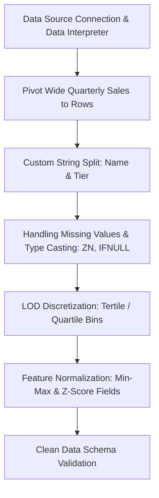
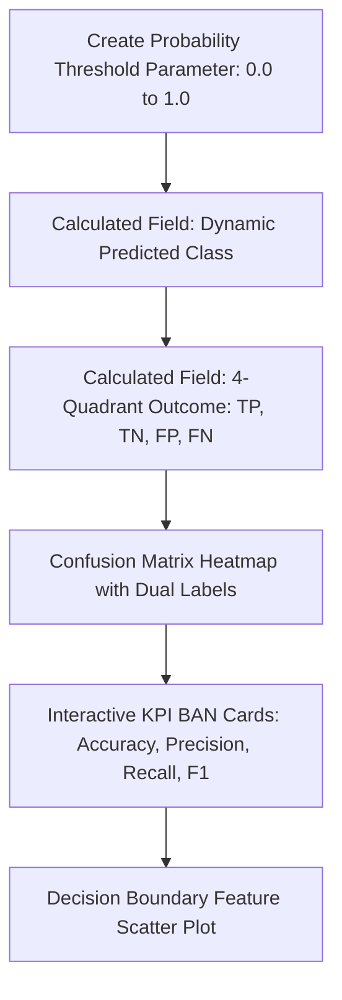
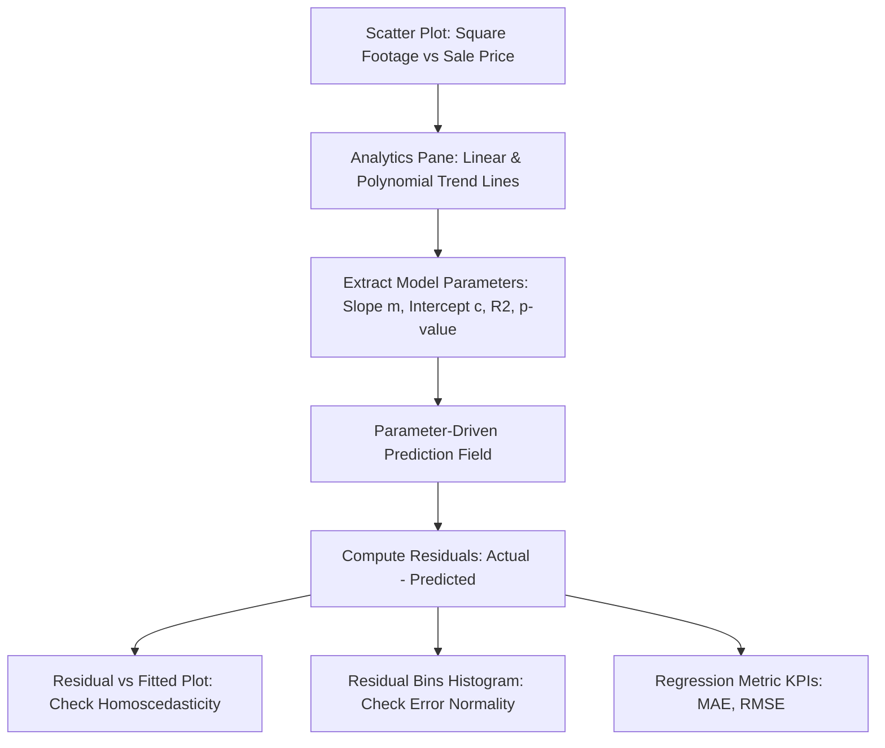
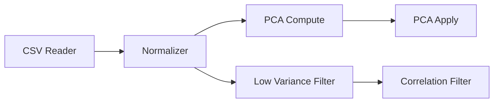
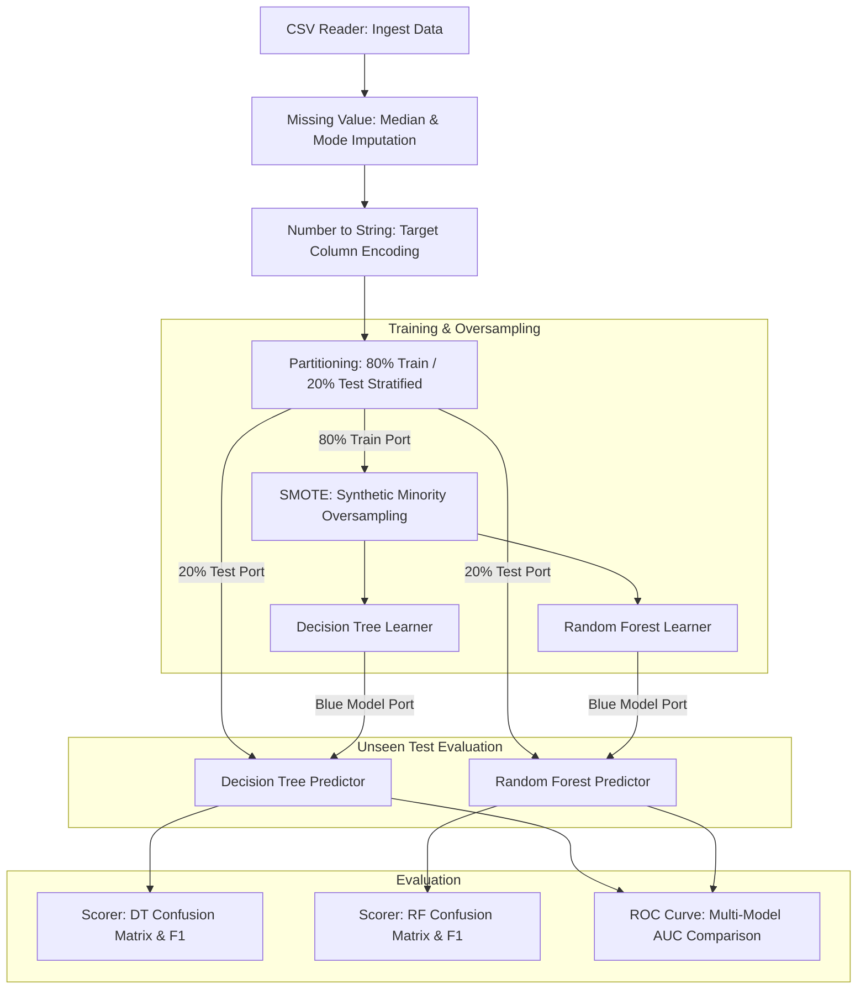
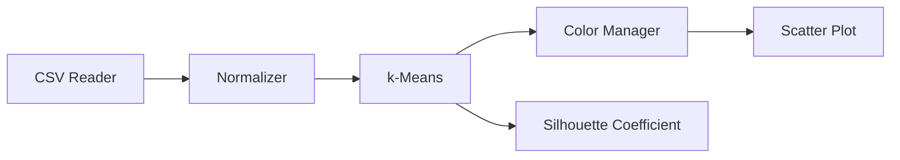
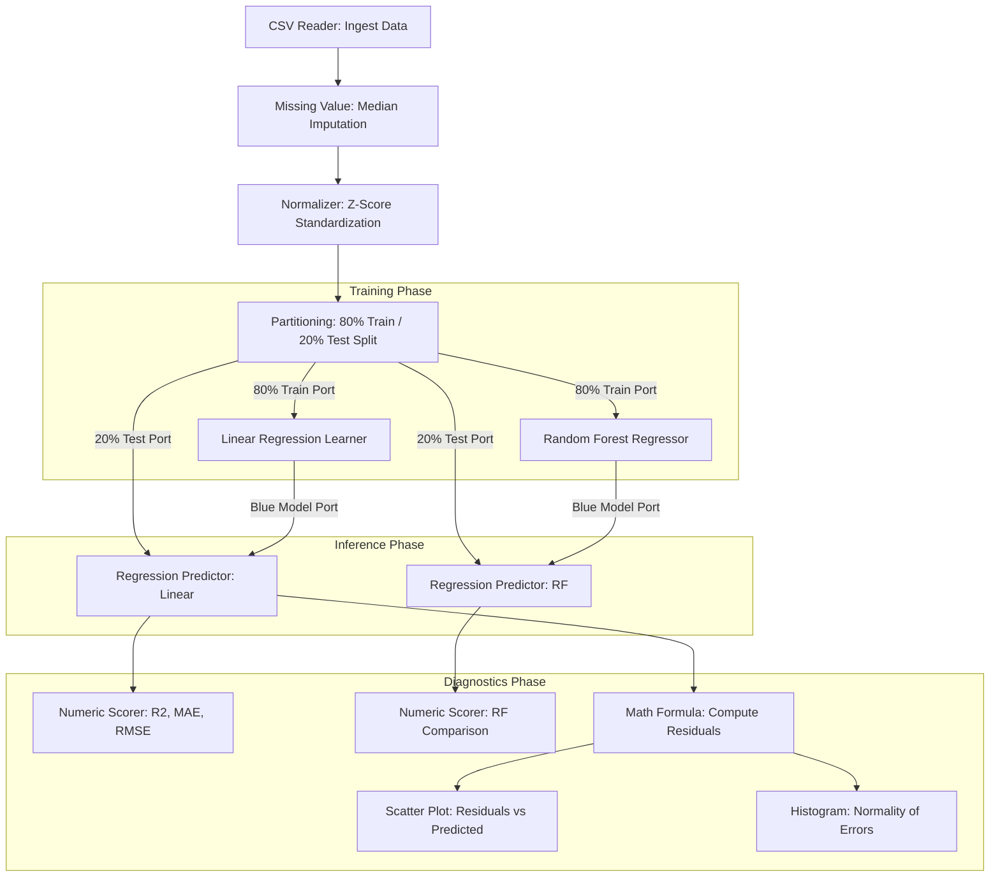
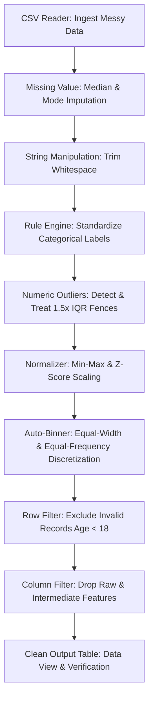

# 3CS103ME24: Data Analysis and Visualisation (DAV)
## Student-Level Lab Manual, Standalone Code & Click-by-Click Tool Guide

*Designed specifically for 3rd-year B.Tech Computer Science lab exams, vivas, and project submissions.*  
*Contains:*
1. **Mathematical concepts and formulas explained simply.**
2. **Student-level standalone Python functions** (Upper-level algorithmic workflows from scratch; internal standard math/linear algebra handled cleanly with `math` / `numpy`).
3. **Idiomatic library implementations** (`pandas`, `scipy`, `sklearn`).
4. **Step-by-step, click-by-click guides for KNIME Analytics Platform**.
5. **Step-by-step, click-by-click guides for Tableau Desktop**.

---

## Table of Contents
1. [Practical 2: Class Balance, Uncertainty & Data Cleaning](#practical-2)
2. [Practical 3: Five-Number Summary, Central Tendency & Outlier Detection](#practical-3)
3. [Practical 4 & 5: Tableau Interface, Visual Variables & Core Visualizations](#practical-4-5)
   - [A. Tableau Core Architecture & Visual Variables](#tableau-architecture)
   - [B. The 7 Core Lab Graphs in Tableau (Click-by-Click)](#tableau-7-graphs)
     - 1. Pie & Donut Chart
     - 2. Bar Chart (Vertical, Horizontal, Stacked, Clustered)
     - 3. Line Chart (Time-Series & Multi-Line)
     - 4. KPI Card / BAN (Big Ass Number)
     - 5. Treemap (Hierarchical Sizing & Coloring)
     - 6. Box & Whisker Plot (Tukey Fences & Outliers)
     - 7. Distribution Histogram (Bins & Frequency)
   - [C. Complete Flow: Tableau Data Processing & Preparation (ETL Pipeline)](#tableau-data-processing-flow)
   - [D. Complete Flow: Tableau Classification & Diagnostics Analytics](#tableau-classification-flow)
   - [E. Complete Flow: Tableau Regression & Residual Error Diagnostics](#tableau-regression-flow)
   - [F. Master Calculated Fields Cheat Sheet](#tableau-calculated-fields)
   - [G. Interactive Dashboard Assembly & Action Filters](#tableau-dashboard-assembly)
4. [Practical 6: KNIME Fundamentals, PCA & Feature Selection](#practical-6)
5. [Practical 7: Supervised Classification & Diagnostics](#practical-7)
   - [A. Concepts & Formulas](#practical-7-concepts)
   - [B. Complete Flow: KNIME End-to-End Classification Workflow (Churn Example)](#knime-classification-flow)
   - [C. Standalone Python: KNN & Metrics](#practical-7-python)
6. [Practical 8: Unsupervised Clustering & Validation](#practical-8)
7. [Practical 9: Regression Techniques & Error Diagnostics](#practical-9)
   - [A. Concepts & Formulas](#practical-9-concepts)
   - [B. Complete Flow: KNIME End-to-End Regression Workflow (Housing Example)](#knime-regression-flow)
   - [C. Standalone Python: OLS & Metrics](#practical-9-python)
8. [Practical 10: Data Smoothing, Normalization, Redundancy & Discretization](#practical-10)
   - [A. Complete Flow: KNIME End-to-End Data Processing Workflow (Messy Data Example)](#knime-data-processing-flow)
   - [B. Standalone Python & Library Implementations](#practical-10-python)
9. [Master Python Graphing Recipes: The 7 Core Lab Graphs (Matplotlib & Seaborn)](#master-graphs)
   - 1. Pie & Donut Chart
   - 2. Bar Chart (Vertical, Horizontal, Stacked, Clustered)
   - 3. Line Chart (Time-Series & Multi-Line Trend)
   - 4. KPI Card / BAN (Big Ass Number)
   - 5. Treemap (Hierarchical Rectangles)
   - 6. Box & Whisker Plot (Tukey Fences & Outliers)
   - 7. Distribution Histogram with KDE
   - Bonus: Correlation Heatmap & Residual Diagnostic Plot

---

<a name="practical-2"></a>
# Practical 2: Class Balance, Uncertainty & Data Cleaning

### 1. Concepts & Formulas Explained
- **Class Balance Ratio**: What proportion of total rows belongs to each class?
  $$P(C_k) = \frac{\text{Count of class } C_k}{\text{Total rows } N}$$
- **Imbalance Ratio ($IR$)**: Measures how severely skewed the dataset is between the majority and minority class.
  $$IR = \frac{\max(N_k)}{\min(N_k)}$$
  *Interpretation*: If $IR > 3$, standard accuracy is misleading; use Precision, Recall, and Stratified Splitting.

---

### 2. Standalone Python Codes

#### Standalone Function: Class Balance & Imbalance Ratio
```python
# --- WITHOUT HEAVY LIBRARY (Student Level Standalone) ---
def compute_class_balance_scratch(labels):
    """
    Takes a raw list of class labels.
    Returns class counts, percentage distribution, and Imbalance Ratio.
    """
    total = len(labels)
    if total == 0:
        return {}, {}, 0.0
    
    counts = {}
    for y in labels:
        counts[y] = counts.get(y, 0) + 1
        
    proportions = {k: v / total for k, v in counts.items()}
    ir = max(counts.values()) / min(counts.values()) if min(counts.values()) > 0 else float('inf')
    
    return counts, proportions, ir

# --- WITH LIBRARY (Pandas Standalone) ---
import pandas as pd

def compute_class_balance_library(series: pd.Series):
    counts = series.value_counts().to_dict()
    proportions = series.value_counts(normalize=True).to_dict()
    ir = float(series.value_counts().max() / series.value_counts().min())
    return counts, proportions, ir
```

#### Standalone Function: Data Cleaning & Imputation
```python
# --- WITHOUT HEAVY LIBRARY (Student Level Standalone) ---
def clean_missing_scratch(rows, missing_values=[None, "", "NaN", "null"]):
    """
    Takes a 2D list of rows (table).
    Imputes numeric columns with the column mean, and text columns with mode.
    """
    if not rows or not rows[0]:
        return []
    
    n_rows = len(rows)
    n_cols = len(rows[0])
    cleaned = [row[:] for row in rows]
    
    for c in range(n_cols):
        col_vals = [cleaned[r][c] for r in range(n_rows)]
        valid_vals = [v for v in col_vals if v not in missing_values]
        
        # Check if numeric
        try:
            num_vals = [float(v) for v in valid_vals]
            col_mean = sum(num_vals) / len(num_vals)
            for r in range(n_rows):
                if cleaned[r][c] in missing_values:
                    cleaned[r][c] = col_mean
        except (ValueError, TypeError):
            # Categorical mode imputation
            freq = {}
            for v in valid_vals:
                freq[v] = freq.get(v, 0) + 1
            mode_val = max(freq, key=freq.get) if freq else ""
            for r in range(n_rows):
                if cleaned[r][c] in missing_values:
                    cleaned[r][c] = mode_val
                    
    return cleaned

# --- WITH LIBRARY (Pandas Standalone) ---
import pandas as pd
import numpy as np

def clean_missing_library(df: pd.DataFrame):
    df_clean = df.copy()
    # Numeric -> median
    for col in df_clean.select_dtypes(include=[np.number]).columns:
        df_clean[col] = df_clean[col].fillna(df_clean[col].median())
    # Categorical -> mode
    for col in df_clean.select_dtypes(exclude=[np.number]).columns:
        if df_clean[col].nunique() > 0:
            df_clean[col] = df_clean[col].fillna(df_clean[col].mode()[0])
    df_clean = df_clean.drop_duplicates()
    return df_clean
```

---

<a name="practical-3"></a>
# Practical 3: Five-Number Summary, Central Tendency & Outlier Detection

### 1. Concepts & Formulas Explained
- **Mean ($\bar{x}$)**: Sum divided by $N$. $\bar{x} = \frac{\sum x_i}{N}$. Sensitive to outliers.
- **Median ($Q_2$)**: Physical 50th percentile rank of sorted data. Robust to outliers.
- **Mode**: Value with the highest count.
- **Midrange**: $\frac{\min + \max}{2}$. Extreme sensitivity to outliers.
- **Five-Number Summary**: $[\min, Q_1, \text{Median}, Q_3, \max]$.
- **IQR (Interquartile Range)**: $IQR = Q_3 - Q_1$. Middle 50% data spread.
- **Tukey's Fences**:
  $$\text{Lower Fence} = Q_1 - 1.5 \times IQR, \quad \text{Upper Fence} = Q_3 + 1.5 \times IQR$$
  Values outside $[\text{Lower Fence}, \text{Upper Fence}]$ are outliers.
- **Z-Score**: $z = \frac{x - \mu}{\sigma}$. Outlier if $|z| > 3.0$.

---

### 2. Standalone Python Codes

#### Standalone Function: Five-Number Summary, Midrange & Outliers
```python
# --- WITHOUT HEAVY LIBRARY (Student Level Standalone) ---
import math

def five_number_summary_and_outliers_scratch(numbers):
    """
    Takes a raw list of numbers.
    Computes Min, Q1, Median, Q3, Max, Mode, Midrange, IQR, and Outliers.
    """
    s = sorted([float(x) for x in numbers if x is not None])
    n = len(s)
    if n == 0:
        return {}
    
    # 1. Median helper
    def calc_med(lst):
        m = len(lst)
        mid = m // 2
        return lst[mid] if m % 2 == 1 else (lst[mid - 1] + lst[mid]) / 2.0
    
    min_v = s[0]
    max_v = s[-1]
    q2 = calc_med(s)
    
    # 2. Quartiles
    mid = n // 2
    lower_half = s[:mid]
    upper_half = s[mid:] if n % 2 == 0 else s[mid + 1:]
    q1 = calc_med(lower_half)
    q3 = calc_med(upper_half)
    iqr = q3 - q1
    
    # 3. Fences & Outliers
    lf = q1 - 1.5 * iqr
    uf = q3 + 1.5 * iqr
    iqr_outliers = [x for x in s if x < lf or x > uf]
    
    # 4. Mode & Midrange
    freq = {}
    for x in s: freq[x] = freq.get(x, 0) + 1
    max_c = max(freq.values())
    modes = [k for k, v in freq.items() if v == max_c]
    midrange = (min_v + max_v) / 2.0
    
    # 5. Z-Score Outliers (> 3 sigma)
    mean_v = sum(s) / n
    std_v = math.sqrt(sum((x - mean_v) ** 2 for x in s) / n)
    z_outliers = [x for x in s if std_v > 0 and abs((x - mean_v) / std_v) > 3.0]
    
    return {
        "Min": min_v, "Q1": q1, "Median": q2, "Q3": q3, "Max": max_v,
        "IQR": iqr, "Lower_Fence": lf, "Upper_Fence": uf,
        "Mode": modes, "Midrange": midrange,
        "IQR_Outliers": iqr_outliers, "Z_Outliers": z_outliers
    }

# --- WITH LIBRARY (Pandas / Scipy Standalone) ---
import pandas as pd
from scipy import stats

def five_number_summary_and_outliers_library(numbers):
    s = pd.Series(numbers).dropna()
    q1 = float(s.quantile(0.25))
    q2 = float(s.quantile(0.50))
    q3 = float(s.quantile(0.75))
    iqr = q3 - q1
    lf = q1 - 1.5 * iqr
    uf = q3 + 1.5 * iqr
    
    iqr_outliers = s[(s < lf) | (s > uf)].tolist()
    z_scores = stats.zscore(s)
    z_outliers = s[abs(z_scores) > 3.0].tolist()
    
    return {
        "Min": float(s.min()), "Q1": q1, "Median": q2, "Q3": q3, "Max": float(s.max()),
        "IQR": iqr, "Lower_Fence": lf, "Upper_Fence": uf,
        "Mode": s.mode().tolist(), "Midrange": float((s.min() + s.max()) / 2.0),
        "IQR_Outliers": iqr_outliers, "Z_Outliers": z_outliers
    }
```

---

<a name="practical-4-5"></a>
# Practical 4 & 5: Tableau Interface, Visual Variables & Interactive Dashboarding

<a name="tableau-architecture"></a>
### 1. Tableau Core Architecture & Visual Variables
- **Data Pane Mechanics**:
  - **Blue Pills (Discrete)**: Creates distinct row/column headers, buckets categories, and slices rows into distinct partitions.
  - **Green Pills (Continuous)**: Creates unbroken, continuous numeric or temporal axes with coordinate mapping.
  - **Dimensions**: Categorical, non-numeric, or qualitative attributes that set the **Level of Detail (LoD)** on the sheet (e.g., `Region`, `Product_Category`, `Customer_Segment`).
  - **Measures**: Numerical values that are aggregated dynamically depending on the active dimensions (`SUM`, `AVG`, `MEDIAN`, `COUNT`, `STDEV`).
- **Marks Card Visual Channels**:
  - **Color**: Heatmaps, class distribution, diverging error bands, conditional threshold formatting.
  - **Size**: Proportional bubble charts, weighted scatter marks, correlation magnitudes.
  - **Label / Text**: Callout KPIs, Big Ass Numbers (BANs), percentage-of-total values.
  - **Detail**: Injects granular row-level data points without adding visual color or shape distortions (critical for unaggregated scatter plots).
  - **Tooltip**: Rich hover cards displaying contextual metadata and secondary metrics.

---

<a name="tableau-7-graphs"></a>
### 2. The 7 Core Lab Graphs in Tableau (Click-by-Click)

#### Graph 1: Pie Chart & Donut Chart
- **A. Standard Pie Chart**:
  1. In the Marks card dropdown, change mark type from *Automatic* to **Pie**.
  2. Drag categorical Dimension (e.g. `Region` or `Category`) to **Color** on the Marks card.
  3. Drag numeric Measure (e.g. `Sales` or `Profit`) to **Angle** on the Marks card.
  4. Drag Dimension to **Label**. Drag Measure to **Label**.
  5. Right-click the Measure pill inside **Label** -> **Quick Table Calculation** -> **Percent of Total**.
  6. In top toolbar, change view mode from *Standard* to **Entire View** for a clear, centered circle.
- **B. Professional Donut Chart (Dual-Axis Method — Exam/Viva Favorite)**:
  1. Follow steps 1-3 above to build the base pie chart.
  2. Double-click the empty space on the **Rows** shelf -> type `AVG(0)` and press Enter.
  3. Type `AVG(0)` a second time on the **Rows** shelf and press Enter. (You now have two identical pie charts stacked vertically).
  4. Right-click the second `AVG(0)` pill in Rows -> Select **Dual Axis**.
  5. In the Marks card sidebar, you will see three tabs: *All*, *AVG(0)* (top pie), and *AVG(0) (2)* (bottom pie):
     - Click **AVG(0)** tab: Increase **Size** slider slightly.
     - Click **AVG(0) (2)** tab: Remove `Color` and `Angle` pills. Change mark type to **Circle**. Set **Color** to solid White. Adjust **Size** slider to be slightly smaller than the outer pie.
     - Drag total metric `SUM(Sales)` to **Label** on the *AVG(0) (2)* tab to display the KPI number in the center hole!
  6. Right-click left vertical axis -> Uncheck **Show Header**. Result: A clean donut chart!

#### Graph 2: Bar Chart (Vertical, Horizontal, Stacked, Clustered)
- **A. Vertical Column Bar Chart**:
  1. Drag Dimension (e.g. `Sub-Category`) to the **Columns** shelf.
  2. Drag Measure (e.g. `Sales`) to the **Rows** shelf.
  3. Click **Sort Descending** icon on the top toolbar.
- **B. Horizontal Sorted Bar Chart**:
  1. Drag Measure to **Columns**, Dimension to **Rows**.
  2. Click **Sort Descending** icon (ideal for long category labels to prevent label overlap).
  3. Drag Measure to **Label** to display exact bar values.
- **C. Stacked Bar Chart**:
  1. Create a vertical or horizontal bar chart as above.
  2. Drag a secondary Dimension (e.g. `Customer_Segment` or `Ship_Mode`) to **Color** on the Marks card.
  3. The single bar splits into proportional stacked colored segments.
- **D. Clustered / Side-by-Side Bar Chart**:
  1. Drag primary Dimension (e.g. `Category`) to **Columns**.
  2. Drag secondary Dimension (e.g. `Segment`) to **Columns** (placed immediately to the right of `Category`).
  3. Drag Measure (e.g. `Sales`) to **Rows**.
  4. Drag secondary Dimension to **Color** on Marks card to color each cluster distinctly.

#### Graph 3: Line Chart (Time-Series & Multi-Line Trend)
- **A. Single Continuous Time-Series Line**:
  1. Drag Date Dimension (e.g. `Order_Date`) to the **Columns** shelf.
  2. Click the date pill dropdown -> Select the continuous green date level (e.g. **Month** with year: `May 2024`).
  3. Drag Measure (e.g. `Sales`) to the **Rows** shelf. Mark type automatically becomes **Line**.
  4. Click **Color** on Marks card -> Under *Effects*, check **Markers** -> Select **All** (places clear dots on each data point).
- **B. Multi-Line Trend Comparison**:
  1. Create single line chart as above.
  2. Drag categorical Dimension (e.g. `Region` or `Category`) to **Color** on Marks card.
  3. Multiple colored trend lines render simultaneously on the same coordinate axis with an interactive legend.
  4. Click **Label** on Marks card -> Check **Show mark labels** -> Select **Line Ends** (labels only start and finish to prevent clutter).

#### Graph 4: KPI Card / BAN (Big Ass Number)
1. In Marks card dropdown, change mark type to **Text**.
2. Drag numeric Measure (e.g. `Sales`) to **Text / Label** on Marks card.
3. Click **Text** on Marks card -> Click the `...` button next to the text preview:
   - Highlight the text `<SUM(Sales)>` -> Change font size to **28pt Bold**, color Dark Navy `#1F2937`.
   - Add a subtitle line above or below: `TOTAL ANNUAL REVENUE` in **9pt Light Gray**, uppercase.
4. Add Secondary Comparison / Delta ($\Delta$):
   - Drag `YoY Growth` or `Target Difference` to **Text / Label**.
   - Format with an up/down arrow symbol ($\blacktriangle$ / $\blacktriangledown$) and conditional color.
5. In top toolbar, set view to **Entire View**. Right-click canvas -> **Format...** -> Set background shading and borders.

#### Graph 5: Treemap (Hierarchical Sizing & Coloring)
1. Drag categorical Dimension (e.g. `Category`) to **Label** on the Marks card.
2. Drag numeric Measure (e.g. `Sales`) to **Size** on the Marks card.
3. Mark type automatically changes to **Square / Rectangle** layout.
4. Drag secondary metric (e.g. `Profit` or `Profit_Margin`) to **Color** on the Marks card.
   - Click **Color** -> **Edit Colors...** -> Select **Red-Green Diverging** or **Orange-Blue Diverging** (instantly reveals high-sales but low-profit categories!).
5. **Nested Hierarchical Treemap**:
   - Drag a lower-level Dimension (e.g. `Sub-Category`) onto **Detail** or **Label** on Marks card.
   - Tableau groups sub-categories neatly inside their parent Category bounding boxes!

#### Graph 6: Box & Whisker Plot (Tukey Fences & Outliers)
1. Drag categorical Dimension (e.g. `Department` or `Category`) to the **Columns** shelf.
2. Drag numeric Measure (e.g. `Salary` or `Sales`) to the **Rows** shelf.
3. **Crucial Disaggregation Step**:
   - By default, Tableau aggregates all rows into one bar. Go to top menu: click **Analysis** -> **Uncheck "Aggregate Measures"** (or drag unique row ID `Record_ID` to **Detail** on Marks card). Every observation is now a distinct dot.
4. Click the **Analytics** tab next to Data on the left sidebar.
5. Drag **Box Plot** onto the canvas and drop it on **Cell**.
6. Right-click the box plot on the chart -> Select **Edit...**:
   - **Whiskers**: Set to **1.5 times the IQR** (Standard Tukey Fence rule).
   - Check **Hide underlying marks (except outliers)** if you only want to see the box summary and extreme outlier dots, or leave unchecked with jitter to see all data points.
7. Points beyond the upper and lower whiskers appear distinctly as outlier marks!

#### Graph 7: Distribution Histogram (Bins & Frequency)
1. In the Data Pane (left), find your numeric Measure (e.g. `Age`, `Salary`, or `Discount`).
2. Right-click the Measure -> Select **Create** -> **Bins...**.
3. In the dialog, set **Size of bins** (e.g. `10` for Age, `500` for Salary) -> Click **OK**.
4. Drag the newly created Bin dimension (Blue pill with histogram icon) to the **Columns** shelf.
5. Drag the original numeric Measure to the **Rows** shelf.
6. Click the dropdown arrow on the Measure pill in Rows -> Change **Measure (Sum)** to **Count** (or `Count (Distinct)`).
7. In Marks card, verify mark type is **Bar**. Click **Size** -> Set to **Fixed** with alignment center to produce touching histogram bins without artificial gaps.
8. Drag `Count` to **Label** to display exact bin frequency counts.

---

<a name="tableau-data-processing-flow"></a>
### 3. Complete Flow: Tableau Data Processing & Preparation (ETL Pipeline)

#### Concrete Dataset Scenario: `raw_ecommerce_transactions.csv`
Columns present in messy source:
- `Transaction_ID`: Alpha-numeric code (e.g. `TX-2023-9901`).
- `Customer_Info`: Combined string (`"John Doe - Corporate Tier"`).
- `Order_Date`: String date format with mixed separators.
- `Region`: Geographic category (`East`, `West`, `South`, `North`, `Unknown`).
- `Sales_Q1`, `Sales_Q2`, `Sales_Q3`, `Sales_Q4`: Wide unpivoted quarterly sales columns.
- `Discount_Raw`: String formatted percentages containing symbols and nulls (`"15%"`, `"None"`, `NULL`).
- `Return_Status`: Categorical with nulls (`"Returned"`, `NULL`).

#### Click-by-Click Implementation Steps:



1. **Step 1: Ingestion & Data Interpreter**:
   - In Tableau start page, click **Text file** -> Select `raw_ecommerce_transactions.csv`.
   - On the Data Source canvas, check the box **Use Data Interpreter** (top left). Tableau automatically detects titles, removes empty introductory rows, and properly infers header rows.
2. **Step 2: Pivoting Wide Columns into Tall/Normalized Format**:
   - In the data preview grid, multi-select `Sales_Q1`, `Sales_Q2`, `Sales_Q3`, and `Sales_Q4` using `Ctrl + Click`.
   - Right-click any of the selected column headers -> Select **Pivot**.
   - Two new columns appear:
     - Rename `Pivot Field Names` to **`Quarter`**.
     - Rename `Pivot Field Values` to **`Revenue`**.
   - *Why this is mandatory*: Analysis requires aggregating total revenue over time; wide columns force clumsy calculations (`Q1 + Q2 + Q3 + Q4`), whereas a tall table enables instantaneous slicing by `Quarter`.
3. **Step 3: String Splitting (Feature Extraction)**:
   - In the Data grid, locate `Customer_Info`.
   - Click the drop-down arrow on the header -> Select **Custom Split...**.
   - In the dialog:
     - *Use separator*: Enter `-`.
     - *Split off*: Select **All**.
   - Rename `Customer_Info - Split 1` to **`Customer_Name`** (click header -> Rename).
   - Rename `Customer_Info - Split 2` to **`Customer_Tier`**.
   - Clean up trailing whitespace using a Calculated Field if necessary: `TRIM([Customer_Name])`.
4. **Step 4: Imputation & Type Casting with Calculated Fields**:
   - Go to any worksheet tab. Click **Analysis** -> **Create Calculated Field...**.
   - **Discount Imputation & Float Casting (`[Clean_Discount]`)**:
     ```tableau
     // Removes %, treats 'None' and NULLs as 0.0, and converts to decimal float
     ZN(FLOAT(REPLACE(REPLACE([Discount_Raw], "%", ""), "None", "0"))) / 100.0
     ```
   - **Handling Categorical Nulls (`[Clean_Return_Status]`)**:
     ```tableau
     IFNULL([Return_Status], "Kept / Not Returned")
     ```
5. **Step 5: Normalization via Level of Detail (LOD) Calculations**:
   - Create Calculated Field **`[Revenue_MinMax_Normalized]`**:
     ```tableau
     ([Revenue] - {FIXED : MIN([Revenue])}) / ({FIXED : MAX([Revenue])} - {FIXED : MIN([Revenue])})
     ```
   - Create Calculated Field **`[Revenue_ZScore_Normalized]`**:
     ```tableau
     ([Revenue] - {FIXED : AVG([Revenue])}) / {FIXED : STDEV([Revenue])}
     ```
   - *Explanation*: `{FIXED : MIN([Revenue])}` computes the global minimum across the entire dataset independent of worksheet filters, providing true standardized scaling.
6. **Step 6: Discretization (Equal-Width vs. Equal-Frequency Bins)**:
   - **Method A: Equal-Width Discretization (Tableau Native Bins)**:
     - Right-click `Revenue` in the Data pane -> **Create** -> **Bins...**.
     - Set **Size of bins** to `500`. Every transaction is placed in rigid $500 increments ($[0, 500), [500, 1000)$, etc.).
   - **Method B: Equal-Frequency Discretization (Quantile / Tertile Cutoffs)**:
     - Create Calculated Field **`[Revenue_Tertile_Cohort]`**:
       ```tableau
       IF [Revenue] <= {FIXED : PERCENTILE([Revenue], 0.333)} THEN "T1: Low Volume (<33%)"
       ELSEIF [Revenue] <= {FIXED : PERCENTILE([Revenue], 0.667)} THEN "T2: Mid Volume (33-67%)"
       ELSE "T3: High Volume (>67%)"
       END
       ```
     - *Result*: Guarantees an equal number of records in each cohort regardless of right-skewed revenue distribution.

---

<a name="tableau-classification-flow"></a>
### 4. Complete Flow: Tableau Classification & Diagnostics Analytics

#### Concrete Dataset Scenario: `telecom_customer_churn_eval.csv`
Model predictions generated from classification experiments:
- `Customer_ID`: Unique client key.
- `Actual_Churn`: Binary ground truth (`"Yes"`, `"No"`).
- `Churn_Probability`: Continuous output from logistic / tree model ($0.00$ to $1.00$).
- `Monthly_Charges`: Customer monthly billing measure.
- `Tenure_Months`: Customer loyalty duration in months.
- `Contract_Type`: Categorical (`"Month-to-month"`, `"One year"`, `"Two year"`).

#### Click-by-Click Implementation Steps:



1. **Step 1: Create Interactive Classification Threshold Parameter**:
   - In Data Pane, click the top dropdown arrow next to the search box -> Select **Create Parameter...**.
   - Name: **`Classification_Threshold`**.
   - Data type: **Float**.
   - Current value: `0.50`.
   - Allowable values: **Range** -> Minimum: `0.0`, Maximum: `1.0`, Step size: `0.05`.
   - Right-click `Classification_Threshold` in the parameters shelf -> Select **Show Parameter**. (An interactive slider appears on canvas!).
2. **Step 2: Generate Dynamic Predictions via Parameter**:
   - Create Calculated Field **`[Dynamic_Predicted_Churn]`**:
     ```tableau
     IF [Churn_Probability] >= [Classification_Threshold] THEN "Yes" ELSE "No" END
     ```
3. **Step 3: Define Diagnostic Outcome (TP, TN, FP, FN)**:
   - Create Calculated Field **`[Confusion_Matrix_Class]`**:
     ```tableau
     IF [Actual_Churn] = "Yes" AND [Dynamic_Predicted_Churn] = "Yes" THEN "True Positive (TP)"
     ELSEIF [Actual_Churn] = "No" AND [Dynamic_Predicted_Churn] = "No" THEN "True Negative (TN)"
     ELSEIF [Actual_Churn] = "No" AND [Dynamic_Predicted_Churn] = "Yes" THEN "False Positive (FP)"
     ELSEIF [Actual_Churn] = "Yes" AND [Dynamic_Predicted_Churn] = "No" THEN "False Negative (FN)"
     END
     ```
4. **Step 4: Build Confusion Matrix Heatmap**:
   - Drag `Actual_Churn` to the **Rows** shelf.
   - Drag `Dynamic_Predicted_Churn` to the **Columns** shelf.
   - In Marks card, change mark type from *Automatic* to **Square**.
   - Drag `Customer_ID` to **Color** on Marks card -> Set aggregation to **Count (Distinct)**.
   - Click **Color** -> **Edit Colors...** -> Palette: **Orange-Blue Diverging** -> Check **Reversed** (so high counts are dark blue).
   - Drag `Customer_ID` (Count Distinct) to **Label** on Marks card.
   - *Add Percentage Label*: Drag `Customer_ID` (Count Distinct) to **Label** a second time -> Click its dropdown -> **Quick Table Calculation** -> **Percent of Total**.
   - Right-click row header `Actual_Churn` -> Edit Alias if needed to label rows as "Actual: Yes" / "Actual: No".
5. **Step 5: Create KPI BAN Cards for Model Performance**:
   - **Calculated Field `[Model_Accuracy]`**:
     ```tableau
     SUM(IIF([Actual_Churn] = [Dynamic_Predicted_Churn], 1, 0)) / COUNT([Customer_ID])
     ```
   - **Calculated Field `[Model_Precision]`**:
     ```tableau
     SUM(IIF([Actual_Churn] = "Yes" AND [Dynamic_Predicted_Churn] = "Yes", 1, 0)) /
     NULLIF(SUM(IIF([Dynamic_Predicted_Churn] = "Yes", 1, 0)), 0)
     ```
   - **Calculated Field `[Model_Recall]` (Sensitivity)**:
     ```tableau
     SUM(IIF([Actual_Churn] = "Yes" AND [Dynamic_Predicted_Churn] = "Yes", 1, 0)) /
     NULLIF(SUM(IIF([Actual_Churn] = "Yes", 1, 0)), 0)
     ```
   - **Calculated Field `[Model_F1_Score]`**:
     ```tableau
     2 * (([Model_Precision] * [Model_Recall]) / NULLIF(([Model_Precision] + [Model_Recall]), 0))
     ```
   - *Formatting BANs*: Create a new sheet named "KPI_Precision" -> Drag `[Model_Precision]` to **Text** -> Format number as **Percentage (1 decimal place)** -> Set font size to 24pt Bold. Repeat for Accuracy, Recall, and F1!
6. **Step 6: Diagnostic Scatter Plot (Feature Space Misclassification View)**:
   - Open a new sheet. Drag `Tenure_Months` to **Columns**, `Monthly_Charges` to **Rows**.
   - Uncheck **Analysis** -> **Aggregate Measures**.
   - Drag `[Confusion_Matrix_Class]` to **Color** and **Shape** on Marks card.
   - Color True Positives & True Negatives in light muted gray, and highlight False Positives (orange) and False Negatives (crimson red).
   - Moving the `Classification_Threshold` slider dynamically shifts dots between False Negatives and False Positives in real-time!

---

<a name="tableau-regression-flow"></a>
### 5. Complete Flow: Tableau Regression & Residual Error Diagnostics

#### Concrete Dataset Scenario: `real_estate_sales_regression.csv`
- `Property_ID`: Observation identifier.
- `Square_Footage`: Continuous predictor attribute ($X$).
- `Sale_Price`: Dependent continuous target ($Y$).
- `Neighborhood`: Categorical grouping dimension.
- `Bedrooms`: Discrete numeric attribute.

#### Click-by-Click Implementation Steps:



1. **Step 1: Construct the Regression Scatter Plot**:
   - Drag `Square_Footage` to the **Columns** shelf.
   - Drag `Sale_Price` to the **Rows** shelf.
   - Uncheck **Analysis** (top menu) -> **Aggregate Measures** so every house appears as a separate circle.
   - On Marks card: Change mark type to **Circle**, click **Color** -> Set Opacity to 65% and Border to Dark Gray.
2. **Step 2: Fit and Compare Trend Lines**:
   - Click the **Analytics** tab on the left sidebar.
   - Drag **Trend Line** onto the view canvas -> Drop it on **Linear**.
   - Drag another Trend Line -> Test **Polynomial (Degree 2)** or **Logarithmic**.
   - Right-click the Linear Trend Line on the chart -> Select **Describe Trend Line...**:
     - Read the mathematical equation: e.g. $\text{Sale\_Price} = 215.42 \times \text{Square\_Footage} + 35120.5$.
     - Read model quality: $R^2 = 0.8412$, $p\text{-value} < 0.0001$.
   - Right-click -> Select **Describe Trend Model...** to view full ANOVA tables, degrees of freedom, and standard errors of coefficients.
3. **Step 3: Create Parameter-Driven Predictions & Error Metrics**:
   - In Data Pane, create two Float parameters:
     - `Param_Slope` (Current Value: `215.42`).
     - `Param_Intercept` (Current Value: `35120.5`).
   - Create Calculated Field **`[Predicted_Sale_Price]`**:
     ```tableau
     ([Param_Slope] * [Square_Footage]) + [Param_Intercept]
     ```
   - Create Calculated Field **`[Residual_Error]`**:
     ```tableau
     [Sale_Price] - [Predicted_Sale_Price]
     ```
   - Create Calculated Field **`[Absolute_Residual]`**:
     ```tableau
     ABS([Residual_Error])
     ```
   - Create Calculated Field **`[Squared_Residual]`**:
     ```tableau
     ([Residual_Error]) ^ 2
     ```
4. **Step 4: Diagnostic Sheet 1 — Residual vs. Fitted (Homoscedasticity Check)**:
   - Open a new sheet: "Residual_vs_Fitted".
   - Drag `[Predicted_Sale_Price]` to **Columns**.
   - Drag `[Residual_Error]` to **Rows**.
   - Ensure **Analysis** -> **Aggregate Measures** is unchecked.
   - Click **Analytics** tab -> Drag **Constant Line** to the canvas -> Set value to `0.0` (format with dashed red line).
   - *Diagnostic Rule*: If points are randomly scattered around zero with constant vertical spread, **homoscedasticity holds**. If the scatter forms a horn/cone shape (expanding variance), **heteroscedasticity is present**, indicating non-linear variance or missing predictors!
   - Highlight extreme errors: Create Calculated Field `[Outlier_Residual_Flag]`:
     ```tableau
     IF ABS([Residual_Error]) > 2.0 * {FIXED : STDEV([Residual_Error])} THEN "High Residual (>2σ)" ELSE "Normal Residual" END
     ```
     Drag `[Outlier_Residual_Flag]` to **Color** (Red vs Gray).
5. **Step 5: Diagnostic Sheet 2 — Residual Normality Histogram**:
   - Right-click `[Residual_Error]` in Data Pane -> **Create** -> **Bins...**.
   - Set **Size of bins** to `5000` -> Click **OK**.
   - Drag `[Residual_Error (bin)]` to **Columns**.
   - Drag `Property_ID` to **Rows** -> Set aggregation to **Count (Distinct)**.
   - *Diagnostic Rule*: Ordinary Least Squares assumes normally distributed residuals $\epsilon \sim \mathcal{N}(0, \sigma^2)$. A symmetric bell curve centered at zero confirms valid error distribution.
6. **Step 6: Regression Performance KPI Cards**:
   - Create Calculated Field **`[MAE_Metric]`**:
     ```tableau
     AVG([Absolute_Residual])
     ```
   - Create Calculated Field **`[RMSE_Metric]`**:
     ```tableau
     SQRT(AVG([Squared_Residual]))
     ```
   - Display these on KPI summary cards next to the scatter plots.

---

<a name="tableau-calculated-fields"></a>
### 6. Master Calculated Fields Cheat Sheet

| Task | Tableau Calculated Field Expression | Notes |
| :--- | :--- | :--- |
| **Missing Imputation (Numeric)** | `ZN([Metric])` or `IFNULL([Metric], {FIXED : MEDIAN([Metric])})` | Replaces nulls with 0 or dataset median |
| **Missing Imputation (String)** | `IFNULL([Category], "Missing / Unspecified")` | Prevents filter drops |
| **Z-Score Normalization** | `([Value] - {FIXED : AVG([Value])}) / {FIXED : STDEV([Value])}` | Scales mean to 0, std to 1 |
| **Min-Max Normalization** | `([Value] - {FIXED : MIN([Value])}) / ({FIXED : MAX([Value])} - {FIXED : MIN([Value])})` | Bounds data strictly in $[0, 1]$ |
| **Tukey IQR Outlier Flag** | `IF [Value] < {FIXED : PERCENTILE([Value], 0.25)} - 1.5 * ({FIXED : PERCENTILE([Value], 0.75)} - {FIXED : PERCENTILE([Value], 0.25)}) OR [Value] > {FIXED : PERCENTILE([Value], 0.75)} + 1.5 * ({FIXED : PERCENTILE([Value], 0.75)} - {FIXED : PERCENTILE([Value], 0.25)}) THEN "Outlier" ELSE "Inlier" END` | Flags 1.5x IQR outliers |
| **Custom Equal-Freq Quantile** | `IF [Value] <= {FIXED : PERCENTILE([Value], 0.25)} THEN "Q1" ELSEIF [Value] <= {FIXED : PERCENTILE([Value], 0.50)} THEN "Q2" ELSEIF [Value] <= {FIXED : PERCENTILE([Value], 0.75)} THEN "Q3" ELSE "Q4" END` | Creates 4 equal-count groups |
| **Model Classification Accuracy**| `SUM(IIF([Actual] = [Predicted], 1, 0)) / COUNT([ID])` | Proportion of correct predictions |
| **Model Precision** | `SUM(IIF([Actual] = "1" AND [Predicted] = "1", 1, 0)) / NULLIF(SUM(IIF([Predicted] = "1", 1, 0)), 0)` | Positive predictive value |
| **Model Recall** | `SUM(IIF([Actual] = "1" AND [Predicted] = "1", 1, 0)) / NULLIF(SUM(IIF([Actual] = "1", 1, 0)), 0)` | True positive rate (Sensitivity) |
| **Model F1-Score** | `2 * (([Precision] * [Recall]) / NULLIF(([Precision] + [Recall]), 0))` | Harmonic mean of Precision and Recall |
| **Regression Residual** | `[Actual_Y] - [Predicted_Y]` | Raw deviation |
| **Regression RMSE** | `SQRT(AVG(([Actual_Y] - [Predicted_Y]) ^ 2))` | Root Mean Squared Error |

---

<a name="tableau-dashboard-assembly"></a>
### 7. Interactive Dashboard Assembly & Action Filters
1. At the bottom tab bar, click **New Dashboard** (four squares icon).
2. Under Dashboard Size on the left, set Size to **Fixed (1920 x 1080)** or **Automatic**.
3. Drag a **Horizontal Container** to the top of the canvas for KPI cards.
4. Drag your KPI sheets (`Accuracy`, `Precision`, `Recall`, `F1` or `RMSE`, `MAE`) side-by-side into this container.
5. Drag a **Vertical Container** below the KPIs.
6. Drag your Confusion Matrix / Scatter Plot and Residual Histogram into the vertical container.
7. Show Parameters: Click the down-arrow on any sheet container -> **Parameters** -> Check **`Classification_Threshold`** or **`Param_Slope`**.
8. **Add Interactive Filter Actions**:
   - In the top menu, click **Dashboard** -> **Actions...**.
   - Click **Add Action** -> **Filter...**.
   - *Source Sheets*: Check your Breakdown Bar Chart or Confusion Matrix.
   - *Run action on*: Select **Select** (click).
   - *Target Sheets*: Check your KPI cards and Diagnostic Scatter sheets.
   - *Clearing the selection will*: Select **Show all values**.
   - Click **OK**.
9. Clicking any quadrant (e.g., clicking the "False Positive" square) instantly filters the scatter plot to show only those misclassified clients!

---

<a name="practical-6"></a>
# Practical 6: KNIME Fundamentals, PCA & Feature Selection

### 1. KNIME Analytics Platform Core Concepts
- **Node Traffic Light States**:
  - 🔴 **Red**: Unconfigured node. Missing file path or settings.
  - 🟡 **Yellow**: Configured and ready to execute.
  - 🟢 **Green**: Executed successfully. Data ready at output port.
  - ❌ **Red with X**: Execution error (e.g. data type mismatch).
- **Port Types**:
  - **Black Triangle**: Data table.
  - **Blue Square**: Trained machine learning model / predictor port.

---

### 2. Click-by-Click Guide for KNIME Workflows

#### A. Practical 6 Workflow: PCA & Feature Selection


1. **Step 1: Reading Data (`CSV Reader`)**:
   - In the **Node Repository** (bottom-left), search `CSV Reader`.
   - Drag it onto the canvas. Double-click it.
   - Click **Browse...** -> Select your CSV file.
   - Ensure "Has Column Header" is checked -> Click **Apply** -> **OK**.
   - Press **F7** (or right-click -> **Execute**). The traffic light turns green 🟢.
2. **Step 2: Normalization (`Normalizer`)**:
   - Search `Normalizer` in the repository -> Drag it onto the canvas.
   - Connect the output port (black triangle) of `CSV Reader` to the input of `Normalizer`.
   - Double-click `Normalizer`: Select **Z-Score Normalization (Gaussian)** or **Min-Max**.
   - Under column inclusion, ensure all numeric features are in the **Include** box.
   - Click **OK** -> Press **F7**.
3. **Step 3: Dimensionality Reduction (`PCA Compute` & `PCA Apply`)**:
   - Drag `PCA Compute` onto the canvas. Connect `Normalizer` output to it.
   - Double-click `PCA Compute`:
     - Select target components (e.g. fixed number $k=2$, or target variance $95\%$).
   - Drag `PCA Apply` onto the canvas.
   - Connect `Normalizer` data port to top input of `PCA Apply`.
   - Connect `PCA Compute` model port (blue square) to bottom model port of `PCA Apply`.
   - Press **F7**. Right-click `PCA Apply` -> View **PCA Transformed Data**.
4. **Step 4: Feature Selection (`Low Variance Filter` & `Correlation Filter`)**:
   - Drag `Low Variance Filter` -> Connect to `Normalizer`.
   - Double-click -> Set threshold to `0.01` -> Click **OK** -> Execute.
   - Drag `Correlation Filter` -> Connect to `Low Variance Filter`.
   - Double-click -> Set maximum correlation threshold to `0.85` (removes collinear features).
   - Right-click -> View **Filtered Table**.

---

### 3. Standalone Python: PCA (Student Level)
*Upper-level workflow from scratch; uses standard `np.linalg.eig` for internal eigendecomposition.*

```python
# --- WITHOUT HEAVY ML LIBRARY (Student Level Standalone) ---
import numpy as np

def pca_student_scratch(matrix, n_components=2):
    """
    Student-level PCA workflow from scratch:
    1. Center data (X - mean)
    2. Compute covariance matrix
    3. Use standard numpy.linalg.eig for eigenvalues/vectors
    4. Sort descending by variance
    5. Calculate EVR and project data
    """
    X = np.array(matrix, dtype=float)
    n_samples, n_features = X.shape
    
    # 1. Mean centering
    mean_vec = np.mean(X, axis=0)
    X_centered = X - mean_vec
    
    # 2. Covariance matrix: (1 / (N - 1)) * X_c^T * X_c
    cov_matrix = np.dot(X_centered.T, X_centered) / (n_samples - 1)
    
    # 3. Eigendecomposition (standard library internal solver)
    eigenvalues, eigenvectors = np.linalg.eig(cov_matrix)
    
    # 4. Sort eigenvalues and eigenvectors descending
    sort_indices = np.argsort(eigenvalues)[::-1]
    sorted_evals = eigenvalues[sort_indices]
    sorted_evecs = eigenvectors[:, sort_indices]
    
    # 5. Explained Variance Ratio
    total_var = np.sum(sorted_evals)
    evr = (sorted_evals[:n_components] / total_var).tolist()
    
    # 6. Project data onto top n_components
    W = sorted_evecs[:, :n_components]
    projected_data = np.dot(X_centered, W).tolist()
    
    return {
        "Eigenvalues": sorted_evals[:n_components].tolist(),
        "Eigenvectors": W.tolist(),
        "Explained_Variance_Ratio": evr,
        "Projected_Data": projected_data
    }

# --- WITH SCIKIT-LEARN (Standalone) ---
from sklearn.decomposition import PCA

def pca_library(matrix, n_components=2):
    pca = PCA(n_components=n_components)
    projected = pca.fit_transform(matrix)
    return {
        "EVR": pca.explained_variance_ratio_.tolist(),
        "Projected_Data": projected.tolist()
    }
```

---

<a name="practical-7"></a>
# Practical 7: Supervised Classification & Diagnostics

<a name="practical-7-concepts"></a>
### 1. Concepts & Formulas Explained
- **Shannon Entropy**: Impurity measure of a partition. $H(S) = -\sum_{i=1}^c p_i \log_2(p_i)$.
- **Information Gain**: Expected reduction in entropy caused by partitioning on attribute $A$:
  $$Gain(S, A) = H(S) - \sum_{v \in Values(A)} \frac{|S_v|}{|S|} H(S_v)$$
- **Gini Impurity**: Probability of incorrectly labeling a randomly chosen element:
  $$Gini(S) = 1 - \sum_{i=1}^c p_i^2$$
- **KNN Euclidean Distance**: Distance metric in continuous feature space:
  $$d(p, q) = \sqrt{\sum_{j=1}^m (p_j - q_j)^2}$$
- **Diagnostic Metrics**:
  $$\text{Accuracy} = \frac{TP + TN}{TP + TN + FP + FN}, \quad \text{Precision} = \frac{TP}{TP + FP}$$
  $$\text{Recall (Sensitivity)} = \frac{TP}{TP + FN}, \quad F_1\text{-Score} = \frac{2 \cdot \text{Precision} \cdot \text{Recall}}{\text{Precision} + \text{Recall}}$$
- **Cohen's Kappa ($\kappa$)**: Measures inter-rater agreement above chance ($0 =$ random, $1 =$ perfect agreement):
  $$\kappa = \frac{p_o - p_e}{1 - p_e}$$

---

<a name="knime-classification-flow"></a>
### 2. Complete Flow: KNIME End-to-End Classification Workflow (Churn Example)

#### Concrete Dataset Scenario: `customer_churn_classification.csv`
- `CustomerID`: Unique string key.
- `Tenure_Months`: Integer ($1$ to $72$).
- `MonthlyCharges`: Numeric continuous float.
- `TotalCharges`: Numeric float (contains occasional missing strings/blanks).
- `ContractType`: Categorical (`"Month-to-month"`, `"One year"`, `"Two year"`).
- `TechSupport`: Categorical (`"Yes"`, `"No"`, `"No internet"`).
- `Churn`: Target class label (`"Yes"`, `"No"`; 75% No, 25% Yes — class imbalanced!).

#### End-to-End Architecture Workflow:



#### Detailed Step-by-Step Node Configuration:

1. **Step 1: Data Ingestion (`CSV Reader`)**:
   - Drag `CSV Reader` onto canvas. Double-click to configure:
     - Set file path to `customer_churn_classification.csv`.
     - In the **Data format** tab: Ensure "Has column header" is checked.
     - Click **Apply** -> **OK** -> Press **F7**. Verify status is green 🟢.
2. **Step 2: Clean Data (`Missing Value`)**:
   - Connect `CSV Reader` output to `Missing Value` input.
   - Double-click to configure:
     - **Default tab**: Set *Number (Double)* -> **Median** (robust against outliers in `TotalCharges`).
     - Set *String* -> **Most Frequent Value (Mode)**.
     - Click **OK** -> Press **F7**.
3. **Step 3: Ensure Categorical Target Type (`Number To String` or `Domain Calculator`)**:
   - Classification algorithms in KNIME require the target column to be nominal/string.
   - If `Churn` is coded as numeric $0/1$, drag `Number To String`, include `Churn`.
   - Add `Domain Calculator` if necessary to ensure the distinct values (`"Yes"`, `"No"`) are cached in table metadata.
4. **Step 4: Train/Test Split (`Partitioning`)**:
   - Connect to `Partitioning` node.
   - Double-click to configure:
     - Select **Relative (%)**: Enter `80%`.
     - Sampling method: Select **Stratified sampling**.
     - Dropdown: Select `Churn` as the stratification column.
     - *Why this is critical*: With a 75/25 imbalanced dataset, random sampling risks creating unrepresentative test sets. Stratified sampling guarantees both partitions have exactly 25% churners!
     - Top port outputs 80% Training records; bottom port outputs 20% Testing records.
5. **Step 5: Class Imbalance Rebalancing (`SMOTE` Node)**:
   - Connect **top 80% Train port** of `Partitioning` to `SMOTE`.
   - *Never apply SMOTE before Partitioning! Oversampling the test partition causes data leakage and invalid test metrics.*
   - Double-click `SMOTE`:
     - **Class column**: `Churn`.
     - **Class value to oversample**: `"Yes"`.
     - **Nearest neighbors ($k$)**: `5`.
     - **Oversample percentage**: Set to balance classes to 50:50.
     - Click **OK** -> Press **F7**.
6. **Step 6: Train Baseline Model (`Decision Tree Learner`)**:
   - Connect `SMOTE` output to `Decision Tree Learner`.
   - Double-click `Decision Tree Learner`:
     - **Class column**: `Churn`.
     - **Quality measure**: `Gini Index` or `Gain Ratio`.
     - **Pruning method**: Select **MDL** (Minimum Description Length) or **Reduced error pruning** to prevent deep tree overfitting.
     - **Min number of records per node**: `10`.
     - Click **OK** -> Press **F7**.
     - *Inspection*: Right-click `Decision Tree Learner` -> Select **View: Decision Tree View** to explore split rules visually.
7. **Step 7: Train Ensemble Benchmark (`Random Forest Learner`)**:
   - Connect `SMOTE` output to `Random Forest Learner`.
   - Double-click `Random Forest Learner`:
     - **Target column**: `Churn`.
     - **Number of models (trees)**: `100`.
     - **Split criterion**: `Information Gain Ratio`.
     - Click **OK** -> Press **F7**.
8. **Step 8: Generate Test Predictions (`Predictor` Nodes)**:
   - Drag `Decision Tree Predictor` and `Random Forest Predictor` onto canvas.
   - For `Decision Tree Predictor`:
     - Connect `Decision Tree Learner` **blue model port** to top input.
     - Connect `Partitioning` **bottom 20% test data port** to bottom input.
     - Double-click: Check **"Append columns with predicted probabilities"**.
   - For `Random Forest Predictor`:
     - Connect `Random Forest Learner` model port and `Partitioning` test port.
     - Check **"Append individual class probabilities"**.
   - Press **F7** on both. Output tables now append columns `Prediction (Churn)`, `P(Churn=Yes)`, and `P(Churn=No)`.
9. **Step 9: Diagnostics & Confusion Matrix (`Scorer` Node)**:
   - Drag two `Scorer` nodes. Connect output of `Decision Tree Predictor` to Scorer 1, and `Random Forest Predictor` to Scorer 2.
   - Double-click `Scorer`:
     - **First column (Reference)**: `Churn`.
     - **Second column (Prediction)**: `Prediction (Churn)`.
     - Click **OK** -> Press **F7**.
   - Right-click `Scorer` -> Select **View: Confusion Matrix**:
     - View exact counts of True Positives, False Positives, True Negatives, False Negatives.
   - Right-click `Scorer` -> Select **View: Class Statistics**:
     - Inspect Accuracy, Error Rate, Precision, Recall, Sensitivity, Specificity, F-Measure, and Cohen's Kappa.
10. **Step 10: Multi-Model ROC Analysis (`ROC Curve` Node)**:
    - Drag `ROC Curve` node onto canvas.
    - Connect `Decision Tree Predictor` output table to `ROC Curve`.
    - Double-click `ROC Curve`:
      - **Class column**: `Churn`.
      - **Positive class value**: `"Yes"`.
      - **Include columns**: Select `P(Churn=Yes)` from both models.
      - Click **OK** -> Press **F7**.
    - Right-click `ROC Curve` -> Select **Interactive View: ROC Curve**:
      - Inspect the curves: The model closer to the top-left corner is superior.
      - Read the **Area Under the Curve (AUC)** score directly from the legend (e.g. $AUC_{RF} = 0.88$ vs $AUC_{DT} = 0.79$).

---

<a name="practical-7-python"></a>
### 3. Standalone Python: KNN & Metrics (Student Level)

```python
# --- WITHOUT HEAVY ML LIBRARY (Student Level Standalone) ---
import math

class KNNClassifierStudent:
    def __init__(self, k=3):
        self.k = k
        self.X_train = []
        self.y_train = []

    def fit(self, X_train, y_train):
        self.X_train = X_train
        self.y_train = y_train

    def predict(self, X_test):
        preds = []
        for test_pt in X_test:
            # 1. Distances to all training points
            dists = []
            for i, tr_pt in enumerate(self.X_train):
                d = math.sqrt(sum((test_pt[j] - tr_pt[j]) ** 2 for j in range(len(test_pt))))
                dists.append((d, self.y_train[i]))
            # 2. Sort by distance & pick top k
            dists.sort(key=lambda t: t[0])
            top_k_labels = [label for _, label in dists[:self.k]]
            # 3. Vote
            counts = {}
            for l in top_k_labels: counts[l] = counts.get(l, 0) + 1
            preds.append(max(counts, key=counts.get))
        return preds

def classification_metrics_scratch(y_true, y_pred, pos_label=1):
    tp = sum(1 for t, p in zip(y_true, y_pred) if t == pos_label and p == pos_label)
    fp = sum(1 for t, p in zip(y_true, y_pred) if t != pos_label and p == pos_label)
    fn = sum(1 for t, p in zip(y_true, y_pred) if t == pos_label and p != pos_label)
    tn = sum(1 for t, p in zip(y_true, y_pred) if t != pos_label and p != pos_label)
    
    total = len(y_true)
    acc = (tp + tn) / total if total > 0 else 0.0
    prec = tp / (tp + fp) if (tp + fp) > 0 else 0.0
    rec = tp / (tp + fn) if (tp + fn) > 0 else 0.0
    f1 = (2 * prec * rec) / (prec + rec) if (prec + rec) > 0 else 0.0
    
    return {"Accuracy": acc, "Precision": prec, "Recall": rec, "F1": f1, "CM": {"TP": tp, "FP": fp, "TN": tn, "FN": fn}}

# --- WITH SCIKIT-LEARN (Standalone) ---
from sklearn.neighbors import KNeighborsClassifier
from sklearn.metrics import classification_report

def knn_library(X_train, y_train, X_test, y_test, k=3):
    clf = KNeighborsClassifier(n_neighbors=k).fit(X_train, y_train)
    preds = clf.predict(X_test)
    return classification_report(y_test, preds, output_dict=True)
```

---

<a name="practical-8"></a>
# Practical 8: Unsupervised Clustering & Validation

### 1. Concepts & Formulas Explained
- **K-Means Objective (WCSS / Inertia)**: Sum of squared Euclidean distances to assigned centroids.
  $$WCSS = \sum_{k=1}^K \sum_{x \in C_k} \|x - \mu_k\|^2$$
- **Silhouette Coefficient**:
  $$s(i) = \frac{b(i) - a(i)}{\max(a(i), b(i))}, \quad -1 \le s(i) \le +1$$
  - $a(i)$: Average intra-cluster distance.
  - $b(i)$: Average distance to nearest outside cluster.

---

### 2. KNIME Click-by-Click Guide: Clustering Workflow



1. **Step 1: Normalization**:
   - Connect `CSV Reader` to `Normalizer`. Set to **Min-Max [0, 1]** or **Z-Score**. Execute (F7).
2. **Step 2: K-Means Clustering (`k-Means` Node)**:
   - Drag `k-Means` node onto canvas. Connect `Normalizer` output to it.
   - Double-click `k-Means`:
     - Set **Number of clusters ($k$)**: e.g., `3`.
     - Set **Max number of iterations**: `100`.
     - Select numeric features to include in clustering.
     - Click **OK** -> Press **F7**.
3. **Step 3: Cluster Visualization (`Color Manager` & `Scatter Plot`)**:
   - Drag `Color Manager` onto canvas. Connect `k-Means` output to it.
   - Double-click: Select `Cluster` column -> Assign distinctive colors to each cluster (`cluster_0`, `cluster_1`).
   - Drag `Scatter Plot` -> Connect `Color Manager` to it -> Open View.
   - Select $X$ and $Y$ columns to see the visual boundary between clusters!
4. **Step 4: Validation (`Silhouette Coefficient` Node)**:
   - Drag `Silhouette Coefficient` node -> Connect `k-Means` output table.
   - Execute -> Right-click -> View table to inspect overall mean silhouette score!

---

### 3. Standalone Python: K-Means from Scratch (Student Level)

```python
# --- WITHOUT HEAVY ML LIBRARY (Student Level Standalone) ---
import math

class KMeansStudent:
    def __init__(self, k=3, max_iter=100):
        self.k = k
        self.max_iter = max_iter

    def fit(self, data):
        n_features = len(data[0])
        # Pick first k points as initial seeds
        self.centroids = [data[i][:] for i in range(self.k)]
        
        for _ in range(self.max_iter):
            # Assignment
            clusters = [[] for _ in range(self.k)]
            self.labels = []
            for pt in data:
                dists = [math.sqrt(sum((pt[j] - c[j]) ** 2 for j in range(n_features))) for c in self.centroids]
                closest = dists.index(min(dists))
                clusters[closest].append(pt)
                self.labels.append(closest)
                
            # Update centroids
            new_centroids = []
            for k_idx in range(self.k):
                pts = clusters[k_idx]
                if pts:
                    new_centroids.append([sum(p[j] for p in pts) / len(pts) for j in range(n_features)])
                else:
                    new_centroids.append(self.centroids[k_idx])
                    
            # Check convergence
            shifts = [math.sqrt(sum((self.centroids[k][j] - new_centroids[k][j]) ** 2 for j in range(n_features))) for k in range(self.k)]
            self.centroids = new_centroids
            if max(shifts) < 1e-4: break
            
        # WCSS computation
        self.wcss = sum(sum((data[i][j] - self.centroids[self.labels[i]][j]) ** 2 for j in range(n_features)) for i in range(len(data)))
        return self

# --- WITH SCIKIT-LEARN (Standalone) ---
from sklearn.cluster import KMeans
from sklearn.metrics import silhouette_score

def kmeans_library(data, k=3):
    km = KMeans(n_clusters=k, random_state=42, n_init=10).fit(data)
    sil = silhouette_score(data, km.labels_)
    return {"Centroids": km.cluster_centers_.tolist(), "Labels": km.labels_.tolist(), "WCSS": float(km.inertia_), "Silhouette": float(sil)}
```

---

<a name="practical-9"></a>
# Practical 9: Regression Techniques & Error Diagnostics

<a name="practical-9-concepts"></a>
### 1. Concepts & Formulas Explained
- **Ordinary Least Squares (OLS) Closed Form**:
  $$y = X\beta + \epsilon, \quad \hat{\beta} = (X^T X)^{-1} X^T y$$
  - For simple linear regression:
    $$m = \frac{\sum (x_i - \bar{x})(y_i - \bar{y})}{\sum (x_i - \bar{x})^2}, \quad c = \bar{y} - m\bar{x}$$
- **Gauss-Markov Core Regression Assumptions**:
  1. **Linearity**: The relationship between $X$ and $Y$ is linear in parameters.
  2. **Homoscedasticity**: Residual variance is constant across all fitted values: $\text{Var}(\epsilon_i | X) = \sigma^2$.
  3. **Independence / No Autocorrelation**: Errors are uncorrelated: $\text{Cov}(\epsilon_i, \epsilon_j) = 0$ for $i \ne j$.
  4. **Normality of Errors**: Residuals are normally distributed: $\epsilon \sim \mathcal{N}(0, \sigma^2)$.
  5. **No Multicollinearity**: Independent variables are not perfectly collinear (Variance Inflation Factor $VIF < 5$).
- **Comprehensive Error Metrics**:
  - **Mean Absolute Error (MAE)**: Average magnitude of errors (less sensitive to outliers):
    $$MAE = \frac{1}{N}\sum_{i=1}^N |y_i - \hat{y}_i|$$
  - **Mean Squared Error (MSE)** & **Root Mean Squared Error (RMSE)** (Heavily penalizes large deviations):
    $$MSE = \frac{1}{N}\sum_{i=1}^N (y_i - \hat{y}_i)^2, \quad RMSE = \sqrt{MSE}$$
  - **Coefficient of Determination ($R^2$)**: Proportion of total variance explained by model:
    $$R^2 = 1 - \frac{\sum (y_i - \hat{y}_i)^2}{\sum (y_i - \bar{y})^2} = 1 - \frac{SS_{res}}{SS_{tot}}$$
  - **Adjusted $R^2$** (Penalizes gratuitous features):
    $$R_{adj}^2 = 1 - \left[ \frac{(1 - R^2)(N - 1)}{N - p - 1} \right]$$
  - **Mean Absolute Percentage Error (MAPE)**:
    $$MAPE = \frac{100\%}{N}\sum_{i=1}^N \left| \frac{y_i - \hat{y}_i}{y_i} \right|$$

---

<a name="knime-regression-flow"></a>
### 2. Complete Flow: KNIME End-to-End Regression Workflow (Housing Example)

#### Concrete Dataset Scenario: `real_estate_house_pricing.csv`
- `Property_ID`: Identifier string.
- `SquareFootage`: Continuous predictor ($X_1$).
- `Bedrooms`: Discrete numeric ($X_2$).
- `Bathrooms`: Discrete numeric ($X_3$).
- `DistanceToMetro`: Continuous distance in km ($X_4$).
- `BuildingAge`: Age of building in years ($X_5$).
- `SalePrice`: Continuous target variable ($Y$, e.g. $150,000 to $850,000).

#### End-to-End Architecture Workflow:



#### Detailed Step-by-Step Node Configuration:

1. **Step 1: Ingest Data (`CSV Reader`)**:
   - Drag `CSV Reader` onto canvas.
   - Point file path to `real_estate_house_pricing.csv`.
   - Verify that column types are inferred correctly as *Number (Double)* or *Number (Integer)*. Execute (F7) 🟢.
2. **Step 2: Missing Value Imputation (`Missing Value`)**:
   - Connect `CSV Reader` to `Missing Value`.
   - In configuration, select **Number (Double)** -> **Median** (prevents outliers from shifting baseline averages).
   - Click **OK** -> Execute (F7).
3. **Step 3: Feature Scaling (`Normalizer`)**:
   - Connect to `Normalizer`.
   - Select **Z-Score Normalization (Gaussian)**.
   - In Include list: Add all numeric predictors (`SquareFootage`, `Bedrooms`, `Bathrooms`, `DistanceToMetro`, `BuildingAge`).
   - *Why this is essential*: Standardizing features allows direct comparison of regression coefficients ($\beta$) to measure relative feature importance.
4. **Step 4: Train/Test Split (`Partitioning`)**:
   - Connect to `Partitioning` node.
   - Select **Relative (%)**: `80%`.
   - Sampling method: Select **Random sampling** -> Check "Use random seed" (enter `42` for exact reproducibility).
   - Top port emits 80% Train rows; bottom port emits 20% Test rows.
5. **Step 5: Train Parametric Model (`Linear Regression Learner`)**:
   - Connect **top 80% Train port** of `Partitioning` to `Linear Regression Learner`.
   - Double-click `Linear Regression Learner`:
     - **Target column**: Select `SalePrice`.
     - **Include columns**: Select `SquareFootage`, `Bedrooms`, `Bathrooms`, `DistanceToMetro`, `BuildingAge` (Exclude `Property_ID`).
     - Check **"Calculate coefficient statistics"** (generates standard error, $t$-values, and $p$-values).
     - Click **OK** -> Execute (F7).
     - *Model Inspection*: Right-click `Linear Regression Learner` -> Select **View: Linear Regression Result View**:
       - Inspect the coefficients table: Verify which features have $p < 0.05$ (statistically significant).
6. **Step 6: Train Non-Parametric Benchmark (`Random Forest Regressor`)**:
   - Connect 80% Train port to `Random Forest Regressor` (from KNIME Ensemble Learning extension).
   - Double-click: Target column = `SalePrice`, Number of trees = `100`.
   - Execute (F7).
7. **Step 7: Predict on Unseen Test Partition (`Regression Predictor`)**:
   - Drag two `Regression Predictor` nodes onto canvas.
   - Connect `Linear Regression Learner` model port (blue square) to top input of Predictor 1.
   - Connect `Partitioning` **bottom 20% test port** to bottom input of Predictor 1.
   - Connect `Random Forest Regressor` model port and test port to Predictor 2.
   - Execute both. The output tables now contain the appended column **`Prediction (SalePrice)`**.
8. **Step 8: Error Metric Calculation (`Numeric Scorer`)**:
   - Drag two `Numeric Scorer` nodes. Connect output table of Predictor 1 to Scorer 1, and Predictor 2 to Scorer 2.
   - Double-click `Numeric Scorer`:
     - **Reference column**: `SalePrice`.
     - **Predicted column**: `Prediction (SalePrice)`.
     - Click **OK** -> Execute (F7).
   - Right-click `Numeric Scorer` -> Select **View: Statistics**:
     - View exact quantitative metrics:
       - $R^2$ (e.g. $0.842$).
       - Mean Absolute Error ($MAE$).
       - Mean Squared Error ($MSE$).
       - Root Mean Squared Error ($RMSE$).
       - Mean Absolute Percentage Error ($MAPE$).
     - Compare Linear Model vs Random Forest Regressor directly!
9. **Step 9: Compute Residuals (`Math Formula` Node)**:
   - Connect output of `Regression Predictor` (Linear Model) to `Math Formula`.
   - Double-click `Math Formula`:
     - In Expression box, enter:
       ```knime
       $SalePrice$ - $Prediction (SalePrice)$
       ```
     - Check **"Append New Column"** -> Set column name to **`Residual`**.
     - Click **OK** -> Execute (F7).
10. **Step 10: Regression Error Diagnostics Visualization**:
    - **A. Residual vs. Predicted Plot (Homoscedasticity Test)**:
      - Drag `Scatter Plot` node. Connect `Math Formula` output to it.
      - Double-click:
        - $X$-axis: `Prediction (SalePrice)`.
        - $Y$-axis: `Residual`.
      - Right-click -> Select **Interactive View: Scatter Plot**.
      - *Diagnostic Criteria*: Residuals should fluctuate evenly around zero. If points fan out in a wedge/cone shape as price increases, heteroscedasticity is present, indicating that log-transforming `SalePrice` is required!
    - **B. Normality of Residuals Histogram**:
      - Drag `Histogram` node. Connect `Math Formula` output to it.
      - Double-click: Select `Residual` column -> Number of bins = `20`.
      - Right-click -> Select **Interactive View: Histogram**.
      - *Diagnostic Criteria*: Verify that the error distribution forms a symmetric, bell-shaped Gaussian curve centered at zero without heavy skew or multimodal peaks.

---

<a name="practical-9-python"></a>
### 3. Standalone Python: OLS & Metrics (Student Level)

```python
# --- WITHOUT HEAVY ML LIBRARY (Student Level Standalone) ---
import math

def simple_ols_scratch(x, y):
    n = len(x)
    mx, my = sum(x) / n, sum(y) / n
    m = sum((x[i] - mx) * (y[i] - my) for i in range(n)) / sum((x[i] - mx) ** 2 for i in range(n))
    c = my - m * mx
    
    y_pred = [m * val + c for val in x]
    mae = sum(abs(y[i] - y_pred[i]) for i in range(n)) / n
    mse = sum((y[i] - y_pred[i]) ** 2 for i in range(n)) / n
    rmse = math.sqrt(mse)
    ss_tot = sum((val - my) ** 2 for val in y)
    r2 = 1.0 - (sum((y[i] - y_pred[i]) ** 2 for i in range(n)) / ss_tot) if ss_tot > 0 else 0.0
    
    return {"Slope": m, "Intercept": c, "Predictions": y_pred, "MAE": mae, "MSE": mse, "RMSE": rmse, "R2": r2}

# --- WITH SCIKIT-LEARN (Standalone) ---
from sklearn.linear_model import LinearRegression
from sklearn.metrics import mean_squared_error, r2_score
import numpy as np

def simple_ols_library(x, y):
    X_arr = np.array(x).reshape(-1, 1)
    model = LinearRegression().fit(X_arr, y)
    preds = model.predict(X_arr)
    return {
        "Slope": float(model.coef_[0]), "Intercept": float(model.intercept_),
        "RMSE": float(np.sqrt(mean_squared_error(y, preds))), "R2": float(r2_score(y, preds))
    }
```

---

<a name="practical-10"></a>
# Practical 10: Data Smoothing, Normalization, Redundancy & Discretization

<a name="knime-data-processing-flow"></a>
### 1. Complete Flow: KNIME End-to-End Data Processing Workflow (Messy Data Example)

#### Concrete Dataset Scenario: `raw_messy_customer_data.csv`
- `Cust_ID`: Alpha-numeric client identifier (`"CUST-00921"`).
- `Age`: Numeric with missing values (`NaN`) and erroneous negative entries (`-8`, `150`).
- `Annual_Income`: Numeric with missing values and severe positive outliers (`$2,500,000` vs dataset median of `$60,000`).
- `Gender`: Inconsistent strings (`"M"`, `"Male"`, `"male"`, `"F"`, `"Female"`, `"female"`, `"?"`).
- `Department`: Padded strings with trailing/leading whitespace (`"  Sales  "`, `" Marketing "`).
- `Credit_Score`: Integer range ($300$ to $850$).
- `Purchase_Frequency`: Numeric transactions per quarter.

#### End-to-End Architecture Workflow:



#### Detailed Step-by-Step Node Configuration:

1. **Step 1: Data Ingestion (`CSV Reader`)**:
   - Drag `CSV Reader` onto canvas.
   - In Settings:
     - Point to `raw_messy_customer_data.csv`.
     - Check **"Has column header"**.
     - Support quotes: Ensure quote character `"` is configured so strings with commas are parsed accurately.
     - Press **F7** to execute 🟢.
2. **Step 2: Handle Missing Data (`Missing Value` Node)**:
   - Connect `CSV Reader` to `Missing Value`.
   - Double-click to configure column-specific rules:
     - Under **Default tab**:
       - *Number (Double)* -> Select **Median** (median is immune to the `$2,500,000` outlier; mean would corrupt baseline imputation).
       - *Number (Integer)* -> Select **Median**.
       - *String* -> Select **Most Frequent Value (Mode)** or fixed text `"Unknown"`.
     - Under **Individual tab**:
       - Select `Department` -> Set to fixed value `"General"`.
     - Click **OK** -> Execute (F7).
3. **Step 3: Text Cleaning (`String Manipulation`)**:
   - Connect to `String Manipulation` node.
   - Remove spaces:
     - Expression: `strip($Department$)`
     - Check **"Replace Existing Column"** -> Select `Department`.
     - Click **OK** -> Execute (F7).
4. **Step 4: Categorical Value Standardization (`Rule Engine`)**:
   - Inconsistent string categories cause spurious distinct classes.
   - Connect to `Rule Engine`. Double-click to define matching rules:
     ```knime
     // Standardize Gender categories
     $Gender$ LIKE "M*" OR $Gender$ LIKE "m*" => "Male"
     $Gender$ LIKE "F*" OR $Gender$ LIKE "f*" => "Female"
     TRUE => "Other"
     ```
   - Check **"Replace Existing Column"** -> Select `Gender` (or append `Gender_Cleaned`).
   - Click **OK** -> Execute (F7).
5. **Step 5: Outlier Detection & Treatment (`Numeric Outliers`)**:
   - Connect to `Numeric Outliers` node (located under *Data Manipulation* -> *Row* -> *Filter*).
   - Double-click `Numeric Outliers`:
     - Select target column: `Annual_Income`.
     - **Outlier estimation**: Select **IQR (Interquartile Range)**.
     - **IQR multiplier**: Set to `1.5` (Standard Tukey Fence).
     - **Treatment option**:
       - *Option A: "Remove outlier rows"* -> Completely eliminates extreme corruption.
       - *Option B: "Replace outlier values"* (Winsorization) -> Replaces extreme points with the upper fence value ($Q_3 + 1.5 \times IQR$), preserving sample size without variance blowup.
     - Select Option B (Replace with fence) -> Click **OK** -> Execute (F7).
6. **Step 6: Feature Normalization (`Normalizer` Node)**:
   - Connect to `Normalizer`.
   - Double-click to configure:
     - Select **Min-Max Normalization**: Scales data to $[0.0, 1.0]$.
       - Select `Credit_Score` in Include list.
       - Formula applied: $\frac{x - 300}{850 - 300}$.
     - (Alternative: Use a second `Normalizer` for **Z-Score Normalization** on `Annual_Income` to scale $\mu = 0, \sigma = 1$).
     - *Key Architecture Note*: Notice the two output ports:
       - Top black triangle: Transformed data table.
       - Bottom blue square: Normalization Model object (save this model to deploy on future production test sets using `Normalizer Apply`!).
     - Click **OK** -> Execute (F7).
7. **Step 7: Discretization & Binning (`Auto-Binner` Node)**:
   - Connect to `Auto-Binner` node.
   - Double-click to configure continuous-to-nominal discretization:
     - **Column 1: `Age` -> Equal-Width Discretization**:
       - Select `Age` -> Set Binning Method to **Equal width**.
       - Number of bins: `4`.
       - Bin naming: Select **Numbered** or **Borders** ($[18, 35), [35, 50), [50, 65), [65, 100]$).
     - **Column 2: `Annual_Income` -> Equal-Frequency Discretization (Quantiles)**:
       - Select `Annual_Income` -> Set Binning Method to **Sample quantiles (Equal frequency)**.
       - Number of bins: `4` (Quartiles: $Q_1, Q_2, Q_3, Q_4$).
       - Guarantees 25% of customers reside in each income tier!
     - Click **OK** -> Execute (F7).
8. **Step 8: Filter Erroneous Rows (`Row Filter` Node)**:
   - Connect to `Row Filter`.
   - Exclude edge noise:
     - Select column: `Age`.
     - Use criteria: **Range checking** -> Lower bound: `18`, Upper bound: `100`.
     - Check **"Include rows by attribute value"**. (Eliminates negative ages like `-8` or corrupt inputs like `150`).
     - Click **OK** -> Execute (F7).
9. **Step 9: Column Selection & Feature Cleanup (`Column Filter`)**:
   - Connect to `Column Filter`.
   - Exclude raw uncleaned variables (`Cust_ID`, uncleaned `Department`, intermediate calculations).
   - Keep only clean modeling attributes: `Clean_Gender`, `Department`, `Credit_Score [Normalized]`, `Age_binned`, `Annual_Income_binned`.
   - Click **OK** -> Execute (F7).
10. **Step 10: Final Clean Schema Verification (`Interactive Table`)**:
    - Right-click `Column Filter` -> Select **View: Filtered table** (or connect `Interactive Table` node).
    - Check summary statistics: Verify missing cell count is **0**, string values are standardized, and all numerical ranges adhere to normalized bounds.

---

<a name="practical-10-python"></a>
### 2. Standalone Python: Smoothing, Normalization, Redundancy & Discretization

```python
# --- WITHOUT HEAVY ML LIBRARY (Student Level Standalone) ---
import math

# 1. Smoothing (Bin Mean, Median, Boundary)
def bin_smoothing_scratch(data, bin_size=3, method='mean'):
    s = sorted(data)
    smoothed = []
    for i in range(0, len(s), bin_size):
        b = s[i:i + bin_size]
        if method == 'mean':
            smoothed.extend([sum(b) / len(b)] * len(b))
        elif method == 'median':
            m = len(b)
            med = b[m // 2] if m % 2 == 1 else (b[m // 2 - 1] + b[m // 2]) / 2.0
            smoothed.extend([med] * len(b))
        elif method == 'boundary':
            for x in b:
                smoothed.append(b[0] if abs(x - b[0]) <= abs(x - b[-1]) else b[-1])
    return smoothed

# 2. Normalization (Min-Max, Z-Score, Decimal Scaling)
def normalize_all_scratch(data):
    n = len(data)
    mn, mx = min(data), max(data)
    mean_v = sum(data) / n
    std_v = math.sqrt(sum((x - mean_v) ** 2 for x in data) / n)
    j = len(str(int(max(abs(x) for x in data)))) if max(abs(x) for x in data) >= 1 else 0
    scale = 10 ** j
    
    return {
        "MinMax": [(x - mn) / (mx - mn) if mx != mn else 0.0 for x in data],
        "ZScore": [(x - mean_v) / std_v if std_v > 0 else 0.0 for x in data],
        "DecimalScaling": [x / scale for x in data]
    }

# 3. Pearson Correlation
def pearson_scratch(x, y):
    n = len(x)
    mx, my = sum(x) / n, sum(y) / n
    num = sum((x[i] - mx) * (y[i] - my) for i in range(n))
    den = math.sqrt(sum((x[i] - mx)**2 for i in range(n)) * sum((y[i] - my)**2 for i in range(n)))
    return num / den if den != 0 else 0.0

# 4. Chi-Square Test from Raw Lists
def chi_square_scratch(col_a, col_b):
    cats_a, cats_b = sorted(list(set(col_a))), sorted(list(set(col_b)))
    table = {ca: {cb: 0 for cb in cats_b} for ca in cats_a}
    for a, b in zip(col_a, col_b): table[a][b] += 1
    
    row_t = {ca: sum(table[ca].values()) for ca in cats_a}
    col_t = {cb: sum(table[ca][cb] for ca in cats_a) for cb in cats_b}
    grand = len(col_a)
    
    chi2 = 0.0
    for ca in cats_a:
        for cb in cats_b:
            exp = (row_t[ca] * col_t[cb]) / grand
            obs = table[ca][cb]
            if exp > 0: chi2 += ((obs - exp) ** 2) / exp
    dof = (len(cats_a) - 1) * (len(cats_b) - 1)
    return {"Chi2": chi2, "DoF": dof}

# 5. Discretization (Equal-Width & Equal-Frequency)
def discretize_scratch(data, k=3):
    # Equal Width
    mn, mx = min(data), max(data)
    w = (mx - mn) / k
    ew = [f"W_Bin_{min(int((x - mn)/w) + 1, k)}" for x in data]
    # Equal Frequency
    indexed = sorted(enumerate(data), key=lambda t: t[1])
    n = len(data)
    bin_size = n // k
    ef = [None] * n
    for rank, (orig_i, _) in enumerate(indexed):
        ef[orig_i] = f"F_Bin_{min(rank // bin_size + 1, k)}"
    return {"Equal_Width": ew, "Equal_Frequency": ef}

# --- WITH LIBRARIES (Pandas / Scipy Standalone) ---
import pandas as pd
from scipy import stats
from sklearn.preprocessing import MinMaxScaler, StandardScaler
import numpy as np

def preprocessing_libraries(series_num, col_a, col_b, k=3):
    arr = series_num.values.reshape(-1, 1)
    mm = MinMaxScaler().fit_transform(arr).flatten().tolist()
    zs = StandardScaler().fit_transform(arr).flatten().tolist()
    r, _ = stats.pearsonr(series_num, series_num) # self or other
    contingency = pd.crosstab(pd.Series(col_a), pd.Series(col_b))
    chi2, p_val, dof, _ = stats.chi2_contingency(contingency)
    ew = pd.cut(series_num, bins=k, labels=[f"W{i+1}" for i in range(k)]).tolist()
    ef = pd.qcut(series_num, q=k, labels=[f"F{i+1}" for i in range(k)], duplicates='drop').tolist()
    return {"MinMax": mm, "ZScore": zs, "Chi2": float(chi2), "EqualWidth": ew, "EqualFrequency": ef}
```

---

<a name="master-graphs"></a>
# Master Python Graphing Recipes: The 7 Core Lab Graphs (Matplotlib & Seaborn)

```python
import matplotlib.pyplot as plt
import seaborn as sns
import numpy as np
import pandas as pd
import matplotlib.patches as patches

# Set clean aesthetic defaults
sns.set_theme(style="whitegrid", font="sans-serif")
plt.rcParams['font.size'] = 10
plt.rcParams['figure.autolayout'] = True

# ==============================================================================
# 1. PIE CHART & DONUT CHART
# ==============================================================================
def plot_pie_chart(categories, values, title="Market Share Breakdown"):
    """
    Standard Pie Chart with explode on top category, percentages, and shadow.
    """
    plt.figure(figsize=(7, 5))
    colors = sns.color_palette("pastel")[:len(categories)]
    # Explode the largest slice slightly for emphasis
    max_idx = values.index(max(values)) if isinstance(values, list) else np.argmax(values)
    explode = [0.08 if i == max_idx else 0.0 for i in range(len(categories))]
    
    plt.pie(
        values,
        labels=categories,
        autopct='%1.1f%%',
        startangle=140,
        explode=explode,
        colors=colors,
        shadow=True,
        wedgeprops={'edgecolor': 'white', 'linewidth': 1.5}
    )
    plt.title(title, fontsize=13, weight='bold')
    plt.show()

def plot_donut_chart(categories, values, center_text="Total\n$1.2M", title="Category Distribution"):
    """
    Professional Donut Chart with a white center cutout and center metric.
    """
    plt.figure(figsize=(6, 6))
    colors = sns.color_palette("Set2")[:len(categories)]
    
    # Outer Pie
    wedges, texts, autotexts = plt.pie(
        values,
        labels=categories,
        autopct='%1.1f%%',
        pctdistance=0.80,
        startangle=90,
        colors=colors,
        wedgeprops={'width': 0.35, 'edgecolor': 'white', 'linewidth': 2}
    )
    for at in autotexts:
        at.set_fontsize(9)
        at.set_weight('bold')
        
    # Center text annotation
    plt.text(0, 0, center_text, ha='center', va='center', fontsize=12, weight='bold', color='#1F2937')
    plt.title(title, fontsize=13, weight='bold')
    plt.show()

# ==============================================================================
# 2. BAR CHART (Vertical, Horizontal, Stacked, Clustered)
# ==============================================================================
def plot_vertical_bar(df, cat_col, val_col):
    """Vertical bar chart with automated direct value labels on top of bars."""
    plt.figure(figsize=(8, 4.5))
    ax = sns.barplot(data=df, x=cat_col, y=val_col, palette="Blues_d")
    for p in ax.patches:
        ax.annotate(f"{p.get_height():,.0f}",
                    (p.get_x() + p.get_width() / 2., p.get_height()),
                    ha='center', va='bottom', fontsize=9, xytext=(0, 3),
                    textcoords='offset points')
    plt.title(f"{val_col} by {cat_col}", fontsize=12, weight='bold')
    plt.xlabel(cat_col); plt.ylabel(val_col)
    plt.show()

def plot_horizontal_bar_sorted(df, cat_col, val_col):
    """Horizontal sorted bar chart (best for long categorical labels)."""
    sorted_df = df.sort_values(by=val_col, ascending=True)
    plt.figure(figsize=(8, 5))
    ax = plt.barh(sorted_df[cat_col], sorted_df[val_col], color='teal', edgecolor='black', alpha=0.8)
    plt.bar_label(ax, fmt='{:,.0f}', padding=4)
    plt.title(f"Ranked {val_col} by {cat_col}", fontsize=12, weight='bold')
    plt.xlabel(val_col); plt.ylabel(cat_col)
    plt.show()

def plot_stacked_bar(df_crosstab, title="Stacked Composition by Category"):
    """
    Stacked Bar Chart. Takes a pandas crosstab / pivot table:
    Example: df_crosstab = pd.crosstab(df['Region'], df['Product_Tier'], values=df['Sales'], aggfunc='sum')
    """
    ax = df_crosstab.plot(kind='bar', stacked=True, figsize=(8, 5), colormap='viridis', edgecolor='white')
    plt.title(title, fontsize=12, weight='bold')
    plt.ylabel("Cumulative Total"); plt.xticks(rotation=0)
    plt.legend(title="Sub-Group", bbox_to_anchor=(1.05, 1), loc='upper left')
    plt.show()

def plot_clustered_bar(df, cat_col, hue_col, val_col):
    """Clustered / Side-by-Side Bar Chart."""
    plt.figure(figsize=(9, 5))
    sns.barplot(data=df, x=cat_col, y=val_col, hue=hue_col, palette="Set1")
    plt.title(f"{val_col} Comparison across {cat_col} and {hue_col}", fontsize=12, weight='bold')
    plt.legend(title=hue_col); plt.show()

# ==============================================================================
# 3. LINE CHART (Time-Series & Multi-Line Trend)
# ==============================================================================
def plot_time_series_line(dates, values, label="Sales Trend"):
    """Single continuous time-series line with markers and grid styling."""
    plt.figure(figsize=(9, 4.5))
    plt.plot(dates, values, marker='o', linewidth=2.2, color='#2563EB', label=label)
    plt.fill_between(dates, values, color='#93C5FD', alpha=0.25) # Soft under-area fill
    plt.title(f"{label} Over Time", fontsize=12, weight='bold')
    plt.xlabel("Timeline"); plt.ylabel("Metric Value")
    plt.xticks(rotation=30)
    plt.grid(True, linestyle='--', alpha=0.5)
    plt.legend(); plt.show()

def plot_multi_line_trend(df, date_col, val_col, group_col):
    """Multi-line comparative trend plot with legend."""
    plt.figure(figsize=(10, 5))
    sns.lineplot(data=df, x=date_col, y=val_col, hue=group_col, marker='s', linewidth=2)
    plt.title(f"{val_col} Trend Grouped by {group_col}", fontsize=12, weight='bold')
    plt.xticks(rotation=30); plt.grid(True, linestyle='--', alpha=0.5)
    plt.show()

# ==============================================================================
# 4. KPI CARD / BAN (Big Ass Number Card)
# ==============================================================================
def plot_kpi_card(title="TOTAL REVENUE", value="$842,500", delta="+12.4% vs last period", positive=True):
    """
    Renders an executive KPI Card (BAN) as a standalone visual card.
    """
    fig, ax = plt.subplots(figsize=(4, 2.5), dpi=100)
    ax.axis('off')
    
    # Outer Card Background with Rounded Box
    rect = patches.FancyBboxPatch(
        (0.05, 0.05), 0.90, 0.90,
        boxstyle="round,pad=0.04,rounding_size=0.08",
        ec="#E5E7EB", fc="#F9FAFB", lw=1.5
    )
    ax.add_patch(rect)
    
    # Title Subheading
    ax.text(0.12, 0.72, title.upper(), fontsize=9, weight='bold', color="#6B7280", transform=ax.transAxes)
    
    # Hero KPI Value
    ax.text(0.12, 0.40, value, fontsize=22, weight='heavy', color="#111827", transform=ax.transAxes)
    
    # Delta Badge
    delta_color = "#16A34A" if positive else "#DC2626"
    arrow = "▲" if positive else "▼"
    ax.text(0.12, 0.20, f"{arrow} {delta}", fontsize=9, weight='semibold', color=delta_color, transform=ax.transAxes)
    
    plt.show()

# ==============================================================================
# 5. TREEMAP (Hierarchical Rectangles with Size and Color)
# ==============================================================================
def plot_treemap(labels, sizes, color_metric=None, title="Hierarchical Treemap"):
    """
    Hierarchical Treemap using squarify (standard Python treemap library).
    If squarify is not installed, install via: pip install squarify
    """
    try:
        import squarify
        plt.figure(figsize=(9, 6))
        
        # Color mapping by secondary metric or primary size
        norm = plt.Normalize(min(sizes), max(sizes))
        colors = [plt.cm.Blues(norm(value)) for value in sizes]
        
        formatted_labels = [f"{lbl}\n{val:,.0f}" for lbl, val in zip(labels, sizes)]
        squarify.plot(sizes=sizes, label=formatted_labels, color=colors, alpha=0.85,
                      text_kwargs={'fontsize': 10, 'weight': 'bold'}, edgecolor="white", linewidth=2)
        plt.title(title, fontsize=13, weight='bold')
        plt.axis('off')
        plt.show()
    except ImportError:
        # Fallback if squarify is absent
        print("Note: Run `pip install squarify` for Treemap rendering.")

# ==============================================================================
# 6. BOX & WHISKER PLOT (With Outliers & Tukey Fences)
# ==============================================================================
def plot_boxplot_with_fences(df, cat_col, val_col):
    """
    Boxplot showing Median, IQR Box, Whiskers at 1.5x IQR, and Outlier Dots.
    """
    plt.figure(figsize=(8, 5))
    ax = sns.boxplot(
        data=df, x=cat_col, y=val_col,
        palette="light:#597dbf",
        showmeans=True,
        meanprops={"marker": "^", "markerfacecolor": "yellow", "markeredgecolor": "black", "markersize": "7"},
        flierprops={"marker": "D", "markerfacecolor": "crimson", "markeredgecolor": "black", "markersize": 6}
    )
    plt.title(f"Box & Whisker Distribution: {val_col} by {cat_col}", fontsize=12, weight='bold')
    plt.xlabel(cat_col); plt.ylabel(val_col)
    plt.show()

# ==============================================================================
# 7. DISTRIBUTION HISTOGRAM WITH KDE & CENTRAL TENDENCY
# ==============================================================================
def plot_histogram_with_stats(df, col, bins=25):
    """
    Histogram with continuous KDE curve, Mean line (red), and Median line (green).
    """
    plt.figure(figsize=(8, 4.5))
    clean_series = df[col].dropna()
    mean_val = clean_series.mean()
    median_val = clean_series.median()
    
    sns.histplot(clean_series, kde=True, bins=bins, color='#3B82F6', edgecolor='white', alpha=0.7)
    plt.axvline(mean_val, color='crimson', linestyle='--', linewidth=2, label=f'Mean: {mean_val:.2f}')
    plt.axvline(median_val, color='green', linestyle='-', linewidth=2, label=f'Median: {median_val:.2f}')
    
    plt.title(f"Distribution & Density of {col}", fontsize=12, weight='bold')
    plt.xlabel(col); plt.ylabel("Frequency Count")
    plt.legend(frameon=True)
    plt.show()

# ==============================================================================
# BONUS: CORRELATION HEATMAP & REGRESSION RESIDUALS
# ==============================================================================
def plot_correlation_heatmap(df):
    """Lower triangle correlation heatmap."""
    plt.figure(figsize=(8, 6))
    corr = df.select_dtypes(include=[np.number]).corr()
    mask = np.triu(np.ones_like(corr, dtype=bool))
    sns.heatmap(corr, mask=mask, annot=True, fmt=".2f", cmap="vlag", vmin=-1, vmax=1,
                linewidths=0.5, cbar_kws={"shrink": 0.8})
    plt.title("Correlation Matrix Heatmap", fontsize=12, weight='bold')
    plt.show()

def plot_residuals(y_true, y_pred):
    """Regression diagnostic: Residual vs Fitted scatter plot."""
    residuals = np.array(y_true) - np.array(y_pred)
    plt.figure(figsize=(7, 4.5))
    plt.scatter(y_pred, residuals, alpha=0.6, color='#8B5CF6', edgecolors='k', s=35)
    plt.axhline(0, color='crimson', linestyle='--', linewidth=1.8, label="Zero Error Baseline")
    plt.xlabel("Fitted / Predicted Values"); plt.ylabel("Residuals (y - ŷ)")
    plt.title("Residual vs. Fitted Plot (Homoscedasticity Check)", fontsize=12, weight='bold')
    plt.legend(); plt.show()
```
