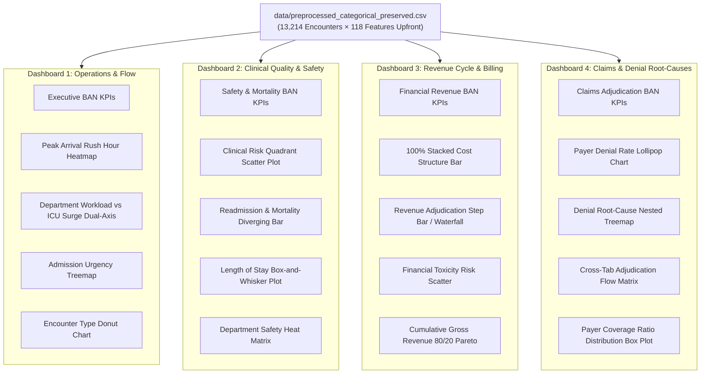

# 🏥 Healthcare Analytics & Hospital Operations Tableau Master Guide
### Zero-Calculated-Field Enterprise Interactive Dashboards for Multi-Department Hospital Management
**Document Version:** 2.0.0 (Data Analysis & Visualization — DAV Assignment)  
**Primary Dataset:** `data/preprocessed_categorical_preserved.csv` (13,214 encounters × 118 columns)  
**Engineering Pipeline:** `code/Data_Preprocessing.ipynb` (Enhanced Upfront)  
**Secondary Reference:** `data/preprocessed_full_encoded.csv` (13,214 encounters × 119 features)
**Dataset Source:** [Kaggle/DeepLumiere](https://www.kaggle.com/datasets/deeplumiere/hospital-management-data) 
---

## 📑 Table of Contents
1. [Architecture & Upfront Data Engine](#1-architecture--upfront-data-engine)
2. [Data Source Connection & Upfront Field Directory](#2-data-source-connection--upfront-field-directory)
3. [Dashboard 1: Executive Hospital Operations & Patient Flow Command Center](#3-dashboard-1-executive-hospital-operations--patient-flow-command-center)
4. [Dashboard 2: Clinical Acuity, Quality of Care & Patient Safety Monitor](#4-dashboard-2-clinical-acuity-quality-of-care--patient-safety-monitor)
5. [Dashboard 3: Hospital Revenue Cycle & Departmental Financial Suite](#5-dashboard-3-hospital-revenue-cycle--departmental-financial-suite)
6. [Dashboard 4: Payer Performance, Claim Adjudication & Denial Root-Cause Suite](#6-dashboard-4-payer-performance-claim-adjudication--denial-root-cause-suite)
7. [Global Interactivity, Actions & Parameters Engine](#7-global-interactivity-actions--parameters-engine)
8. [UI/UX Design Standards, Clinical Color Palette & Container Layouts](#8-uiux-design-standards-clinical-color-palette--container-layouts)
9. [Story Points, Presentation & Publishing Checklist](#9-story-points-presentation--publishing-checklist)

---

## 1. Architecture & Upfront Data Engine

### 1.1 Why Upfront Feature Engineering Eliminates Tableau Complexity
Traditional Tableau implementations require users to write 15–25 manual Calculated Fields (`IF/THEN`, `CASE`, unscaling arithmetic, string formatting). In this enhanced pipeline, **all required metrics, dollar values, clinical scores, temporal labels, and KPI indicator flags have been engineered upfront** in Python (`code/Data_Preprocessing.ipynb`) and baked directly into [`data/preprocessed_categorical_preserved.csv`](file:///R:/DeepWorks/DeepCollege/DAV/assignment/data/preprocessed_categorical_preserved.csv).

* **Zero Calculated Fields Needed:** Simply drag and drop pre-computed fields onto **Rows**, **Columns**, **Color**, **Size**, and **Marks**.
* **Native Tableau Aggregations:** Standard aggregations (`SUM`, `AVG`, `CNT`) work out-of-the-box. For example:
  * `AVG([readmission_30d_flag])` formatted as `0.0%` immediately renders the 30-day readmission rate.
  * `AVG([mortality_flag])` formatted as `0.0%` immediately gives the in-hospital mortality rate.
  * `AVG([claim_is_denied])` formatted as `0.0%` immediately gives the payer denial rate.
  * `SUM([gross_total_usd])` immediately aggregates actual billed hospital revenue ($18.6M+ portfolio).

### 1.2 Enterprise Multi-Dashboard Architecture



---

## 2. Data Source Connection & Upfront Field Directory

### 2.1 Importing Data into Tableau
1. Launch **Tableau Desktop** or **Tableau Public**.
2. Under **Connect** → **To a File**, select **Text file**.
3. Select [`data/preprocessed_categorical_preserved.csv`](file:///R:/DeepWorks/DeepCollege/DAV/assignment/data/preprocessed_categorical_preserved.csv).
4. Verify table row count (13,214 rows) and column count (118 fields).
5. Switch to **Sheet 1**.

---

### 2.2 Upfront Field Catalog (Ready for Direct Drag-and-Drop)

#### A. Real-World Dollar Values & Financial Metrics
| Upfront Field Name | Data Type | Physical Meaning | Default Tableau Format |
|---|---|---|---|
| `gross_total_usd` | Number (Decimal) | Total billed invoice amount ($846 to $147,314) | Currency (Custom): `$#,##0` (Units: Thousands/Millions) |
| `net_billed_usd` | Number (Decimal) | Net bill after contractual write-downs | Currency (Custom): `$#,##0` |
| `outstanding_balance_usd` | Number (Decimal) | Unpaid hospital balance ($0.01 to $65,071) | Currency (Custom): `$#,##0` |
| `discount_adjustment_usd` | Number (Decimal) | Payer contractual discount write-off | Currency (Custom): `$#,##0` |
| `insurance_covered_usd` | Number (Decimal) | Payer reimbursed portion ($0 to $80,418) | Currency (Custom): `$#,##0` |
| `patient_copay_usd` | Number (Decimal) | Patient out-of-pocket responsibility | Currency (Custom): `$#,##0` |
| `patient_paid_usd` | Number (Decimal) | Actual cash remitted by patient | Currency (Custom): `$#,##0` |
| `cost_per_day_usd` | Number (Decimal) | Billed dollar intensity per day of stay | Currency (Custom): `$#,##0` |
| `room_and_board_usd` | Number (Decimal) | Ward rate & ICU bed charges | Currency (Custom): `$#,##0` |
| `procedure_surgical_usd` | Number (Decimal) | OR & CPT surgical fee | Currency (Custom): `$#,##0` |
| `physician_consultation_usd` | Number (Decimal) | Professional doctor consultation fees | Currency (Custom): `$#,##0` |
| `laboratory_diagnostic_usd` | Number (Decimal) | Lab panels & imaging charges | Currency (Custom): `$#,##0` |
| `pharmacy_charges_usd` | Number (Decimal) | Dispensed medications total cost | Currency (Custom): `$#,##0` |
| `denied_amount_usd` | Number (Decimal) | Billed dollars on Rejected claims ($0 if approved) | Currency (Custom): `$#,##0` |

#### B. Real-World Clinical & Operational Physical Measures
| Upfront Field Name | Data Type | Physical Meaning | Default Tableau Format |
|---|---|---|---|
| `length_of_stay_days_actual` | Number (Decimal) | Actual inpatient stay duration (0.15 to 34.0 days) | Number (Custom): `0.0` suffix: ` days` |
| `age_years` | Number (Whole) | Patient age in actual years (0 to 90) | Number (Custom): `0` suffix: ` yrs` |
| `news2_acuity_score_actual` | Number (Whole) | National Early Warning Score 2 (0 to 18) | Number (Custom): `0` |
| `comorbidity_index_actual` | Number (Whole) | Charlson Comorbidity Index (0 to 8) | Number (Custom): `0` |
| `systolic_bp_actual` | Number (Decimal) | Systolic blood pressure (68.0 to 197.8 mmHg) | Number (Custom): `0.0` |
| `diastolic_bp_actual` | Number (Decimal) | Diastolic blood pressure (45.0 to 120.0 mmHg) | Number (Custom): `0.0` |
| `heart_rate_actual` | Number (Whole) | Heart rate (55 to 155 bpm) | Number (Custom): `0 bpm` |
| `respiratory_rate_actual` | Number (Whole) | Respiratory rate (12 to 39 breaths/min) | Number (Custom): `0` |
| `temperature_actual` | Number (Decimal) | Body temperature in Celsius (36.0 to 40.4 °C) | Number (Custom): `0.0 °C` |
| `spo2_percent_actual` | Number (Decimal) | Oxygen saturation percentage (77.9% to 100%) | Number (Custom): `0.0%` |
| `blood_glucose_actual` | Number (Decimal) | Blood glucose (65.0 to 349.2 mg/dL) | Number (Custom): `0.0` |
| `serum_creatinine_actual` | Number (Decimal) | Serum creatinine (0.5 to 7.5 mg/dL) | Number (Custom): `0.00` |
| `hemoglobin_actual` | Number (Decimal) | Hemoglobin concentration (6.5 to 17.5 g/dL) | Number (Custom): `0.0` |
| `wbc_count_actual` | Number (Decimal) | White blood cell count (3.2 to 31.0 k/uL) | Number (Custom): `0.0` |
| `baseline_bmi_actual` | Number (Decimal) | Pre-admission Body Mass Index (15.0 to 45.4) | Number (Custom): `0.0` |

#### C. Temporal & Formatted Categorical Dimensions
| Upfront Field Name | Data Type | Sample Values | Analytical Purpose |
|---|---|---|---|
| `admission_day_name` | String (Dimension) | `Mon`, `Tue`, `Wed`, `Thu`, `Fri`, `Sat`, `Sun` | Day of week rush hour heatmap & staffing analysis |
| `admission_hour_formatted` | String (Dimension) | `00:00`, `01:00`, `02:00`, ..., `23:00` | Peak triage surge hour detection |
| `admission_time_slot` | String (Dimension) | `Morning (06:00-12:00)`, `Afternoon (12:00-18:00)`, `Evening (18:00-24:00)`, `Night (00:00-06:00)` | Shift-based hospital resource allocation |
| `acuity_risk_quadrant` | String (Dimension) | `Critical Risk (High CCI / High NEWS2)`, `Acute Deterioration`, `Chronic Fragile`, `Stable / Low Acuity` | Pre-computed 4-quadrant clinical triage stratification |

#### D. KPI Binary Indicator Flags (Use `AVG(...)` formatted as `0.0%` or `SUM(...)`)
| Upfront Field Name | Data Type | Values | Tableau Usage |
|---|---|---|---|
| `readmission_30d_flag` | Number (Whole) | 0 or 1 | Drag to view, set aggregation to `AVG` → Instant 30-day readmission rate % |
| `mortality_flag` | Number (Whole) | 0 or 1 | Drag to view, set aggregation to `AVG` → Instant in-hospital mortality rate % |
| `icu_admitted` | Number (Whole) | 0 or 1 | Drag to view, set aggregation to `AVG` → Instant ICU admission rate % |
| `has_hai_flag` | Number (Whole) | 0 or 1 | Drag to view, set aggregation to `AVG` → Instant hospital-acquired infection rate % |
| `high_risk_med_flag` | Number (Whole) | 0 or 1 | Drag to view, set aggregation to `AVG` → Instant high-risk medication order rate % |
| `is_weekend_admission` | Number (Whole) | 0 or 1 | Drag to view, set aggregation to `AVG` → Instant weekend admission share % |
| `claim_is_denied` | Number (Whole) | 0 or 1 | Drag to view, set aggregation to `AVG` → Instant claim rejection rate % |
| `claim_is_approved` | Number (Whole) | 0 or 1 | Drag to view, set aggregation to `AVG` → Instant claim approval rate % |
| `is_commercial_claim` | Number (Whole) | 0 or 1 | Drag to view, set filter to 1 → Exclude Self-Pay from commercial claim metrics |

---

## 3. Dashboard 1: Executive Hospital Operations & Patient Flow Command Center

### 3.1 Strategic Objective & Business Questions
Designed for the **Chief Operating Officer (COO)**, **Bed Planning Committee**, and **Patient Access Director**:
* *What is the hospital's overall throughput and bed utilization?*
* *When are the peak triage surges throughout the week to optimize clinical shift staffing?*
* *Which clinical departments face severe ICU bed escalation pressure?*
* *How is encounter urgency distributed across Inpatient, Outpatient, and Emergency channels?*

---

### 3.2 Visual Variety & Chart Inventory (Dashboard 1)

| # | Worksheet Name | Chart Type | Variety Purpose | Upfront Fields Used (Zero Calculations) |
|---|---|---|---|---|
| **1.1** | `Ops_KPI_Cards` | **Big Numbers (BANs) with Indicators** | Immediate executive pulse check | `CNT(preprocessed...)`, `AVG(length_of_stay_days_actual)`, `AVG(icu_admitted)`, `AVG(is_weekend_admission)` |
| **1.2** | `Ops_Heatmap_Arrivals` | **2D Highlight Matrix / Heatmap** | Temporal congestion detection | Rows: `admission_day_name`, Cols: `admission_hour_formatted`, Color: `CNT(...)` |
| **1.3** | `Ops_Dept_Workload_ICU` | **Dual-Axis Combination Chart** (Bar + Line) | Workload vs acuity comparison | Cols: `department`, Rows: `CNT(...)` (Bar) & `AVG(icu_admitted)` (Line) |
| **1.4** | `Ops_Urgency_Treemap` | **Hierarchical Treemap** | Departmental severity mix | Detail: `department`, Color: `admission_urgency`, Size: `CNT(...)` |
| **1.5** | `Ops_Encounter_Donut` | **Donut Chart** (Dual-Axis Pie) | Channel distribution | Color: `encounter_type`, Angle: `CNT(...)`, Center: `CNT(...)` |

---

### 3.3 Detailed Step-by-Step Worksheet Construction

#### Worksheet 1.1: `Ops_KPI_Cards` (Executive BANs)
1. Create a new worksheet: Name it `Ops_KPI_Cards`.
2. Drag `Measure Names` to **Columns**.
3. Drag `Measure Values` to **Text** on the Marks card.
4. On the `Measure Values` card shelf, remove all measures except these 4:
   * `CNT(preprocessed_categorical_preserved.csv)` → Right-click → Edit Alias: **Total Patient Encounters**.
   * `length_of_stay_days_actual` → Right-click → Aggregation: **Average** → Edit Alias: **Avg Length of Stay (Days)**.
   * `icu_admitted` → Right-click → Aggregation: **Average** → Default Properties → Number Format: **Percentage (1 decimal)** → Edit Alias: **ICU Escalation Rate**.
   * `is_weekend_admission` → Right-click → Aggregation: **Average** → Default Properties → Number Format: **Percentage (1 decimal)** → Edit Alias: **Weekend Surge Share**.
5. Set view dropdown to **Entire View**.
6. Click **Text** on Marks card: Format font size to **22pt Bold**, dark navy `#0F172A`, with measure labels in **10pt Gray** `#64748B`.

---

#### Worksheet 1.2: `Ops_Heatmap_Arrivals` (Peak Arrival Rush Hour Heatmap)
1. Create a new worksheet: Name it `Ops_Heatmap_Arrivals`.
2. Drag upfront field `admission_day_name` to **Rows**.
   * *Sorting:* Right-click pill → Sort → Manual → Order: `Mon`, `Tue`, `Wed`, `Thu`, `Fri`, `Sat`, `Sun`.
3. Drag upfront field `admission_hour_formatted` to **Columns** (`00:00` to `23:00`).
4. Change Mark type from `Automatic` to **Square**.
5. Drag `CNT(preprocessed_categorical_preserved.csv)` to **Color** on the Marks card.
6. Click **Color** on Marks card:
   * Select Palette: **Orange-Blue Diverging** or **Sequential Blues**.
   * Check **Stepped Color** (5 steps) for rapid visual triage.
   * Border: Set to white thin line for clean tile separation.
7. Drag `CNT(...)` to **Tooltip**.
8. Set view to **Fit Width**.

> **Analytical Meaning:** Instantly spotlights arrival spikes (e.g., Monday morning elective admissions and weekend emergency surges), enabling data-driven nurse and physician shift scheduling.

---

#### Worksheet 1.3: `Ops_Dept_Workload_ICU` (Dual-Axis Workload & ICU Surge Chart)
1. Create a new worksheet: Name it `Ops_Dept_Workload_ICU`.
2. Drag `department` to **Columns**.
   * Sort `department` descending by `CNT(preprocessed_categorical_preserved.csv)`.
3. Drag `CNT(preprocessed_categorical_preserved.csv)` to **Rows**.
4. Drag `icu_admitted` to **Rows** (placed to the right of Count).
   * Right-click `icu_admitted` on Rows → Change Aggregation to **Average**.
   * Right-click `AVG(icu_admitted)` → Select **Dual Axis**.
5. On the Marks card:
   * **CNT(...) Marks:** Set Mark type to **Bar**. Color: Deep Slate Blue `#3B82F6`. Adjust Size slider to medium-thick bars.
   * **AVG(icu_admitted) Marks:** Set Mark type to **Line** (or **Shape: Circle**). Color: Crimson Alert `#EF4444`. Size: Medium. Click **Label** → Check *Show mark labels* (formatted as `0.0%`).
6. Format left axis title: `Total Encounters (Volume)`.
7. Format right axis title: `ICU Admission Rate (%)`.
8. Uncheck *Show Header Title* on `department`. Remove vertical grid lines, retain subtle horizontal dashed grid lines (`#E2E8F0`).

---

#### Worksheet 1.4: `Ops_Urgency_Treemap` (Hierarchical Urgency Treemap)
1. Create a new worksheet: Name it `Ops_Urgency_Treemap`.
2. Change Mark type to **Square**.
3. Drag `department` to **Detail** on Marks card.
4. Drag `admission_urgency` to **Detail** on Marks card.
5. Drag `CNT(preprocessed_categorical_preserved.csv)` to **Size** on Marks card.
6. Drag `admission_urgency` to **Color** on Marks card.
   * Color assignment:
     * `Emergency` → Bright Crimson `#DC2626`
     * `Urgent` → Amber `#F59E0B`
     * `Elective` → Emerald Green `#10B981`
7. Drag `department`, `admission_urgency`, and `CNT(...)` to **Label**.
8. Set Label Alignment: Middle Center.

---

#### Worksheet 1.5: `Ops_Encounter_Donut` (Encounter Type Donut Chart)
1. Create a new worksheet: Name it `Ops_Encounter_Donut`.
2. In the **Columns** shelf, double-click and type `MIN(0)`. Repeat to add a second `MIN(0)` pill.
3. Change Mark type for both to **Pie**.
4. On the first `MIN(0)` Marks card:
   * Drag `encounter_type` to **Color** (`Inpatient` `#6366F1`, `Outpatient` `#06B6D4`, `Emergency` `#F43F5E`).
   * Drag `CNT(...)` to **Angle**.
   * Adjust Size slider to ~70%.
5. On the second `MIN(0)` Marks card:
   * Remove `encounter_type` from Color. Set Color to solid White `#FFFFFF`.
   * Drag `CNT(...)` to **Text** (Center KPI total).
   * Adjust Size slider to ~45% (creating the donut hole).
6. Right-click the second `MIN(0)` pill on Columns → Select **Dual Axis**.
7. Right-click both axes → Uncheck **Show Header**. Remove zero lines and grid lines.

---

### 3.4 Dashboard 1 Assembly & Layout Specification
1. Click **New Dashboard**: Name it `D1_Hospital_Operations`.
2. Set Size: **Fixed Size** → `1440 × 900 px`.
3. Drag a **Vertical Layout Container** into the empty canvas.
4. **Header Section:**
   * Drag a **Horizontal Container** to the top (Height: `80px`).
   * Add a Text Object: Title `🏥 HOSPITAL OPERATIONS & PATIENT FLOW COMMAND CENTER` (18pt Bold, `#0F172A`), Subtitle: `Real-time bed utilization, departmental workload, and encounter intake monitoring` (10pt Regular, `#64748B`).
   * Drag Filters for `department`, `admission_urgency`, and `admission_year` into the right side of the header.
5. **KPI Bar:**
   * Drag `Ops_KPI_Cards` below header (Height: `100px`, Outer padding: `8px`).
6. **Main Body Section:**
   * Drag a **Horizontal Container** below KPI cards.
   * Left Pane (Width: `60%`):
     * Drag a **Vertical Container**:
       * Top: `Ops_Heatmap_Arrivals` (Height: `340px`).
       * Bottom: `Ops_Dept_Workload_ICU` (Height: `320px`).
   * Right Pane (Width: `40%`):
     * Drag a **Vertical Container**:
       * Top: `Ops_Urgency_Treemap` (Height: `340px`).
       * Bottom: `Ops_Encounter_Donut` (Height: `320px`).
7. Container Background: `#FFFFFF` with `1px solid #E2E8F0` border. Canvas Background: `#F8FAFC`.

---

## 4. Dashboard 2: Clinical Acuity, Quality of Care & Patient Safety Monitor

### 4.1 Strategic Objective & Business Questions
Designed for the **Chief Medical Officer (CMO)**, **Patient Safety Officer**, and **Quality Committee**:
* *What is our 30-day readmission and mortality profile across clinical disease specialties?*
* *How do acute physiological warning signs (NEWS2) interact with chronic comorbidity (CCI)?*
* *Where are length-of-stay outliers occurring across different patient discharge pathways?*
* *Which clinical categories trigger highest high-risk medication orders and healthcare-acquired infections (HAI)?*

---

### 4.2 Visual Variety & Chart Inventory (Dashboard 2)

| # | Worksheet Name | Chart Type | Variety Purpose | Upfront Fields Used (Zero Calculations) |
|---|---|---|---|---|
| **2.1** | `Clin_KPI_Safety` | **Clinical Alert BANs** | Quality safety baseline | `AVG(readmission_30d_flag)`, `AVG(mortality_flag)`, `AVG(has_hai_flag)`, `AVG(high_risk_med_flag)` |
| **2.2** | `Clin_Risk_Quadrants` | **Four-Quadrant Scatter Plot** with Trendline | Multi-parameter risk correlation | X: `comorbidity_index_actual`, Y: `news2_acuity_score_actual`, Size: `length_of_stay_days_actual`, Color: `acuity_risk_quadrant` |
| **2.3** | `Clin_Readmission_Disease` | **Grouped Horizontal Bar Chart** | Clinical disease risk ranking | Rows: `disease_category`, Cols: `AVG(readmission_30d_flag)` & `AVG(mortality_flag)` |
| **2.4** | `Clin_LOS_Disposition_Box` | **Box-and-Whisker Plot** | Statistical outlier distribution | Cols: `discharge_disposition`, Rows: `length_of_stay_days_actual`, Color: `encounter_type` |
| **2.5** | `Clin_Dept_Risk_Matrix` | **Clinical Heat Matrix Table** | Cross-specialty safety triage | Rows: `department`, Cols: `Measure Names` (`has_hai_flag`, `high_risk_med_flag`, `low_spo2`, `has_fever`) |

---

### 4.3 Detailed Step-by-Step Worksheet Construction

#### Worksheet 2.1: `Clin_KPI_Safety` (Clinical Safety BANs)
1. Create a new worksheet: Name it `Clin_KPI_Safety`.
2. Drag `Measure Names` to **Columns**, `Measure Values` to **Text**.
3. Retain only these 4 measures in `Measure Values` shelf:
   * `readmission_30d_flag` → Aggregation: **Average** → Format: **Percentage (1 decimal)** → Alias: **30-Day Readmission Rate**.
   * `mortality_flag` → Aggregation: **Average** → Format: **Percentage (2 decimals)** → Alias: **In-Hospital Mortality Rate**.
   * `has_hai_flag` → Aggregation: **Average** → Format: **Percentage (2 decimals)** → Alias: **HAI Infection Rate**.
   * `high_risk_med_flag` → Aggregation: **Average** → Format: **Percentage (1 decimal)** → Alias: **High-Risk Med Order Rate**.
4. Set view to **Entire View**. Format fonts: Values 24pt Bold, labels 9pt uppercase `#475569`.

---

#### Worksheet 2.2: `Clin_Risk_Quadrants` (Four-Quadrant Scatter Plot)
1. Create a new worksheet: Name it `Clin_Risk_Quadrants`.
2. Drag upfront field `comorbidity_index_actual` to **Columns** (0 to 8).
   * Right-click pill → Select **Dimension** (so each encounter plots individually).
3. Drag upfront field `news2_acuity_score_actual` to **Rows** (0 to 18).
   * Right-click pill → Select **Dimension**.
4. Change Mark type to **Circle**.
5. Drag upfront field `acuity_risk_quadrant` to **Color**:
   * `Critical Risk (High CCI / High NEWS2)` → Deep Crimson `#991B1B`
   * `Acute Deterioration (Low CCI / High NEWS2)` → Coral Red `#F87171`
   * `Chronic Fragile (High CCI / Low NEWS2)` → Amber `#FBBF24`
   * `Stable / Low Acuity` → Emerald `#34D399`
6. Drag `length_of_stay_days_actual` to **Size** (adjust slider to prevent visual overlap).
7. Drag `disease_category`, `age_group`, `gender` to **Tooltip**.
8. **Add Analytical Reference Lines:**
   * Open **Analytics Tab** on the left panel.
   * Drag **Reference Line** onto `Table` → `comorbidity_index_actual`: Constant value `3`, Label: `High Comorbidity (CCI >= 3)`.
   * Drag **Reference Line** onto `Table` → `news2_acuity_score_actual`: Constant value `7`, Label: `Severe Acuity (NEWS2 >= 7)`.
9. **Add Trendline:**
   * From **Analytics Tab**, drag **Trend Line** onto view → Select **Linear**.

> **Clinical Meaning:** Instantly isolates patients in the Upper-Right quadrant ("Critical Risk") suffering from both severe chronic illnesses and acute clinical deterioration, requiring priority ICU transfers.

---

#### Worksheet 2.3: `Clin_Readmission_Disease` (Grouped Specialty Bar Chart)
1. Create a new worksheet: Name it `Clin_Readmission_Disease`.
2. Drag `disease_category` to **Rows**.
   * Sort by `AVG(readmission_30d_flag)` descending.
3. Drag `readmission_30d_flag` to **Columns** → Aggregation: **Average** → Format: **Percentage (1 decimal)**.
4. Drag `mortality_flag` to **Columns** → Aggregation: **Average** → Format: **Percentage (2 decimals)**.
5. Right-click both axes to verify separate clean scaling.
6. Marks Card: Set Mark type to **Bar**.
   * For `readmission_30d_flag`: Color Amber `#F59E0B`.
   * For `mortality_flag`: Color Crimson `#EF4444`.
7. Add Mark Labels formatted as percentages on each bar.

---

#### Worksheet 2.4: `Clin_LOS_Disposition_Box` (Statistical Box-and-Whisker Plot)
1. Create a new worksheet: Name it `Clin_LOS_Disposition_Box`.
2. Drag `discharge_disposition` to **Columns** (`Home`, `Skilled Nursing Facility`, `Rehabilitation`, `Expired`, `Transferred`, `Left AMA`).
3. Drag `length_of_stay_days_actual` to **Rows**.
4. Change Mark type to **Circle**.
5. Drag `encounter_type` to **Color** (Set Opacity to 40% to show point clustering).
6. Drag `zip_code` or row index to **Detail** to prevent aggregation.
7. Open **Analytics Tab** → Drag **Box Plot** onto view.
   * Whiskers: **1.5 times the IQR** (Standard Tukey outlier detection).
   * Box fill: Light gray `#CBD5E1`.

> **Statistical Meaning:** Highlights extreme stay bottlenecks for `Skilled Nursing Facility` (placement discharge delays) vs `Expired` (rapid early mortality within 48h vs prolonged multi-week ICU declines).

---

#### Worksheet 2.5: `Clin_Dept_Risk_Matrix` (Department Safety Heat Matrix)
1. Create a new worksheet: Name it `Clin_Dept_Risk_Matrix`.
2. Drag `department` to **Rows**.
3. Drag `Measure Names` to **Columns**. Filter to:
   * `AVG(has_hai_flag)`
   * `AVG(high_risk_med_flag)`
   * `AVG(low_spo2)`
   * `AVG(has_fever)`
4. Drag `Measure Values` to **Color** and **Text**.
5. Change Mark type to **Square**.
6. Edit Colors: Right-click legend → Select **Use Separate Color Legends** for each column.

---

### 4.4 Dashboard 2 Assembly & Layout Specification
1. Click **New Dashboard**: Name it `D2_Clinical_Quality_Safety`.
2. Size: `1440 × 900 px`.
3. Header: `🩺 CLINICAL ACUITY, QUALITY OF CARE & PATIENT SAFETY SUITE` (Subtitle: `Longitudinal readmission risks, comorbidity triage, and clinical complication monitoring`).
4. Place `Clin_KPI_Safety` across top (Height: `100px`).
5. Body Split:
   * Left 55%: `Clin_Risk_Quadrants` (Height: `660px`).
   * Right 45%: Vertical Container with `Clin_Readmission_Disease` (Top, Height: `330px`) and `Clin_LOS_Disposition_Box` (Bottom, Height: `330px`).

---

## 5. Dashboard 3: Hospital Revenue Cycle & Departmental Financial Suite

### 5.1 Strategic Objective & Business Questions
Designed for the **Chief Financial Officer (CFO)**, **Director of Revenue Cycle Management**, and **Hospital Finance Committee**:
* *What is our gross billing pipeline across hospital departments ($18M+ portfolio)?*
* *How do itemized charge categories (Room & Board, Surgery, Consultations, Diagnostics, Pharmacy) distribute across units?*
* *What is the financial attrition from Gross Billed Amount to Net Realized Cash?*
* *Where does patient out-of-pocket toxicity concentrate across socioeconomic tiers?*

---

### 5.2 Visual Variety & Chart Inventory (Dashboard 3)

| # | Worksheet Name | Chart Type | Variety Purpose | Upfront Fields Used (Zero Calculations) |
|---|---|---|---|---|
| **3.1** | `Fin_KPI_Cards` | **Revenue BANs** | Top-line financial pulse | `SUM(gross_total_usd)`, `SUM(net_billed_usd)`, `SUM(outstanding_balance_usd)`, `AVG(out_of_pocket_ratio)` |
| **3.2** | `Fin_Cost_Bucket_100pct` | **100% Stacked Bar Chart** | Cost component dissection | Rows: `department`, Cols: `SUM(Measure Values)` (5 itemized `*_usd` charges), Quick Calc: Percent of Total |
| **3.3** | `Fin_Adjudication_Waterfall` | **Adjudication Step Bar Chart** | Billed-to-realized cash flow | Cols: `Measure Names` (`gross`, `discount`, `insured`, `copay`, `outstanding`), Rows: `SUM(Measure Values)` |
| **3.4** | `Fin_Financial_Toxicity_Scatter` | **Financial Risk Scatter / Bubble** | Patient out-of-pocket vulnerability | X: `cost_per_day_usd`, Y: `out_of_pocket_ratio`, Color: `socioeconomic_tier`, Size: `gross_total_usd` |
| **3.5** | `Fin_Pareto_Revenue` | **Pareto 80/20 Dual-Axis Chart** | High-value clinical revenue drivers | Cols: `disease_category`, Rows: `SUM(gross_total_usd)` (Bar) & Running % of Total (Line) |

---

### 5.3 Detailed Step-by-Step Worksheet Construction

#### Worksheet 3.1: `Fin_KPI_Cards` (Revenue Cycle BANs)
1. Create a new worksheet: Name it `Fin_KPI_Cards`.
2. Add `Measure Values` to **Text**:
   * `SUM(gross_total_usd)` → Format: `$#,##0,, M` → Alias: **Total Gross Billed**.
   * `SUM(net_billed_usd)` → Format: `$#,##0,, M` → Alias: **Total Net Realized**.
   * `SUM(outstanding_balance_usd)` → Format: `$#,##0,, M` → Alias: **Total Outstanding Balance**.
   * `AVG(out_of_pocket_ratio)` → Format: `0.0%` → Alias: **Avg Out-of-Pocket Share**.
3. Colors: Gross Teal `#0F766E`, Net Realized Blue `#2563EB`, Outstanding Crimson `#DC2626`.

---

#### Worksheet 3.2: `Fin_Cost_Bucket_100pct` (100% Stacked Cost Structure Bar Chart)
1. Create a new worksheet: Name it `Fin_Cost_Bucket_100pct`.
2. Drag `department` to **Rows**.
3. Drag `Measure Names` to **Columns**.
4. Drag `Measure Values` to **Columns**.
5. Filter `Measure Names` shelf to include ONLY these 5 upfront fields:
   * `SUM(room_and_board_usd)`
   * `SUM(procedure_surgical_usd)`
   * `SUM(physician_consultation_usd)`
   * `SUM(laboratory_diagnostic_usd)`
   * `SUM(pharmacy_charges_usd)`
6. Right-click `SUM(Measure Values)` on Columns → Select **Quick Table Calculation** → **Percent of Total**.
7. Right-click again → Select **Compute Using** → **Table (across)** or **Cell**.
8. Change Mark type to **Bar**.
9. Drag `Measure Names` to **Color**:
   * `room_and_board_usd` → Slate Gray `#64748B`
   * `procedure_surgical_usd` → Royal Indigo `#6366F1`
   * `physician_consultation_usd` → Amber `#F59E0B`
   * `laboratory_diagnostic_usd` → Cyan `#06B6D4`
   * `pharmacy_charges_usd` → Emerald `#10B981`
10. Click **Label** → Check *Show mark labels* (formatted as `0%`).

> **Operational Insight:** Instantly reveals that *General Surgery* revenue is driven by procedure and OR charges, whereas *General Medicine* and *ICU* are dominated by room and board plus pharmacy intensive therapies.

---

#### Worksheet 3.3: `Fin_Adjudication_Waterfall` (Adjudication Step Flow Chart)
1. Create a new worksheet: Name it `Fin_Adjudication_Waterfall`.
2. Drag `Measure Names` to **Columns**.
3. Drag `Measure Values` to **Rows**.
4. Filter `Measure Names` to:
   * `SUM(gross_total_usd)` (Gross Billing)
   * `SUM(discount_adjustment_usd)` (Payer Discounts)
   * `SUM(insurance_covered_usd)` (Insurance Covered)
   * `SUM(patient_paid_usd)` (Patient Cash Collected)
   * `SUM(outstanding_balance_usd)` (Remaining Bad Debt)
5. Change Mark type to **Bar**.
6. Drag `Measure Names` to **Color** (Teal for Gross, Amber for Discounts, Green for Paid, Crimson for Outstanding).
7. Format Y-axis as Currency: `$#,##0,, M`.

---

#### Worksheet 3.4: `Fin_Financial_Toxicity_Scatter` (Financial Risk & Out-of-Pocket Matrix)
1. Create a new worksheet: Name it `Fin_Financial_Toxicity_Scatter`.
2. Drag upfront field `cost_per_day_usd` to **Columns** (X-axis).
3. Drag upfront field `out_of_pocket_ratio` to **Rows** (Y-axis).
4. Change Mark type to **Circle**.
5. Drag `socioeconomic_tier` to **Color**:
   * `Low` → Crimson Alert `#EF4444`
   * `Middle` → Amber `#F59E0B`
   * `High` → Blue `#3B82F6`
6. Drag `gross_total_usd` to **Size** (adjust size slider).
7. Set Mark Opacity to **60%**, border to thin dark gray.
8. Add Reference Line on Y-axis at **0.25** (25% out-of-pocket financial toxicity threshold).

> **Socioeconomic Finding:** Demonstrates where low-socioeconomic-tier patients face severe out-of-pocket copay burdens (>25% of large inpatient bills), directly predicting subsequent unpaid debt and collections.

---

#### Worksheet 3.5: `Fin_Pareto_Revenue` (Cumulative Revenue Pareto Chart)
1. Create a new worksheet: Name it `Fin_Pareto_Revenue`.
2. Drag `disease_category` to **Columns**.
   * Sort descending by `SUM(gross_total_usd)`.
3. Drag `gross_total_usd` to **Rows**.
4. Drag a second instance of `gross_total_usd` to **Rows**.
5. On the second pill on Rows:
   * Select **Quick Table Calculation** → **Running Total**.
   * Right-click again → Select **Secondary Table Calculation** → **Percent of Total**.
6. Right-click the second pill → Select **Dual Axis**.
7. Marks Card:
   * First Measure (`gross_total_usd`): Mark type **Bar** (Color: Soft Navy `#334155`).
   * Second Measure (`Running % of Total`): Mark type **Line** (Color: Amber `#D97706`, Size: Thick).
8. Add Constant Reference Line on the right axis at **80%** (`0.80`).

---

### 5.4 Dashboard 3 Assembly & Layout Specification
1. Click **New Dashboard**: Name it `D3_Revenue_Cycle_Billing`.
2. Size: `1440 × 900 px`.
3. Header: `💰 HOSPITAL REVENUE CYCLE & BILLING ADJUDICATION SUITE` (Subtitle: `Gross revenue capture, contractual allowances, out-of-pocket exposure, and bad debt`).
4. Place `Fin_KPI_Cards` across top (Height: `100px`).
5. Layout Structure:
   * Top Section: `Fin_Cost_Bucket_100pct` (Width: `55%`) paired with `Fin_Pareto_Revenue` (Width: `45%`).
   * Bottom Section: `Fin_Financial_Toxicity_Scatter` (Width: `60%`) paired with `Fin_Adjudication_Waterfall` (Width: `40%`).

---

## 6. Dashboard 4: Payer Performance, Claim Adjudication & Denial Root-Cause Suite

### 6.1 Strategic Objective & Business Questions
Designed for the **Managed Care Contracting Committee**, **Claims Adjudication Team**, and **Denial Management Specialists**:
* *Which commercial and public payers generate the highest claim rejection rates?*
* *What are the actionable administrative root causes behind claim denials?*
* *Are specific hospital departments disproportionately impacted by pre-authorization failures or CPT coding discrepancies?*
* *How do payment statuses (Paid in Full vs Partial) distribute by denial history?*

---

### 6.2 Visual Variety & Chart Inventory (Dashboard 4)

| # | Worksheet Name | Chart Type | Variety Purpose | Upfront Fields Used (Zero Calculations) |
|---|---|---|---|---|
| **4.1** | `Claims_KPI_Adjudication` | **Claims Rate BANs** | Adjudication efficiency | `CNT(...)`, `AVG(claim_is_denied)`, `AVG(claim_is_approved)`, `SUM(denied_amount_usd)` |
| **4.2** | `Claims_Payer_Denial_Lollipop` | **Lollipop Chart** (Dual-Axis Bar + Circle) | High-contrast payer ranking | Rows: `primary_insurance_provider`, Cols: `AVG(claim_is_denied)` (Thin Bar + Circle) |
| **4.3** | `Claims_Denial_Reason_Treemap` | **Categorical Nested Treemap** | Root-cause breakdown | Filter: `claim_is_denied=1`, Detail: `claim_denial_reason` & `department`, Size: `CNT(...)` |
| **4.4** | `Claims_Adjudication_Matrix` | **Cross-Tab Adjudication Matrix** | Payer vs Payment reconciliation | Rows: `primary_insurance_provider`, Cols: `claim_status` × `payment_status`, Text & Color: `CNT(...)` |
| **4.5** | `Claims_Coverage_Boxplot` | **Coverage Distribution Jitter / Box** | Adjudicated reimbursement variance | Cols: `primary_insurance_provider`, Rows: `insurance_coverage_ratio` |

---

### 6.3 Detailed Step-by-Step Worksheet Construction

#### Worksheet 4.1: `Claims_KPI_Adjudication` (Claims BANs)
1. Create a new worksheet: Name it `Claims_KPI_Adjudication`.
2. Drag `is_commercial_claim` to **Filters** → Select **1** (excludes Self-Pay from claim statistics).
3. Add `Measure Values` to **Text**:
   * `CNT(preprocessed_categorical_preserved.csv)` → Alias: **Total Submitted Claims**.
   * `claim_is_denied` → Aggregation: **Average** → Format: **Percentage (1 decimal)** → Alias: **Claim Denial Rate**.
   * `claim_is_approved` → Aggregation: **Average** → Format: **Percentage (1 decimal)** → Alias: **Claim Approval Rate**.
   * `SUM(denied_amount_usd)` → Format: `$#,##0,, M` → Alias: **Denied Revenue at Risk**.

---

#### Worksheet 4.2: `Claims_Payer_Denial_Lollipop` (Payer Denial Rate Lollipop Chart)
Lollipop charts provide superior visual precision compared to heavy solid bars:
1. Create a new worksheet: Name it `Claims_Payer_Denial_Lollipop`.
2. Drag `primary_insurance_provider` to **Rows**.
   * Filter out `Self-Pay / Not Applicable`.
   * Sort by `AVG(claim_is_denied)` descending.
3. Drag upfront field `claim_is_denied` to **Columns** → Aggregation: **Average**.
4. Drag a second instance of `claim_is_denied` to **Columns** → Aggregation: **Average**.
5. On the first pill:
   * Change Mark type to **Bar**.
   * Click **Size** → Reduce slider to a thin stem.
   * Color: Neutral Slate `#94A3B8`.
6. On the second pill:
   * Change Mark type to **Circle**.
   * Click **Size** → Increase diameter to a prominent circular head.
   * Drag `AVG(claim_is_denied)` to **Color** (Sequential Red Palette: Deep Red `#B91C1C` for highest denial rate).
   * Drag `AVG(claim_is_denied)` to **Label** → Align: Center, Font: 9pt Bold White.
7. Right-click the second pill on Columns → Select **Dual Axis**.
8. Right-click top axis → Select **Synchronize Axis**. Format X-axis: Percentage `0.0%`.

---

#### Worksheet 4.3: `Claims_Denial_Reason_Treemap` (Root-Cause Treemap)
1. Create a new worksheet: Name it `Claims_Denial_Reason_Treemap`.
2. Drag upfront field `claim_is_denied` to **Filters** → Select **1** (Filters directly to Rejected claims).
3. Change Mark type to **Square**.
4. Drag `claim_denial_reason` to **Detail** and **Color**:
   * `Prior Authorization Missing` → Crimson Red `#DC2626`
   * `Timely Filing Limit Exceeded` → Amber Orange `#F59E0B`
   * `Coding Discrepancy on CPT-ICD Link` → Indigo `#6366F1`
   * `Service Not Covered by Policy Tier` → Purple `#9333EA`
5. Drag `department` to **Detail** (creates hierarchical sub-blocks within each reason).
6. Drag `CNT(preprocessed_categorical_preserved.csv)` to **Size**.
7. Drag `claim_denial_reason` and `CNT(...)` to **Label**.
8. In Tooltip, include `department`, `CNT(...)`, and `SUM(denied_amount_usd)`.

> **Administrative Impact:** Immediately isolates whether claim leakage stems from physician clinical documentation (Coding Discrepancy) vs front-desk authorization lapses (Prior Authorization Missing).

---

#### Worksheet 4.4: `Claims_Adjudication_Matrix` (Cross-Tab Status Matrix)
1. Create a new worksheet: Name it `Claims_Adjudication_Matrix`.
2. Drag `primary_insurance_provider` to **Rows**.
3. Drag `claim_status` to **Columns**.
4. Drag `payment_status` to **Columns** (nested under `claim_status`).
5. Drag `CNT(preprocessed_categorical_preserved.csv)` to **Text**.
6. Drag `CNT(...)` to **Color** (Mark type: **Square**).
7. Color Palette: Sequential Slate Blue.

---

#### Worksheet 4.5: `Claims_Coverage_Boxplot` (Reimbursement Variance Distribution)
1. Create a new worksheet: Name it `Claims_Coverage_Boxplot`.
2. Drag `primary_insurance_provider` to **Columns**.
3. Drag `insurance_coverage_ratio` to **Rows**.
4. Drag row ID / zip code to **Detail** (Marks: Circle, small size, opacity 35%).
5. Switch to **Analytics Tab** → Drag **Box Plot** onto view.
6. Format Y-axis as Percentage (0% to 100%).

---

### 6.4 Dashboard 4 Assembly & Layout Specification
1. Click **New Dashboard**: Name it `D4_Claims_Denial_Analytics`.
2. Size: `1440 × 900 px`.
3. Header: `📑 PAYER PERFORMANCE, CLAIM ADJUDICATION & DENIAL ROOT-CAUSE SUITE` (Subtitle: `Commercial payer reimbursement integrity, administrative denial triage, and uncollectible risk`).
4. Place `Claims_KPI_Adjudication` across top (Height: `100px`).
5. Layout Structure:
   * Left Pane (Width: `45%`): `Claims_Payer_Denial_Lollipop` (Top, Height: `350px`) and `Claims_Coverage_Boxplot` (Bottom, Height: `350px`).
   * Right Pane (Width: `55%`): `Claims_Denial_Reason_Treemap` (Top, Height: `400px`) and `Claims_Adjudication_Matrix` (Bottom, Height: `300px`).

---

## 7. Global Interactivity, Actions & Parameters Engine

Configure **Tableau Dashboard Actions** (`Dashboard` → `Actions...` or `Ctrl+Shift+A`) to connect all sheets into an interactive analytical application:

### 7.1 Cross-Dashboard Filter Actions
* **Action 1: Department Drill-Down Filter**
  * Source Sheets: `Ops_Dept_Workload_ICU`, `Fin_Cost_Bucket_100pct`
  * Run Action On: **Select** (Click)
  * Target Sheets: All worksheets on active dashboard.
  * Clearing Selection: **Show all values**.
  * Target Filters: Selected Fields → `department`.

* **Action 2: Payer Root-Cause Isolation**
  * Source Sheets: `Claims_Payer_Denial_Lollipop`
  * Run Action On: **Select** (Click)
  * Target Sheets: `Claims_Denial_Reason_Treemap`, `Claims_Adjudication_Matrix`
  * Target Filters: Selected Fields → `primary_insurance_provider`.

* **Action 3: Clinical Risk Quadrant Highlight**
  * Source Sheets: `Clin_Risk_Quadrants`
  * Run Action On: **Hover**
  * Target Sheets: `Clin_Readmission_Disease`, `Clin_LOS_Disposition_Box`
  * Target Filters: Selected Fields → `acuity_risk_quadrant`.

---

### 7.2 Viz-in-Tooltip Implementation (Micro-Charts on Hover)
To render rich demographic drill-downs without navigating away from the dashboard:
1. Create a compact worksheet: `Tooltip_Demographics`.
   * Rows: `gender`, `socioeconomic_tier`.
   * Columns: `CNT(preprocessed_categorical_preserved.csv)`.
   * Mark: Horizontal Bar.
2. Open worksheet `Ops_Dept_Workload_ICU` → Click **Tooltip** on Marks card.
3. In Tooltip Editor, click **Insert** → **Sheets** → Select `Tooltip_Demographics`:
   ```text
   <Sheet name="Tooltip_Demographics" maxwidth="300" maxheight="150" filter="<[department]>">
   ```
4. Now, hovering over any department bar renders a crisp demographic micro-breakdown!

---

## 8. UI/UX Design Standards, Clinical Color Palette & Container Layouts

### 8.1 Executive Clinical Color Palette

| UI Semantic Role | Color Name | Hex Code | Tableau RGB | Usage Guidelines |
|---|---|---|---|---|
| **Primary Header** | Deep Midnight Navy | `#0F172A` | `rgb(15, 23, 42)` | Dashboard titles, primary KPI numbers |
| **Secondary Subtitle** | Slate Gray | `#64748B` | `rgb(100, 116, 139)` | Subheaders, axis labels, field captions |
| **Card Background** | Card Pure White | `#FFFFFF` | `rgb(255, 255, 255)` | Individual chart card containers |
| **Dashboard Canvas** | Cool Slate White | `#F8FAFC` | `rgb(248, 250, 252)` | Canvas background under layout containers |
| **Border Divider** | Thin Border Gray | `#E2E8F0` | `rgb(226, 232, 240)` | 1px border around card containers |
| **Normal / Elective** | Emerald Green | `#10B981` | `rgb(16, 185, 129)` | Elective admissions, approved claims |
| **Moderate / Warning** | Warning Amber | `#F59E0B` | `rgb(245, 158, 11)` | Urgent admissions, high copays, medium acuity |
| **Critical / Emergency** | Alert Crimson | `#EF4444` | `rgb(239, 68, 68)` | Emergency admissions, claim rejections, mortality |
| **Inpatient / Surgery** | Royal Indigo | `#6366F1` | `rgb(99, 102, 241)` | Inpatient stays, surgical charge components |

---

### 8.2 Container Hierarchy Rules
1. **Never use Floating objects for core charts.** Build 100% tiled containers with strict nesting.
2. Standard Structure:
   * **Outer Canvas:** 1 Vertical Container (`1440 × 900`).
   * **Header Container:** Horizontal (`Height: 80px`).
   * **KPI Container:** Horizontal (`Height: 100px`).
   * **Body Container:** Horizontal (`Height: 680px`), split into Left and Right Vertical sub-containers.
3. **Card Spacing Standard:**
   * Outer Padding: **8px** on all 4 sides of every chart container.
   * Inner Padding: **4px** to maximize data-ink ratio.
   * Background: Set individual chart container background to `#FFFFFF` and borders to `1px solid #E2E8F0`.

---

## 9. Story Points, Presentation & Publishing Checklist

### 9.1 Creating an Executive Tableau Story
To package the 4 dashboards into an interactive hospital boardroom presentation:
1. Click **New Story** (`Ctrl+Alt+S`): Name it `Hospital_Executive_Narrative`.
2. Story Size: `1440 × 900 px`.
3. **Slide 1:** Drag `D1_Hospital_Operations`.  
   * Caption: *"Executive Patient Throughput: Surge Hours & ICU Capacity Bottlenecks"*
4. **Slide 2:** Drag `D2_Clinical_Quality_Safety`.  
   * Caption: *"Clinical Safety & Quality: Comorbidity Triage, Readmission Risk, and Mortality Drivers"*
5. **Slide 3:** Drag `D3_Revenue_Cycle_Billing`.  
   * Caption: *"Financial Health: $18M+ Gross Revenue Adjudication, Department Cost Drivers & Bad Debt"*
6. **Slide 4:** Drag `D4_Claims_Denial_Analytics`.  
   * Caption: *"Revenue Integrity: Payer Denial Root-Causes and Administrative Denial Recovery Plan"*

---

### 9.2 Publishing & Verification Checklist
- [ ] **Data Source Extraction:** Click `Data` → `preprocessed_categorical_preserved.csv` → Select **Extract Data** (bundles data into `.twbx`).
- [ ] **File Packaging:** Save file as **Tableau Packaged Workbook** (`.twbx`).
- [ ] **Axis & Gridline Polish:** Uncheck *Show Header Title* where redundant; remove harsh black gridlines; set zero lines to faint gray or none.
- [ ] **Tooltip Cleanliness:** Ensure all default raw tooltips (`<All Fields>`) are replaced with polished narrative templates.
- [ ] **Filter Scope Verification:** Confirm that global filters (e.g. `department`, `admission_year`) are set to **Apply to Worksheets** → **Selected Worksheets** across the target dashboard.
- [ ] **Publishing to Tableau Public / Server:** Click `Server` → `Tableau Public` → `Save to Tableau Public As...`. Verify all dashboard actions operate smoothly in the browser.

---

### 🏆 Complete Visual Variety Summary
* **BAN Metric Cards:** Executive Operations, Safety, and Claims pulses.
* **Highlight Heatmap:** 2D Day-Hour congestion matrix.
* **Dual-Axis Charts:** Volume Bar + Acuity Line; Bar + Pareto Line; Lollipop Stems + Heads.
* **Treemaps:** Hierarchical Department Urgency & Nested Denial Root-Causes.
* **Donut Chart:** Dual-Axis Pie with centered volume KPI.
* **Scatter Plots with Quadrants & Reference Lines:** Comorbidity vs Acuity; Cost vs Out-of-Pocket Burden.
* **Box-and-Whisker Plots:** Length of Stay statistical distribution across discharge dispositions.
* **100% Stacked Bar Chart:** Itemized 5-component hospital billing structure.
* **Cross-Tab Heat Matrix:** Safety flags and insurance adjudication cross-reconciliation.
