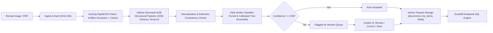

# Invoice & Receipt Processing Pipeline with Field Verifier

An end-to-end Machine Learning pipeline that ingests photographic receipts and PDF invoices, performs OCR and layout parsing via **Docling RapidOCR**, extracts structured JSON Schema via local **Ollama Gemma3n-E2B**, verifies field reliability via a trained **Field Verifier Classifier**, and persists validated records into a strongly-typed **Parquet** datastore queryable through **DuckDB**.

Includes an interactive **Gradio Web Application** featuring an active review queue for uncertain fields and an embedded Parquet dataset explorer.

Developed in compliance with the **Machine Learning Innovative Assignment Guidelines (Stages 1–12)**.

---

## 🏛️ System Architecture



---

## 📁 Repository Structure

```
ml_assignment/
├── configs/
│   └── default.yaml               # Model configuration, thresholds, directory paths
├── prompts/
│   └── extract_v1.txt             # Frozen system prompt for structured extraction
├── src/
│   ├── schema/                    # Pydantic v2 domain schemas (Single source of truth)
│   │   └── invoice.py             # InvoiceExtraction, NormalizedInvoice, FieldResult
│   ├── data/
│   │   ├── cord_loader.py         # CORD-v2 acquisition & local caching
│   │   ├── cord_clean.py          # Data cleaning, deduplication, audit analysis
│   │   ├── run_t1_pipeline.py     # End-to-end CORD acquisition runner
│   │   ├── run_eda.py             # Analytical EDA generator & plotting
│   │   └── populate_extractions.py# Generates extractions for verifier dataset
│   ├── pipeline/
│   │   ├── ingest.py              # SHA-256 doc_id generation & raw storage
│   │   ├── parse.py               # Docling RapidOCR converter & instant replay cache
│   │   ├── extract.py             # Ollama client with retry loop & JSON Schema
│   │   ├── normalize.py           # Indonesian thousand-dot/decimal parser & NFKC
│   │   ├── checks.py              # Arithmetic cross-field consistency signals
│   │   ├── run.py                 # Single end-to-end process_document() pipeline
│   │   └── batch_runner.py        # Resumable batch runner over document lists
│   ├── store/
│   │   └── parquet_store.py       # Atomic part-file storage with PyArrow & DuckDB
│   ├── labels/
│   │   ├── align.py               # Hungarian bipartite matching with RapidFuzz
│   │   └── build_labels.py        # Generates labels_v1.parquet (y=1 error, y=0 correct)
│   ├── verifier/
│   │   ├── features.py            # Feature engineering (No ground truth leakage)
│   │   ├── build_features_dataset.py # Generates features_v1.parquet
│   │   ├── train.py               # 5-fold StratifiedGroupKFold, Tuning, Calibration
│   │   ├── evaluate.py            # Test evaluation, bootstrap CIs, Risk-Coverage
│   │   ├── predict.py             # Runtime confidence scoring and review routing
│   │   └── run_training.py        # Complete training & test evaluation driver
│   └── app/
│       └── gradio_app.py          # Interactive 3-tab Gradio Web UI
├── tests/                         # Pytest automated test suite (83 unit & e2e tests)
├── models/
│   ├── verifier_v1.joblib         # Calibrated HistGradientBoosting model artifact
│   └── model_card.md              # Formal ML model card
├── reports/
│   ├── final_report.md            # Rigorous report addressing all 12 stages
│   ├── data_audit.json            # Deduplication, missingness, and outlier audit
│   ├── metrics.json               # Test split metrics, bootstrap CIs, risk-coverage
│   ├── run_manifest.json          # Environment and model provenance manifest
│   ├── pr_roc_curves.png          # Precision-Recall and ROC curves
│   ├── risk_coverage_curve.png    # Automation coverage vs residual accuracy curve
│   └── calibration_curve.png      # Reliability calibration diagram
└── docs/
    └── ai_usage_log.md            # AI assistance and academic integrity citation log
```

---

## 🚀 Getting Started

### 1. Prerequisites & Environment Setup
- Python 3.10+
- [Ollama](https://ollama.ai) installed with `gemma3n:e2b`:
  ```bash
  ollama pull gemma3n:e2b
  ```
- Install dependencies:
  ```bash
  pip install -r requirements.txt
  ```

### 2. Launch the Gradio Web Application
Launch the interactive 3-tab Web UI:
```bash
python -m src.app.gradio_app
```
Navigate to `http://127.0.0.1:7860`:
- **Tab 1 (Extract & Review):** Upload an invoice or receipt image/PDF, view layout preview, extracted line items, and inspect low-confidence fields highlighted in yellow.
- **Tab 2 (Dataset Explorer):** Search and filter stored documents in Parquet via DuckDB.
- **Tab 3 (Model Performance & Audit):** View live test split PR-AUC, ROC-AUC, Risk-Coverage curve, and dataset audit figures.

### 3. Run Single Document via CLI / Python
Process any receipt image or PDF directly:
```python
from src.pipeline.run import process_document

invoice = process_document("data/raw/cord/train/cord_train_0000.png")
print(f"Doc ID: {invoice.doc_id}")
print(f"Total: {invoice.currency} {invoice.total}")
print(f"Min Field Confidence: {invoice.min_field_confidence:.2%}")
print(f"Needs Manual Review: {invoice.needs_review}")
```

### 4. Query Stored Records via DuckDB
Query the Parquet store using SQL:
```python
from src.store.parquet_store import query_documents

# Query all receipts requiring review
df_review = query_documents("SELECT doc_id, vendor_name, total, min_field_confidence FROM documents WHERE needs_review = true")
print(df_review)
```

### 5. Re-run Training & Evaluation
To retrain the Field Verifier and re-generate test evaluation figures:
```bash
python -m src.verifier.run_training
```

### 6. Run Test Suite
Run all unit and integration tests:
```bash
python -m pytest tests/
```

---

## 📊 Key Results

| Metric | Baseline B0 (Majority) | Baseline B1 (Rule-Based) | Field Verifier (Ours) |
|---|---|---|---|
| **CV PR-AUC (Error Class)** | 0.0281 | 0.0417 | **0.9446** |
| **Test PR-AUC (95% CI)** | 0.0281 | 0.0417 | **0.9212** `[0.8385, 1.0]` |
| **Test ROC-AUC (95% CI)** | 0.5000 | 0.6670 | **0.9782** `[0.9503, 1.0]` |
| **Test Balanced Accuracy** | 50.00% | 72.10% | **95.77%** |
| **Brier Score (Calibration)** | 0.0273 | 0.5075 | **0.0045** |
| **Risk-Coverage Accuracy** | 98.60% (raw) | 98.60% | **99.90%** (at 96% auto-acceptance) |
