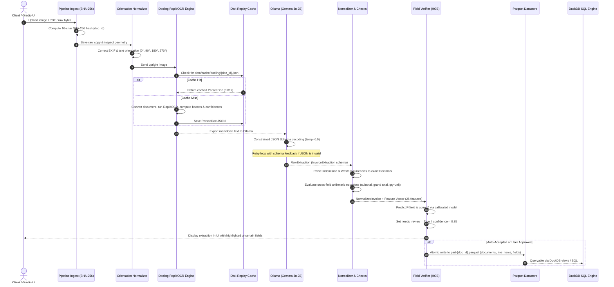
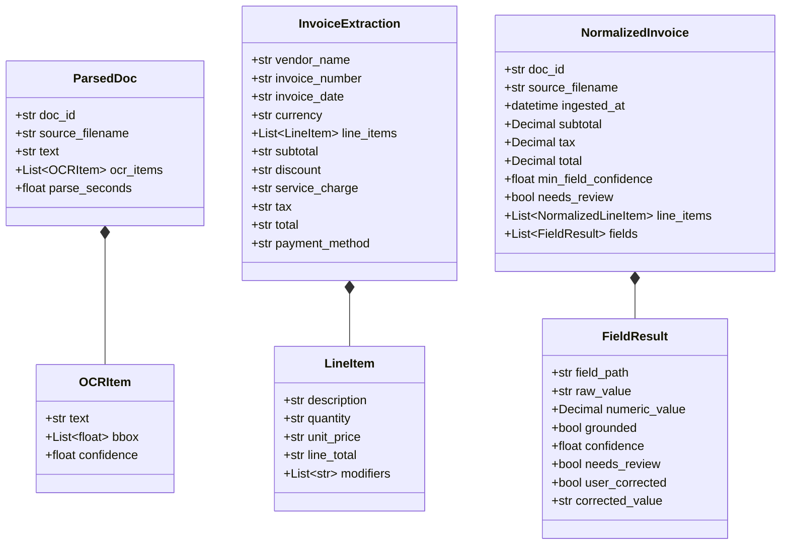

# System Architecture & Flow

This document details the end-to-end execution flow of the **Invoice & Receipt Processing Pipeline**. It explains how a document moves from raw input bytes to validated, queryable analytical tables, highlighting data contracts, error routing, and idempotency guarantees.

---

## 1. End-to-End Architectural Flowchart



---

## 2. Step-by-Step Pipeline Walkthrough

### Step 1: Ingestion & Idempotent Hashing
- **Module:** `src/pipeline/ingest.py`
- **Function:** `ingest_file(source_file_or_bytes, original_filename)`
- **Behavior:**
  1. Computes the SHA-256 cryptographic digest of the raw file content.
  2. Extracts the first 16 hexadecimal characters as the canonical `doc_id` (e.g., `a1b2c3d4e5f67890`).
  3. Writes the raw file to `data/raw_uploads/{doc_id}_{filename}`.
  4. Guarantees **idempotency**: Processing the same document multiple times produces the exact same `doc_id` and does not duplicate raw files.

```python
# Code snippet from src/pipeline/ingest.py
def compute_doc_id(data: bytes) -> str:
    """Compute 16-character SHA-256 hash prefix."""
    return hashlib.sha256(data).hexdigest()[:16]

def ingest_file(source: Union[str, Path, bytes], original_filename: str) -> Tuple[str, Path]:
    if isinstance(source, (str, Path)):
        data = Path(source).read_bytes()
    else:
        data = source
    doc_id = compute_doc_id(data)
    target_path = UPLOADS_DIR / f"{doc_id}_{original_filename}"
    if not target_path.exists():
        target_path.write_bytes(data)
    return doc_id, target_path
```

---

### Step 2: Document Orientation Correction
- **Module:** `src/pipeline/orient.py`
- **Function:** `auto_orient_file(file_path)`
- **Behavior:**
  1. **EXIF Transposition:** Reads phone camera metadata (`ImageOps.exif_transpose`) to fix initial rotation tags.
  2. **Geometry Heuristics:** Detects whether a receipt is oriented horizontally (receipts are predominantly portrait).
  3. **Direction Detection:** If landscape or ambiguous, runs a fast RapidOCR orientation detector across candidate rotations ($0^\circ, 90^\circ, 180^\circ, 270^\circ$). It selects the orientation yielding the maximum count of valid horizontal text bounding boxes.
  4. Saves the upright image to `data/cache/oriented/{doc_id}.png`.

---

### Step 3: Layout & OCR Parsing via Docling
- **Module:** `src/pipeline/parse.py`
- **Function:** `parse_document(file_path, doc_id, use_cache=True)`
- **Behavior:**
  1. Checks for existing cache file: `data/cache/docling/{doc_id}.json`. If present, returns instantly (instant replay in $< 10\text{ ms}$).
  2. If missing, invokes Docling's `DocumentConverter` configured with `PdfPipelineOptions(do_ocr=True, ocr_options=RapidOcrOptions(use_cls=True))`.
  3. Emits:
     - Full document text exported as Markdown.
     - Structured list of `OCRItem` tokens containing word/line text, bounding boxes $[x_0, y_0, x_1, y_1]$, and OCR engine confidence scores.
  4. Caches the serialized `ParsedDoc` to disk.

---

### Step 4: Structured Information Extraction via Ollama
- **Module:** `src/pipeline/extract.py`
- **Function:** `extract_invoice(parsed_doc, k_samples=0)`
- **Behavior:**
  1. Loads the frozen prompt from `prompts/extract_v1.txt`.
  2. Compiles the Pydantic schema `InvoiceExtraction.model_json_schema()`.
  3. Sends request to local Ollama daemon (`http://localhost:11434`) using model `gemma3n:e2b`:
     - `temperature=0.0`: Deterministic greedy decoding for maximum reproducibility.
     - `format=schema`: Hardware-level grammar-constrained decoding (guarantees valid JSON).
  4. **Self-Healing Retry Loop:** If parsing fails, appends the error feedback into the chat context and re-prompts the model (up to 2 retries).
  5. **Self-Consistency (Optional):** If `k_samples > 0`, runs $k$ parallel passes at $\text{temp}=0.7$ with seeds $43, 44, \dots$ to measure multi-sample field agreement.

---

### Step 5: Data Normalization & Arithmetic Validation
- **Module:** `src/pipeline/normalize.py` & `src/pipeline/checks.py`
- **Function:** `normalize_invoice(raw, doc_id, filename, doc_text)`
- **Behavior:**
  1. **Indonesian Numeral Parsing:** Translates thousand-dot/decimal-comma strings (`16.500`, `Rp 12.000,-`, `(1.500)`) into pure `Decimal` numeric values.
  2. **Unicode NFKC Sanitization:** Cleans full-width characters, collapses whitespace, and preserves explicit `None` for absent fields.
  3. **Arithmetic Cross-Field Validation:**
     - **Line Items Check:** Tests if $\sum \text{line\_total} = \text{subtotal}$.
     - **Grand Total Equation:** Tests if $\text{total} = \text{subtotal} + \text{tax} + \text{service} - \text{discount}$.
     - **Line Multiplication Check:** Tests if $\text{qty} \times \text{unit\_price} = \text{line\_total}$.
  4. Constructs the intermediate `NormalizedInvoice` object.

---

### Step 6: Supervised Field Verification & Review Routing
- **Module:** `src/verifier/predict.py`
- **Function:** `verify_normalized_invoice(normalized_inv, parsed_doc, extraction)`
- **Behavior:**
  1. Generates 26 leakage-safe features for every extracted field (identity, text grounding, fuzzy match score, OCR confidence, arithmetic discrepancies, format traits).
  2. Passes features into the calibrated `HistGradientBoostingClassifier` model artifact (`models/verifier_v1.joblib`).
  3. Predicts the calibrated probability of correctness:
     $$P(\text{field is correct}) = 1.0 - P(\text{is\_error})$$
  4. Evaluates decision rule against configured threshold $\tau = 0.85$:
     $$\text{needs\_review} = \begin{cases} \text{False} & \text{if } P(\text{correct}) \ge 0.85 \quad (\text{Auto-accepted}) \\ \text{True} & \text{if } P(\text{correct}) < 0.85 \quad (\text{Flagged for review}) \end{cases}$$
  5. Computes document-level `min_field_confidence`. If any field is flagged, `normalized_inv.needs_review` becomes `True`.

---

### Step 7: Atomic Parquet Persistence & DuckDB Querying
- **Module:** `src/store/parquet_store.py`
- **Function:** `write_document(normalized_invoice, overwrite=True)`
- **Behavior:**
  1. Serializes the validated document across three relational Parquet tables:
     - `data/store/documents/part-{doc_id}.parquet`
     - `data/store/line_items/part-{doc_id}.parquet`
     - `data/store/fields/part-{doc_id}.parquet`
  2. **Atomic Writes:** Writes to a temporary `.tmp_{uuid}` file and performs an atomic filesystem replace. This prevents file corruption during unexpected crashes.
  3. **DuckDB Integration:** Exposes unified views over all part files:
     ```sql
     SELECT doc_id, vendor_name, total, min_field_confidence 
     FROM 'data/store/documents/*.parquet' 
     WHERE needs_review = true;
     ```

---

## 3. Core Data Contracts (Pydantic Schemas)

The entire pipeline communicates using strict Pydantic v2 schemas defined in `src/schema/invoice.py`:



---

## 4. Single Document vs Batch Processing

### Executing a Single Document
The main entry point for single document processing is `process_document()` in `src/pipeline/run.py`:

```python
from src.pipeline.run import process_document

# Ingests, parses, extracts, normalizes, verifies, and stores
invoice = process_document("data/raw/cord/train/cord_train_0000.png")

print(f"Document ID: {invoice.doc_id}")
print(f"Total: {invoice.currency} {invoice.total}")
print(f"Minimum Field Confidence: {invoice.min_field_confidence:.2%}")
print(f"Requires Manual Human Review: {invoice.needs_review}")
```

### Batch Execution with Checkpointing
For batch workloads across thousands of documents, `src/pipeline/batch_runner.py` provides:
- Resumable state persistence via `run_manifest.json`.
- Skip logic for already-processed document IDs.
- Summary metrics and exception trapping without pipeline halting.
