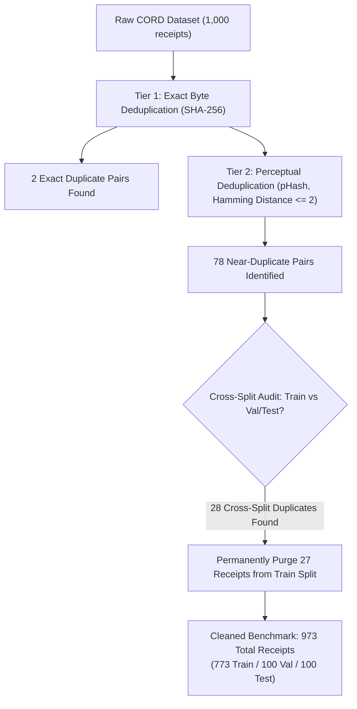

# Dataset Architecture & Data Engineering

This document details the acquisition, structure, deduplication, and leakage prevention engineering applied to the receipt dataset powering the project.

---

## 1. Dataset Origin & Characteristics

The primary benchmark dataset is the **Consolidated Receipt Dataset (CORD-v2)**:
- **Repository:** `naver-clova-ix/cord-v2` on the Hugging Face Hub.
- **License:** Creative Commons Attribution 4.0 International (CC-BY-4.0).
- **Domain:** Photographic captures of Indonesian retail, grocery, restaurant, and service receipts.
- **Modality:** High-resolution RGB images paired with ground-truth OCR bounding boxes and hierarchical JSON parses (`gt_parse`).
- **Initial Partitioning:**
  - `train`: 800 documents
  - `validation`: 100 documents
  - `test`: 100 documents
  - **Total:** 1,000 raw documents

### Ground Truth Hierarchy (`gt_parse`)
The raw ground truth format provides nested JSON representations:
```json
{
  "menu": [
    {
      "nm": "ES TEH MANIS",
      "cnt": "2",
      "price": "10.000",
      "sub": [
        {"sub_nm": "LESS SUGAR"}
      ]
    }
  ],
  "sub_total": {
    "subtotal_price": "20.000",
    "discount_price": "2.000",
    "service_price": null,
    "tax_price": "1.800"
  },
  "total": {
    "total_price": "19.800",
    "cashprice": "50.000",
    "changeprice": "30.200"
  }
}
```

---

## 2. Domain Scope & Ground Truth Limitations

A critical aspect of technical honesty in document ML is distinguishing between standard invoices and store receipts:

| Dimension | CORD Store Receipts (Our Benchmark) | Multi-Page Enterprise B2B Invoices |
| :--- | :--- | :--- |
| **Physical Form** | Single-page thermal paper roll, photographic capture | Multi-page PDF or digital scan, tabular grid |
| **Ground Truth Coverage** | Line items, subtotal, discount, tax, service, total, tender/change | Vendor Tax ID / NPWP, invoice number, due date, IBAN bank account |
| **Handling in Pipeline** | Fully evaluated against ground truth (`is_error` labeled) | Extracted when present; marked `verified = null` to protect metric integrity |

---

## 3. Data Cleaning & Structural Normalization

Implemented in `src/data/cord_clean.py`, the cleaning engine addresses structural inconsistencies in the raw dataset:

1. **Heterogeneous Menu Normalization:**
   In raw CORD annotations, `menu` occasionally appears as a single dictionary mapping rather than a list of dictionaries. The cleaner standardizes all instances into uniform lists:
   ```python
   # Normalize menu structure
   if isinstance(menu_raw, dict):
       menu_list = [menu_raw]
   elif isinstance(menu_raw, list):
       menu_list = menu_raw
   else:
       menu_list = []
   ```

2. **Modifier Flattening:**
   Nested sub-items (`sub_nm`, `sub`) representing kitchen customizations (e.g., *"extra sambal"*, *"no ice"*) are flattened into clean string lists.

3. **Void Item Segregation:**
   Canceled or voided items (`void_menu`) are flagged with `is_void = True`. This ensures they are excluded when evaluating mathematical consistency against receipt subtotals.

---

## 4. Perceptual Deduplication & Cross-Split Leakage Prevention

Data leakage across training, validation, and test splits is a common failure mode in document intelligence. If near-duplicate receipts appear in both training and test sets, evaluation metrics become artificially inflated.

We implemented a two-tier deduplication audit in `src/data/cord_clean.py`:



### Technical Implementation:
- **Perceptual Hashing:** Generates a 64-bit DCT-based image hash (`imagehash.phash`). Two images with a Hamming distance $\le 2$ are flagged as near-duplicates (e.g., same receipt photographed twice with minor angle variations).
- **Leakage Resolution:** When a duplicate pair spanned across `train` and `test` or `train` and `val`, the test/val instances were strictly preserved, and the training duplicate was permanently eliminated.

```python
# Code snippet from src/data/cord_clean.py
def find_near_duplicates_phash(
    records: Sequence[Dict[str, Any]],
    max_distance: int = 2,
) -> List[Tuple[str, str, int, str, str]]:
    """Detect near-duplicate receipt images using pHash Hamming distance."""
    hashes = []
    for r in records:
        ph = imagehash.hex_to_hash(r["phash"])
        hashes.append((r["doc_id"], r["split"], ph))

    duplicates = []
    for i in range(len(hashes)):
        id_a, split_a, ph_a = hashes[i]
        for j in range(i + 1, len(hashes)):
            id_b, split_b, ph_b = hashes[j]
            dist = ph_a - ph_b # Hamming distance
            if dist <= max_distance:
                duplicates.append((id_a, id_b, dist, split_a, split_b))
    return duplicates
```

---

## 5. Processed Dataset Schema & Parquet Exports

The cleaned dataset is persisted into two high-performance columnar Parquet files in `data/processed/`:

### 1. Document-Level Store: `data/processed/cord_docs.parquet`
Contains 973 rows (one per document) with cleaned summary metadata:
- `doc_id`: 16-character SHA-256 identifier.
- `split`: `train` (773), `val` (100), `test` (100).
- `image_path`: Path to cached PNG image.
- `subtotal`, `discount`, `service_charge`, `tax`, `total`: High-precision `Decimal` values.
- `n_items`: Count of purchased line items.
- `sha256`, `phash`: Provenance hash signatures.

### 2. Long-Format Ground Truth Table: `data/processed/cord_gt.parquet`
Contains 11,894 rows representing individual atomic ground truth field values:

| Column | Type | Description |
| :--- | :--- | :--- |
| `doc_id` | `string` | Foreign key referencing `cord_docs` |
| `split` | `string` | Partition (`train`, `val`, `test`) |
| `field_path` | `string` | Canonical JSON pointer (e.g., `total`, `line_items[0].description`) |
| `field_group` | `string` | Semantic category (`total`, `tax`, `line_item_total`, etc.) |
| `gt_raw` | `string` | Verbatim text as annotated in CORD |
| `gt_clean` | `string` | NFKC-normalized text |
| `gt_amount` | `decimal128(18,2)` | Parsed numeric value (or `null` if non-numeric) |
| `item_idx` | `int32` | Line item index (or `-1` for document-level fields) |
| `is_void` | `bool` | True if the item was canceled |
