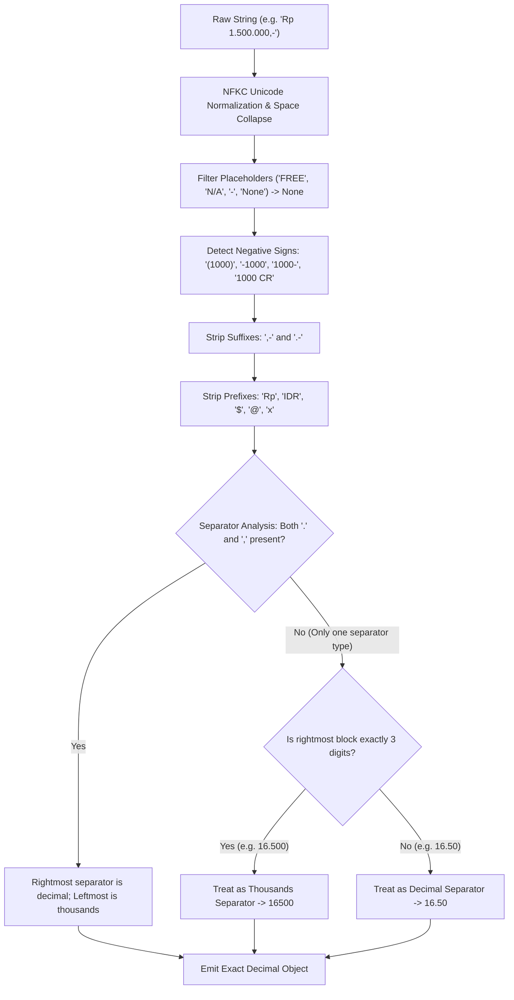

# Data Preprocessing & Normalization

This document explains the data preprocessing, string cleaning, currency amount parsing, and arithmetic validation logic implemented in `src/pipeline/normalize.py` and `src/pipeline/checks.py`.

---

## 1. Indonesian & International Amount Normalization

Financial documents exhibit regional variations in numeral formatting. In particular, Indonesian financial receipts invert Anglo-American conventions:
- **Period (`.`):** Used as the thousand separator (e.g., `16.500` indicates sixteen thousand five hundred IDR).
- **Comma (`,`):** Used as the decimal separator (e.g., `1.500,50` indicates 1,500 IDR and 50 cents).
- **Shorthand zero-cent markers:** Common suffixes `,-` or `.-` (e.g., `10.000,-` or `10.000.-`).
- **Accounting Parentheses:** `(15.000)` denotes a negative deduction or return.
- **Currency Symbols:** Prefixes (`Rp`, `IDR`, `$` , `USD`) and quantity modifiers (`@15.000`, `x2`).

### Deterministic Disambiguation Algorithm
The function `parse_amount()` in `src/pipeline/normalize.py` implements a multi-step disambiguation parser:



### Python Implementation (`src/pipeline/normalize.py`)
```python
def parse_amount(val_str: Optional[str], currency_decimals: int = 0) -> Optional[Decimal]:
    if val_str is None:
        return None
    s = unicodedata.normalize("NFKC", str(val_str)).strip()
    if not s or s.lower() in {"none", "null", "n/a", "free", "nil", "-", ""}:
        return None

    is_negative = False
    if s.startswith("(") and s.endswith(")"):
        is_negative = True
        s = s[1:-1].strip()
    if s.endswith(",-") or s.endswith(".-"):
        s = s[:-2].strip()
    elif s.endswith("-"):
        is_negative = True
        s = s[:-1].strip()
    if s.startswith("-"):
        is_negative = True
        s = s[1:].strip()

    # Strip currency words and symbols
    s = re.sub(r"(?i)^(rp|idr|usd|\$|eur|sgd)\s*", "", s).strip()

    # Disambiguate '.' and ','
    has_dot = "." in s
    has_comma = "," in s

    if has_dot and has_comma:
        last_dot = s.rfind(".")
        last_comma = s.rfind(",")
        if last_comma > last_dot: # European / Indonesian: 1.500,50
            s = s.replace(".", "").replace(",", ".")
        else: # US / UK: 1,500.50
            s = s.replace(",", "")
    elif has_dot and not has_comma:
        parts = s.split(".")
        if len(parts[-1]) == 3 and len(parts) > 1: # 16.500 or 1.250.000 -> 16500
            s = "".join(parts)
        else:
            s = "".join(parts[:-1]) + "." + parts[-1]
    elif has_comma and not has_dot:
        parts = s.split(",")
        if len(parts[-1]) == 3 and len(parts) > 1: # 16,500
            s = "".join(parts)
        else:
            s = "".join(parts[:-1]) + "." + parts[-1]

    val = Decimal(s)
    return -val if is_negative else val
```

---

## 2. Text Normalization & Date Standardization

- **Unicode NFKC Standardization:** Converted all character strings via `unicodedata.normalize("NFKC", text)` to resolve ligature characters (e.g., `fi` to `fi`), full-width digits, and non-breaking spaces.
- **Multilingual Date Normalizer:** Parses Indonesian and English dates (e.g., *"14 Oktober 2026"*, *"14/10/26"*, *"14-Oct-2026"*) into ISO-8601 standard `date(2026, 10, 14)` using a bilingual dictionary lookup (`MONTH_NAMES`).

---

## 3. Missing Value Strategy: Physical Absence vs Corruption

In structured document extraction, missing values fall into two distinct categories:

1. **Structural Non-Applicability (Physical Absence):**
   A grocery store receipt that does not have a `service_charge` or `discount` is not "missing" data in the sense of random corruption; the transaction simply did not incur those charges.
   - **Policy:** Preserved as explicit `None` / SQL `NULL`. Imputing synthetic zeros would falsely alter arithmetic verification logic.

2. **Extraction Misses (Model Failures):**
   If an amount is physically visible on the receipt but omitted by the LLM, the **Hungarian alignment algorithm** flags this discrepancy as an omission error.

---

## 4. Outlier Analysis & High-Value Transactions

An automated audit across all 973 receipts evaluated price distributions using the **Interquartile Range (IQR)** and percentile thresholds:

| Metric | Subtotal | Grand Total | Item Unit Price |
| :--- | :--- | :--- | :--- |
| **Median ($p50$)** | 39,000 IDR | 45,500 IDR | 15,000 IDR |
| **$75^{\text{th}}$ Percentile ($p75$)** | 88,000 IDR | 99,000 IDR | 28,000 IDR |
| **$99^{\text{th}}$ Percentile ($p99$)** | 1,240,000 IDR | 1,565,938 IDR | 215,000 IDR |
| **Maximum Observed** | 3,850,000 IDR | 4,235,000 IDR | 650,000 IDR |

### Handling Extreme Values:
Outlier transactions (receipts exceeding 1,000,000 IDR) were inspected. They represent legitimate high-value commercial catering, hotel banquets, and bulk retail purchases. **They were intentionally retained** in training and testing rather than truncated, training the model to verify large values without false positives.

---

## 5. Cross-Field Arithmetic Consistency Engines

Implemented in `src/pipeline/checks.py`, three mathematical check engines generate objective consistency signals used both for feature engineering and sanity checking:

### Check 1: Line Items Sum vs Subtotal
Evaluates whether the sum of line item totals equals the document subtotal within a 0.01 currency unit tolerance:
$$\Delta_{\text{items}} = \left| \sum_{i=1}^n \text{line\_total}_i - \text{subtotal} \right|$$
$$\text{rel\_diff} = \frac{\Delta_{\text{items}}}{\max(|\text{subtotal}|, \sum |\text{line\_total}_i|, 0.01)}$$

```python
# Code snippet from src/pipeline/checks.py
def check_line_items_sum(subtotal: Optional[Decimal], items: List[NormalizedLineItem]) -> Tuple[bool, float]:
    if subtotal is None or not items:
        return False, 1.0
    valid_totals = [it.line_total for it in items if it.line_total is not None]
    if not valid_totals:
        return False, 1.0
    items_sum = sum(valid_totals)
    diff = abs(items_sum - subtotal)
    denom = max(abs(subtotal), abs(items_sum), Decimal("0.01"))
    rel_diff = float(diff / denom)
    is_consistent = (diff <= Decimal("0.01"))
    return is_consistent, (0.0 if is_consistent else rel_diff)
```

### Check 2: Grand Total Balance Equation
Validates the universal accounting equation:
$$\text{Expected Total} = \text{subtotal} + \text{tax} + \text{service\_charge} - \text{discount}$$
$$\Delta_{\text{grand}} = \left| \text{total} - \text{Expected Total} \right|$$

### Check 3: Quantity Multiplication Consistency
Validates that each line item's quantity multiplied by its unit price matches its reported line total:
$$\Delta_{\text{mul}} = \left| (\text{quantity} \times \text{unit\_price}) - \text{line\_total} \right|$$
