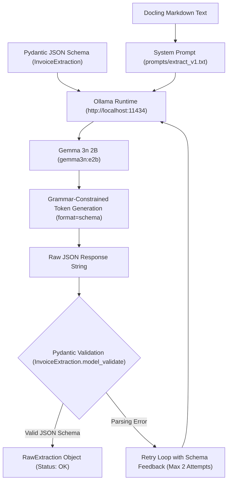

# Ollama & LLM Structured Extraction Deep Dive

This document details the configuration, prompt engineering, schema constraints, and error recovery mechanics governing **Ollama** and the local **Gemma 3n 2B** language model in the extraction stage.

---

## 1. What is Ollama and What Does It Do?

**Ollama** is a lightweight, high-performance local inference runner for Large Language Models. In this pipeline, Ollama acts as the **semantic extractor and schema compiler**:



### Why Ollama & Gemma 3n 2B?
1. **Fully Local & Private:** Financial documents, receipts, and invoices contain sensitive transactional and merchant data. Ollama runs entirely on-premise without transmitting data to third-party cloud APIs.
2. **Resource-Constrained Efficiency:** `gemma3n:e2b` is a lightweight, edge-optimized model requiring $< 3\text{ GB}$ of VRAM/RAM, making it deployable on consumer laptops and edge servers.
3. **Hardware-Level Constrained Generation:** Ollama natively supports grammar-based JSON schema constraints at decode time, preventing malformed syntax or random free-form prose.

---

## 2. System Prompt Engineering & Verbatim Extraction Rule

A known vulnerability of small generative language models is their tendency to perform flawed internal arithmetic (e.g., trying to calculate $2 \times 15,000$ and hallucinating $25,000$, or modifying currency punctuation).

To eliminate this vulnerability, the system prompt (`prompts/extract_v1.txt`) imposes a strict **verbatim extraction rule**:

```text
You are an expert document information extraction system.
Extract structured invoice and receipt information from the provided OCR document text.
Strictly adhere to the following schema rules:

1. Return ONLY the fields specified in the JSON schema.
2. For all numerical amounts (subtotal, tax, discount, service_charge, total, amount_paid, change, line_totals, unit_prices), copy the text EXACTLY as printed in the document (do NOT perform math, do NOT alter formatting or currency symbols).
3. If an amount or field is not present in the document text, return null (do NOT guess or hallucinate).
4. For line items:
   - Extract every purchased line item with its description, quantity, unit price, and line total as printed.
   - If modifier notes exist (e.g., 'no sugar', 'large size'), place them in the modifiers list.
5. Identify payment method (e.g. 'cash', 'card', 'e-money') if mentioned.
6. Extract vendor name, invoice/receipt number, and invoice date if available; otherwise null.
```

### Key Engineering Guardrails:
- **Rule #2 (Copy text EXACTLY):** Prevents the LLM from attempting arithmetic. The LLM acts purely as a copier; mathematical validation is delegated to the downstream deterministic normalization engine.
- **Rule #3 (Explicit Null):** Instructs the model to output `null` when an item is absent rather than hallucinating reasonable numbers.

---

## 3. Constrained JSON Schema Decoding

The Pydantic domain model `InvoiceExtraction` in `src/schema/invoice.py` generates the strict JSON schema:

```python
# Extraction Schema sent to Ollama
class LineItem(BaseModel):
    description: Optional[str] = Field(default=None)
    quantity: Optional[str] = Field(default=None)
    unit_price: Optional[str] = Field(default=None)
    line_total: Optional[str] = Field(default=None)
    modifiers: List[str] = Field(default_factory=list)

class InvoiceExtraction(BaseModel):
    vendor_name: Optional[str] = None
    invoice_number: Optional[str] = None
    invoice_date: Optional[str] = None
    currency: Optional[str] = None
    line_items: List[LineItem] = Field(default_factory=list)
    subtotal: Optional[str] = None
    discount: Optional[str] = None
    service_charge: Optional[str] = None
    tax: Optional[str] = None
    total: Optional[str] = None
    payment_method: Optional[str] = None
    amount_paid: Optional[str] = None
    change: Optional[str] = None
```

Ollama receives this schema directly in the API call:
```python
# Code snippet from src/pipeline/extract.py
schema = InvoiceExtraction.model_json_schema()

response = client.chat(
    model="gemma3n:e2b",
    messages=messages,
    format=schema, # Enforces grammar-level JSON schema constraints
    options={
        "temperature": 0.0, # Deterministic greedy decoding
        "seed": 42,
        "num_ctx": 8192,
    },
)
```

---

## 4. Self-Healing Retry Loop

Even with constrained decoding, small models may occasionally output JSON strings that fail strict Pydantic type validation or contain unescaped characters.

`src/pipeline/extract.py` wraps the inference call in an adaptive retry loop:

```python
# Code snippet from src/pipeline/extract.py
for attempt in range(1 + max_retries):
    try:
        response = client.chat(...)
        raw_response_text = response.message.content or ""
        
        # Validate against Pydantic schema
        parsed_json = json.loads(raw_response_text)
        primary_extraction = InvoiceExtraction.model_validate(parsed_json)
        status = "ok"
        break
    except (json.JSONDecodeError, Exception) as exc:
        logger.warning("Extraction failed on attempt %d: %s", attempt + 1, exc)
        if attempt < max_retries:
            # Feedback message injected into conversation context
            current_messages = list(messages) + [
                {"role": "assistant", "content": raw_response_text},
                {
                    "role": "user",
                    "content": (
                        f"The previous output failed validation: {exc}. "
                        f"Please output strictly valid JSON conforming exactly to the schema."
                    ),
                },
            ]
```

---

## 5. Self-Consistency Sampling ($k$-Samples)

To measure extraction uncertainty, `extract_invoice()` supports self-consistency sampling:
- **Primary Pass:** Executes at `temperature=0.0` (seed 42) for greedy decoding.
- **Consistency Passes:** If `k_samples > 0` (e.g., $k=3$), runs $k$ parallel passes at `temperature=0.7` with seeds $43, 44, 45$.
- **Agreement Ratio (`agree_frac`):** Computes what fraction of sampled passes generated the exact same extracted string. If 3 out of 3 samples match, $\text{agree\_frac} = 1.0$; if samples diverge, $\text{agree\_frac}$ drops, providing an informative feature for the Field Verifier.
