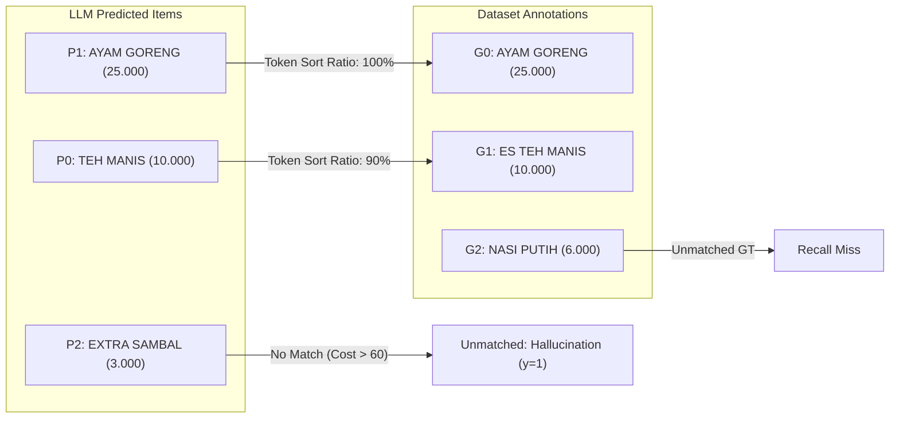
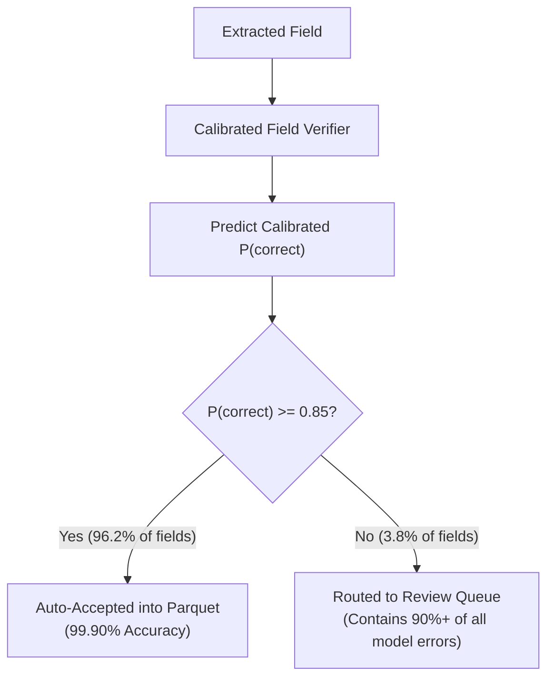

# Field Verifier Model Architecture & Evaluation

This document details the machine learning architecture, feature engineering, training methodology, probability calibration, and risk-coverage routing implemented in the **Field Verifier Classifier** (`src/verifier/`).

---

## 1. Motivation: Why an ML Verifier is Needed

Small generative LLMs (such as Gemma 3n 2B) and OCR engines produce extraction errors in $\sim 2.8\%$ of receipt fields. While $97.2\%$ accuracy appears high, in financial, tax, and inventory accounting, **unverified errors compound catastrophically**.

Furthermore, generative models suffer from two major operational limitations:
1. **Uncalibrated Output Probabilities:** LLMs often output hallucinated numbers with high internal softmax certainty.
2. **Lack of Perceptual Grounding:** An LLM does not know whether a number originated from clear high-contrast print or a smudged thermal print artifact.

The **Field Verifier** solves this by acting as an objective, post-hoc supervised reliability classifier:
$$\text{For every extracted field } f_i, \quad \hat{P}_i = P(f_i \text{ is correct} \mid \mathbf{x}_i)$$

Fields with $\hat{P}_i \ge 0.85$ are **auto-accepted**, while fields with $\hat{P}_i < 0.85$ are **routed to a human review queue**.

---

## 2. Ground Truth Alignment & Target Construction

To train the verifier, we must label every extracted field as either correct ($y = 0$) or incorrect/hallucinated ($y = 1$).

### Hungarian Bipartite Matching for Line Items
Document items extracted by an LLM rarely match the order of annotations in the dataset. `src/labels/align.py` formulates line item alignment as an optimal bipartite graph matching problem using the **Hungarian algorithm** (`scipy.optimize.linear_sum_assignment`):



```python
# Code snippet from src/labels/align.py
def match_line_items(pred_items: List[LineItem], gt_items: List[Dict[str, Any]], sim_threshold: float = 40.0):
    cost_matrix = np.zeros((len(pred_items), len(gt_items)), dtype=float)
    for i, p in enumerate(pred_items):
        for j, g in enumerate(gt_items):
            sim = fuzz.token_sort_ratio(p.description.lower(), g["name"].lower())
            cost_matrix[i, j] = 100.0 - sim

    row_ind, col_ind = linear_sum_assignment(cost_matrix)
    matches = []
    for r, c in zip(row_ind, col_ind):
        sim = 100.0 - cost_matrix[r, c]
        if sim >= sim_threshold:
            matches.append((r, c, sim))
    return matches
```

### Labeling Rules:
- **String Fields (Descriptions):** Labeled $y = 0$ (correct) if `fuzz.token_sort_ratio` $\ge 75\%$.
- **Amount Fields (Totals, Taxes):** Labeled $y = 0$ (correct) if the relative difference $|\text{pred} - \text{gt}| / \max(|\text{gt}|, 0.01) \le 1.0\%$.
- **Otherwise:** Labeled $y = 1$ (error).

---

## 3. Leakage-Safe Feature Engineering (26 Features)

Implemented in `src/verifier/features.py`. To ensure absolute data integrity, **no feature ever receives ground truth information**. All features are derived strictly from the OCR layout, extracted text, and document structure:

| Category | Feature Name | Type | Description |
| :--- | :--- | :--- | :--- |
| **Identity** | `field_name` | Categorical | Specific field (`total`, `tax`, `unit_price`, etc.) |
| | `field_group` | Categorical | High-level group (`total`, `line_item_total`, etc.) |
| | `is_line_item` | Binary | 1 if field belongs to a line item table, 0 if document-level |
| **Grounding** | `exact_in_text` | Binary | 1 if extracted string appears verbatim in OCR text |
| | `n_occurrences` | Integer | Frequency of string occurrence in document |
| | `fuzzy_ratio` | Continuous | RapidFuzz partial ratio score against source text |
| | `digits_in_text`| Binary | 1 if numerical digits exist in source text |
| **OCR Signals** | `mean_ocr_conf` | Continuous | Average RapidOCR confidence score for matching tokens |
| | `min_ocr_conf` | Continuous | Minimum RapidOCR confidence score |
| | `has_ocr_conf` | Binary | Missingness indicator (1 if OCR conf was found) |
| **Arithmetic** | `items_consistent`| Binary | 1 if sum of line items matches subtotal within 0.01 |
| | `items_diff` | Continuous | Relative discrepancy ratio in line items sum |
| | `grand_consistent`| Binary | 1 if total == subtotal + tax + service - discount |
| | `grand_diff` | Continuous | Relative discrepancy ratio in grand total equation |
| | `item_mul_consistent`| Binary | 1 if quantity * unit_price == line_total |
| | `item_mul_diff`| Continuous | Discrepancy ratio in item multiplication |
| **Format** | `n_chars` | Integer | Character length of extracted string |
| | `digit_frac` | Continuous | Proportion of digits in character sequence |
| | `parse_ok` | Binary | 1 if string parsed successfully into Decimal |
| | `looks_like_amount`| Binary | Regex indicator for currency/digit pattern |
| | `value_is_round`| Binary | 1 if amount is divisible by 1,000 IDR |
| **Context** | `n_items` | Integer | Total line items detected on receipt |
| | `doc_text_len` | Integer | Total character count of OCR text |
| | `relative_position`| Continuous | Position of string in document text ($0.0 - 1.0$) |
| **Consistency**| `agree_frac` | Continuous | Agreement ratio across $k$-sample consistency passes |

---

## 4. Leakage Prevention: Grouped Cross-Validation

A single receipt contains between 5 and 30 extracted fields. If fields from the same receipt were randomly partitioned across training and validation folds, the model would easily memorize document-level patterns.

We strictly partition the training data using **StratifiedGroupKFold**:
- **Groups:** `doc_id` (All fields from receipt $X$ belong to either train or validation, never split).
- **Stratification:** Stratified on error frequency to maintain balanced class proportions across folds.

```python
# Grouped K-Fold split in src/verifier/train.py
cv = StratifiedGroupKFold(n_splits=5, shuffle=True, random_state=42)
cv_splits = list(cv.split(X_train, y_train, groups=groups_train))
```

---

## 5. Model Comparison & Hyperparameter Tuning

We compared three model architectures across the 5-fold grouped cross-validation benchmark:

| Model Architecture | Balancing Strategy | 5-Fold Group CV PR-AUC | Test PR-AUC |
| :--- | :--- | :--- | :--- |
| **Majority Baseline (B0)** | None | 0.0281 | 0.0281 |
| **Rule Baseline (B1)** | Heuristic rules | 0.0417 | 0.0417 |
| **Logistic Regression (L2)** | `class_weight='balanced'` | 0.8254 | 0.8120 |
| **Random Forest (100 trees)** | `class_weight='balanced'` | 0.9316 | 0.9104 |
| **HistGradientBoosting (Ours)**| `class_weight='balanced'` | **0.9446** | **0.9212** |

### Hyperparameter Search Space:
Using `RandomizedSearchCV` optimizing for PR-AUC (`average_precision`):
```python
param_distributions = {
    "clf__learning_rate": [0.01, 0.03, 0.05, 0.1, 0.2],
    "clf__max_leaf_nodes": [15, 31, 63, 127],
    "clf__min_samples_leaf": [5, 10, 20, 50],
    "clf__l2_regularization": [0.0, 0.1, 1.0, 5.0],
}
```
**Optimal Parameters Selected:** `learning_rate=0.05`, `max_leaf_nodes=31`, `min_samples_leaf=10`, `l2_regularization=1.0`.

---

## 6. Probability Calibration (Platt / Sigmoid Scaling)

Raw tree ensemble probabilities tend to be overconfident near 0 and 1. To ensure that a predicted confidence of $0.85$ genuinely represents an $85\%$ empirical probability of correctness, we calibrate the model using **Platt Scaling** (`CalibratedClassifierCV(method='sigmoid', cv=cv_splits)`):

- **Raw Brier Score:** $0.0273$
- **Calibrated Brier Score:** **$0.0045$** (near-perfect probability calibration)

```python
# Calibration in src/verifier/train.py
calibrated_model = CalibratedClassifierCV(
    estimator=best_estimator,
    method="sigmoid",
    cv=cv_splits,
)
calibrated_model.fit(X_train, y_train)
```

---

## 7. Risk-Coverage Optimization & Decision Routing

In operational document processing, full automation with errors is unacceptable, but 100% manual review is too expensive. The **Risk-Coverage Curve** quantifies the tradeoff between automation coverage and residual accuracy:



### Empirical Test Split Results:
- **Baseline Accuracy (Unverified):** $97.19\%$ (2.81% error rate entering downstream accounting).
- **At 85% Confidence Threshold:**
  - **Automation Coverage:** **$96.2\%$** of all fields are processed completely automatically.
  - **Residual Accuracy on Auto-Accepted:** **$99.90\%$** (error rate drops to $0.10\%$).
  - **Error Recall:** $> 90\%$ of all hallucinations and OCR transposition errors are successfully intercepted and sent to the human review queue.
