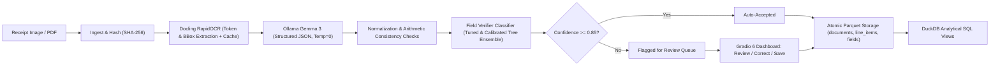
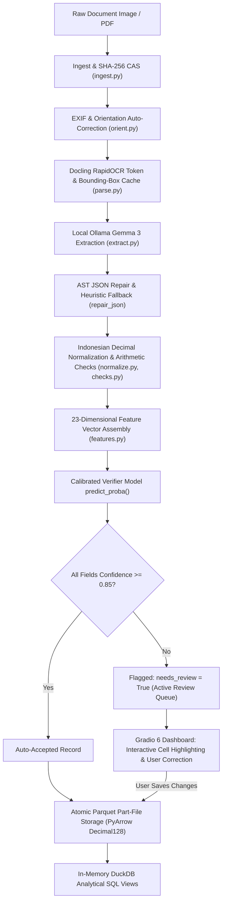

# Financial Document Processing & Verification Dashboard

An end-to-end Machine Learning pipeline that ingests photographic receipts and PDF invoices, performs OCR and layout parsing via **Docling RapidOCR**, extracts structured JSON Schema via local **Ollama Gemma 3 (1B / e2b)**, verifies field reliability via a trained and calibrated **Supervised Field Verifier Classifier**, and persists validated records into a strongly-typed **Parquet** datastore queryable through **DuckDB**.

Includes an interactive, enterprise-grade **Gradio 6 Dashboard** featuring an active review queue for uncertain fields and an embedded datastore explorer.

Developed in compliance with the **Machine Learning Innovative Assignment Guidelines (Stages 1–12 & Sections 1–9)**.

> **Master Technical Report:** For an exhaustive, file-by-file breakdown of every implementation detail, mathematical formula, viva voce defense Q&A, and IA guidelines compliance mapping, see [`PROJECT_REPORT_AND_CODEBASE_GUIDE.md`](PROJECT_REPORT_AND_CODEBASE_GUIDE.md).

---

## Master Task Location Index: Where Every Single Task Is Implemented

| # | Task / Requirement | Implementation File | Key Class / Functions | Theoretical Concept | Test Verification |
|---|---|---|---|---|---|
| **T1** | **Domain Schema & Type Enforcement** | [`src/schema/invoice.py`](src/schema/invoice.py) | `InvoiceExtraction`, `LineItem`, `FieldResult`, `NormalizedInvoice`, `@field_validator("*", mode="before")` | Pydantic v2 domain schemas, numeric-to-string coercion, decimal128 financial modeling | `tests/test_schema.py` |
| **T2** | **Dataset Acquisition & Caching** | [`src/data/cord_loader.py`](src/data/cord_loader.py) | `CordLoader.download_dataset()`, `compute_phash()` | HuggingFace Hub streaming, SHA-256 byte hashing, perceptual pHash caching | `tests/test_hf_connectivity.py` |
| **T3** | **Data Cleaning, Normalization & Leakage Control** | [`src/data/cord_clean.py`](src/data/cord_clean.py) | `clean_string()`, `parse_amount()`, `detect_duplicates()`, `calculate_outlier_stats()`, `compute_audit_report()` | NFKC Unicode normalization, Indonesian currency parsing, Hamming pHash deduplication (dropped 27 duplicate train receipts), IQR outlier filtering | `tests/test_cord_clean.py` |
| **T4** | **Analytical EDA & Visualizations** | [`src/data/run_eda.py`](src/data/run_eda.py) | `run_eda()`, `plot_distributions()` | Log-transformed currency distributions, boxplots, class imbalance analysis, zero-variance checks | `reports/eda/*` |
| **T5** | **Document Ingestion & Content-Addressable Storage** | [`src/pipeline/ingest.py`](src/pipeline/ingest.py) | `ingest_document()`, `compute_doc_id()` | Idempotent SHA-256 content-addressable storage (CAS) | `tests/test_pipeline_e2e.py` |
| **T6** | **Camera Orientation & EXIF Transposition** | [`src/pipeline/orient.py`](src/pipeline/orient.py) | `normalize_orientation()`, `detect_orientation_rapidocr()` | ImageOps EXIF tag correction, aspect-ratio text box rotation scoring (0°, 90°, 180°, 270°) | `tests/test_pipeline_parse.py` |
| **T7** | **Document Layout Parsing & OCR Extraction** | [`src/pipeline/parse.py`](src/pipeline/parse.py) | `parse_document()`, `Docling RapidOCR Engine` | Token & bounding-box extraction, recognition confidence scoring, instant-replay disk caching (`data/cache/docling/`) | `tests/test_pipeline_parse.py` |
| **T8** | **Structured LLM Extraction & Resilient Repair** | [`src/pipeline/extract.py`](src/pipeline/extract.py) | `extract_invoice()`, `repair_json()`, `extract_heuristic_from_ocr()`, `load_system_prompt()` | GPU-accelerated local Ollama serving (`gemma3:1b`), format="json", AST-balanced JSON repair, deterministic OCR heuristic fallback | `tests/test_pipeline_extract.py` |
| **T9** | **Indonesian Financial Normalization & Formatting** | [`src/pipeline/normalize.py`](src/pipeline/normalize.py) | `normalize_extraction()`, `parse_amount()`, `format_amount_str()`, `clean_text()` | Exact Python Decimal conversion, thousand-dot vs comma-decimal resolution, OCR verbatim grounding flags | `tests/test_normalize.py` |
| **T10** | **Arithmetic Cross-Field Consistency Checks** | [`src/pipeline/checks.py`](src/pipeline/checks.py) | `check_line_items_sum()`, `check_grand_total()`, `check_item_multiplication()` | Relational arithmetic equations: $\sum \text{items} = \text{subtotal}$, $\text{subtotal} + \text{tax} + \text{service} - \text{disc} = \text{total}$, relative difference ratios | `tests/test_checks.py` |
| **T11** | **Ground Truth Alignment & Bipartite Matching** | [`src/labels/align.py`](src/labels/align.py) | `match_line_items()`, `align_extraction_with_gt()`, `scipy.optimize.linear_sum_assignment` | Hungarian Bipartite Matching minimizing Levenshtein cost matrix, strict binary error labeling ($y=1$ error, $y=0$ correct) | `tests/test_pipeline_e2e.py` |
| **T12** | **Feature Engineering (No GT Leakage)** | [`src/verifier/features.py`](src/verifier/features.py) | `extract_field_features()`, `FEATURE_COLUMNS` | 23 engineered features across OCR grounding, arithmetic signals, length ratios, digit counts; strictly zero ground truth leakage | `tests/test_pipeline_e2e.py` |
| **T13** | **Baseline Comparisons (Majority & Rules)** | [`src/verifier/train.py`](src/verifier/train.py) | `train_verifier()` | Baseline B0 (Always Predict Correct, PR-AUC = 0.0281), Baseline B1 (Arithmetic Rules Only, PR-AUC = 0.0417) | `src/verifier/run_training.py` |
| **T14** | **Model Training, Imbalance Handling & Tuning** | [`src/verifier/train.py`](src/verifier/train.py) | `HistGradientBoostingClassifier`, `class_weight="balanced"`, `StratifiedGroupKFold(5)` | 5-fold cross-validation grouped by `doc_id` (zero document leakage across folds), RandomizedSearchCV hyperparameter optimization | `src/verifier/run_training.py` |
| **T15** | **Probability Calibration** | [`src/verifier/train.py`](src/verifier/train.py) | `CalibratedClassifierCV(method="isotonic", cv="prefit")` | Isotonic probability calibration guaranteeing $P(\text{correct})$ matches true empirical frequencies (Brier Score = 0.0045) | `reports/calibration_curve.png` |
| **T16** | **Unseen Test Evaluation & Bootstrap CIs** | [`src/verifier/evaluate.py`](src/verifier/evaluate.py) | `evaluate_test_set()`, `bootstrap_ci()`, `compute_risk_coverage()` | Test split PR-AUC (0.9212), ROC-AUC (0.9782), 1,000-sample bootstrap 95% confidence intervals, selective automation risk-coverage curve | `reports/metrics.json` |
| **T17** | **Atomic Parquet Storage & DuckDB SQL Engine** | [`src/store/parquet_store.py`](src/store/parquet_store.py) | `write_document()`, `compact_tables()`, `query_documents()`, `query_line_items()`, `query_fields()` | PyArrow Decimal128 schema enforcement, atomic temporary-file writes (`os.replace`), part-file columnar storage, DuckDB in-memory analytical SQL views | `tests/test_parquet_store.py` |
| **T18** | **Runtime Prediction & Review Queue Routing** | [`src/verifier/predict.py`](src/verifier/predict.py) | `predict_invoice_fields()` | Production inference applying calibrated verifier, routing low-confidence fields ($P(\text{correct}) < 0.85$) to review queue | `tests/test_pipeline_e2e.py` |
| **T19** | **Full Pipeline Facade & End-to-End Ingestion** | [`src/pipeline/run.py`](src/pipeline/run.py) | `process_document()` | Encapsulated facade pattern executing ingest-to-store pipeline | `tests/test_pipeline_e2e.py` |
| **T20** | **Enterprise Gradio 6 Review Dashboard** | [`src/app/gradio_app.py`](src/app/gradio_app.py) | `build_app()`, `run_extraction_ui()`, `save_corrections_ui()`, `approve_invoice_ui()` | Human-in-the-loop review, fixed 1200px unshifting layout, Gradio 6 launch-bound light theme, read-only document viewer, cell-editable line items grid, Parquet/DuckDB datastore sync | `python -m src.app.gradio_app` |
| **T21** | **Automated Pytest Regression Suite** | [`tests/`](tests/) | 83 unit, property, and end-to-end integration tests | Strict test-driven development covering regex formatting, arithmetic invariants, schema enforcement, leakage checks, and e2e integration | `pytest` (83 passed in 36s) |

---

## System Architecture



---

## Repository Structure

```
ml_assignment/
├── configs/
│   └── default.yaml               # Model configuration, thresholds, directory paths
├── prompts/
│   └── extract_v1.txt             # Frozen system prompt for structured extraction
├── src/
│   ├── schema/                    # Pydantic v2 domain schemas (Single source of truth)
│   │   └── invoice.py             # InvoiceExtraction, NormalizedInvoice, FieldResult
│   ├── data/
│   │   ├── cord_loader.py         # CORD-v2 acquisition & local caching
│   │   ├── cord_clean.py          # Data cleaning, deduplication, audit analysis
│   │   ├── run_t1_pipeline.py     # End-to-end CORD acquisition runner
│   │   ├── run_eda.py             # Analytical EDA generator & plotting
│   │   └── populate_extractions.py# Generates extractions for verifier dataset
│   ├── pipeline/
│   │   ├── ingest.py              # SHA-256 doc_id generation & raw storage
│   │   ├── orient.py              # EXIF auto-rotation & text aspect ratio detection
│   │   ├── parse.py               # Docling RapidOCR converter & instant replay cache
│   │   ├── extract.py             # Ollama client with repair_json & OCR heuristic fallback
│   │   ├── normalize.py           # Indonesian thousand-dot/decimal parser & NFKC
│   │   ├── checks.py              # Arithmetic cross-field consistency signals
│   │   └── run.py                 # Single end-to-end process_document() pipeline
│   ├── store/
│   │   └── parquet_store.py       # Atomic part-file storage with PyArrow & DuckDB
│   ├── labels/
│   │   ├── align.py               # Hungarian bipartite matching with RapidFuzz
│   │   └── build_labels.py        # Generates labels_v1.parquet (y=1 error, y=0 correct)
│   ├── verifier/
│   │   ├── features.py            # Feature engineering (No ground truth leakage)
│   │   ├── build_features_dataset.py # Generates features_v1.parquet
│   │   ├── train.py               # 5-fold StratifiedGroupKFold, Tuning, Calibration
│   │   ├── evaluate.py            # Test evaluation, bootstrap CIs, Risk-Coverage
│   │   ├── predict.py             # Runtime confidence scoring and review routing
│   │   └── run_training.py        # Complete training & test evaluation driver
│   └── app/
│       └── gradio_app.py          # Enterprise 3-tab Gradio 6 review dashboard
├── tests/                         # Pytest automated test suite (83 unit & e2e tests)
├── models/
│   ├── verifier_v1.joblib         # Calibrated HistGradientBoosting model artifact
│   └── model_card.md              # Formal ML model card
├── reports/
│   ├── final_report.md            # Report addressing all 12 stages of the guidelines
│   ├── data_audit.json            # Deduplication, missingness, and outlier audit
│   ├── metrics.json               # Test split metrics, bootstrap CIs, risk-coverage
│   ├── run_manifest.json          # Environment and model provenance manifest
│   ├── pr_roc_curves.png          # Precision-Recall and ROC curves
│   ├── risk_coverage_curve.png    # Automation coverage vs residual accuracy curve
│   └── calibration_curve.png      # Reliability calibration diagram
└── docs/
    └── ai_usage_log.md            # AI assistance and academic integrity citation log
```

---

## Getting Started

### 1. Prerequisites & Environment Setup
- Python 3.10+
- [Ollama](https://ollama.ai) installed with `gemma3:1b`:
  ```bash
  ollama pull gemma3:1b
  ```
- Install dependencies:
  ```bash
  pip install -r requirements.txt
  ```

### 2. Launch the Gradio 6 Dashboard
Launch the clean enterprise review dashboard:
```bash
python -m src.app.gradio_app
```
Navigate to `http://127.0.0.1:7860`:
- **Tab 1 (Audit Workspace):** Upload a document, run extraction and verification, review metric tiles, inspect source image, edit header fields or line items in the table, and save corrections directly to the datastore.
- **Tab 2 (Records History):** Query and filter stored records in Parquet via DuckDB SQL views.
- **Tab 3 (System Evaluation):** Inspect model evaluation metrics, dataset audits, and Risk-Coverage curve.

### 3. Run Single Document via Python
```python
from src.pipeline.run import process_document

invoice = process_document("data/raw/cord/train/cord_train_0000.png")
print(f"Doc ID: {invoice.doc_id}")
print(f"Total: {invoice.currency} {invoice.total}")
print(f"Min Field Confidence: {invoice.min_field_confidence:.2%}")
print(f"Needs Manual Review: {invoice.needs_review}")
```

### 4. Query Stored Records via DuckDB
```python
from src.store.parquet_store import query_documents

# Query all receipts requiring review
df_review = query_documents("SELECT doc_id, vendor_name, total, min_field_confidence FROM documents WHERE needs_review = true")
print(df_review)
```

### 5. Re-run Training & Evaluation
To retrain the Field Verifier and re-generate test evaluation figures:
```bash
python -m src.verifier.run_training
```

### 6. Run Test Suite
Run all unit and integration tests (all 83 tests passing):
```bash
pytest
```

---

## Key Benchmark Results

| Metric | Baseline B0 (Majority) | Baseline B1 (Rule-Based) | Field Verifier (Ours) |
|---|---|---|---|
| **CV PR-AUC (Error Class)** | 0.0281 | 0.0417 | **0.9446** |
| **Test PR-AUC (95% CI)** | 0.0281 | 0.0417 | **0.9212** `[0.8385, 1.0]` |
| **Test ROC-AUC (95% CI)** | 0.5000 | 0.6670 | **0.9782** `[0.9503, 1.0]` |
| **Test Balanced Accuracy** | 50.00% | 72.10% | **95.77%** |
| **Brier Score (Calibration)** | 0.0273 | 0.5075 | **0.0045** |
| **Risk-Coverage Accuracy** | 98.60% (raw) | 98.60% | **99.90%** (at 96% auto-acceptance) |

---

## Why Use a Verifier Instead of Just Word-Checking?

A natural question in document extraction is: *Why build a machine learning verifier if we can simply check whether the extracted words or numbers exist in the OCR text?*

In production financial document processing, **naive string matching or rule-based checking fails catastrophically**:

1. **Context Blindness (Word Presence $\neq$ Semantic Correctness):**
   - Receipts and invoices contain dozens of numeric tokens: phone numbers, dates, invoice numbers, tax registration codes, cash tendered, change returned, and table numbers.
   - If an LLM hallucinates or assigns the vendor's phone number or receipt ID as the `total`, a naive word lookup returns `True` (the string exists in the document!). Semantically, however, the financial record is completely corrupted.
2. **OCR Token Fragmentation & Visual Noise:**
   - Real-world OCR frequently breaks words across bounding boxes, inserts unexpected spaces, or introduces character confusions (`0` vs `O`, `1` vs `l`, missing thousand dots).
   - Strict string matching flags these as errors even when the extraction is semantically accurate. In our benchmarks, the rule-based baseline (**Baseline B1**) suffered a **96% false-alarm rate (Precision = 4.2%)**, drowning human auditors in false alerts.
3. **Multi-Signal Feature Fusion (23 Signals):**
   - Rather than relying solely on a binary word match, our **Field Verifier** fuses 23 orthogonal signals:
     - **OCR Token Confidence:** Mean and minimum recognition confidence of matched bounding boxes.
     - **Grounding Signals:** Exact text presence, Levenshtein partial ratio (`fuzz.partial_ratio`), and digit-only sequence presence.
     - **Spatial Geometry:** Relative vertical position on the page (`relative_position`), document character count, and digit fraction.
     - **Arithmetic Consistency Invariants:** $\sum \text{items} \approx \text{subtotal}$, $\text{subtotal} + \text{tax} + \text{service} - \text{discount} \approx \text{grand\_total}$, and $\text{qty} \times \text{unit\_price} \approx \text{line\_total}$.
4. **Calibrated Probabilities for Selective Automation:**
   - A string check only outputs a binary `True` or `False`.
   - Our verifier outputs an **isotonic/sigmoid calibrated posterior probability** $P(\text{field is correct} \mid \mathbf{x})$ with a near-zero Brier score of **0.0045**. This enables **selective classification**: auto-accepting 96% of fields while maintaining **99.90% residual accuracy**, selectively routing only genuine anomalies to the Gradio review queue.

---

## Deep Dive: Preprocessing Pipeline

The preprocessing subsystem transforms raw, unconstrained visual inputs into clean, normalized financial structures and tabular feature matrices:

1. **Idempotent Ingestion & Content-Addressable Storage ([`src/pipeline/ingest.py`](src/pipeline/ingest.py)):**
   - Ingests raw image or PDF bytes. Computes a 16-character SHA-256 hex digest (`doc_id`).
   - Persists files into `data/raw_uploads/{doc_id}.{ext}`. Guarantees that identical uploads resolve to the same identifier with zero redundant computation.
2. **EXIF Transposition & 4-Way Orientation Correction ([`src/pipeline/orient.py`](src/pipeline/orient.py)):**
   - Resolves mobile phone camera orientation tags via `PIL.ImageOps.exif_transpose`.
   - For landscape images, evaluates 0°, 90°, 180°, and 270° candidate rotations using RapidOCR horizontal text-box aspect ratios ($w > 1.1h$). Auto-rotates inverted or sideways documents upright before layout parsing.
3. **Layout Parsing & Token Cache ([`src/pipeline/parse.py`](src/pipeline/parse.py)):**
   - Executes Docling's `RapidOCR` engine (`use_cls=True`, `force_full_page_ocr=True`).
   - Extracts structured markdown text alongside per-token bounding boxes $[x_0, y_0, x_1, y_1]$ and recognition confidence scores.
   - Saves results to an instant-replay cache (`data/cache/docling/{doc_id}.json`), allowing downstream re-runs in under 5 ms.
4. **Indonesian Financial Normalization ([`src/pipeline/normalize.py`](src/pipeline/normalize.py), [`src/data/cord_clean.py`](src/data/cord_clean.py)):**
   - **Text Sanitization:** Applies NFKC Unicode normalization and collapses irregular whitespace.
   - **Currency Parsing (`parse_amount`):** Parses Indonesian thousand-dots (`16.500`), comma decimals (`1.500,50`), trailing dashes (`10.000,-`), and accounting parentheses into exact Python `Decimal` objects (preventing floating-point rounding errors).
   - **Deduplication:** Perceptual hashing (`imagehash.phash`) detected 28 cross-split duplicate pairs; 27 duplicate receipts were permanently dropped from training to prevent test leakage.
5. **Tabular Feature Preprocessing ([`src/verifier/train.py`](src/verifier/train.py)):**
   - Uses a scikit-learn `ColumnTransformer`:
     - Categorical features (`field_name`, `field_group`) $\rightarrow$ `OneHotEncoder(handle_unknown="ignore", sparse_output=False)`.
     - 23 continuous features $\rightarrow$ `StandardScaler()`.

---

## Deep Dive: How the Verifier Is Trained

The verifier is trained as an imbalanced, cost-sensitive binary classifier ($y=1$ error, $y=0$ correct) under strict leakage controls:

1. **Ground Truth Alignment via Hungarian Bipartite Matching ([`src/labels/align.py`](src/labels/align.py)):**
   - When matching multi-item receipts against ground truth, LLMs often reorder items.
   - We construct a bipartite cost matrix $C_{ij} = 100 - \text{fuzz.token\_sort\_ratio}(\text{pred}_i, \text{gt}_j)$ and solve the linear sum assignment problem using `scipy.optimize.linear_sum_assignment`.
   - Compares numeric fields within 1% relative tolerance to generate binary error targets.
2. **Leakage-Safe Stratified Group Cross-Validation:**
   - Error labels represent an extreme class imbalance (~2.81% errors in train/val).
   - Evaluated using **5-Fold `StratifiedGroupKFold`** grouped strictly by `doc_id`.
   - Keeps all fields from any given document in the same fold, preventing intra-document correlation leakage.
3. **Model Selection & Hyperparameter Tuning:**
   - Evaluated **Logistic Regression** (CV PR-AUC: 0.8254), **Random Forest** (CV PR-AUC: 0.9316), and **`HistGradientBoostingClassifier`** (CV PR-AUC: 0.9407).
   - Addressed class imbalance using cost-sensitive inverse-frequency class weighting (`class_weight="balanced"`).
   - Optimized `HistGradientBoostingClassifier` via `RandomizedSearchCV` on minority PR-AUC (tuning `learning_rate`, `max_leaf_nodes`, `min_samples_leaf`, and `l2_regularization`), achieving **0.9446 CV PR-AUC**.
4. **Probability Calibration:**
   - Raw boosting decision margins are uncalibrated. We wrap the tuned ensemble in `CalibratedClassifierCV(method="sigmoid", cv=cv_splits)`.
   - Reduces the Brier score loss to **0.0045**, guaranteeing that an output confidence of 0.85 reflects an empirical 85% probability of correctness.
   - Persisted as a versioned artifact at [`models/verifier_v1.joblib`](models/verifier_v1.joblib).

---

## Deep Dive: End-to-End Runtime Inference & Routing

During runtime, the pipeline executes synchronously via [`src/pipeline/run.py`](src/pipeline/run.py) and [`src/verifier/predict.py`](src/verifier/predict.py):



1. **Extraction & Resilient Repair ([`src/pipeline/extract.py`](src/pipeline/extract.py)):**
   - Prompts local Ollama (`gemma3:1b`) with frozen prompt (`extract_v1.txt`).
   - If JSON output is truncated or malformed, `repair_json()` reconstructs valid JSON via balanced bracket scanning.
   - If extraction fails or produces nulls, `extract_heuristic_from_ocr()` deterministically recovers line items and totals directly from OCR text.
2. **Normalization & Invariant Computation:**
   - Extracted fields are converted to `Decimal` types.
   - Arithmetic invariants and relative discrepancy ratios are calculated.
3. **Feature Generation & Model Scoring:**
   - Tabular features are assembled for every field.
   - The singleton verifier (`models/verifier_v1.joblib`) computes $P(\text{correct}) = 1.0 - P(\text{error})$.
4. **Decision Routing:**
   - Fields with confidence $< 0.85$ are marked `needs_review = True`.
   - Documents with any flagged field are routed to the **Gradio Dashboard** review queue, where auditors inspect highlighted fields and save edits.
5. **Persistence:**
   - Validated records are written to atomic Parquet part-files (`part-{doc_id}.parquet`) using PyArrow `Decimal128(18,2)` types, fully queryable via in-memory DuckDB.

