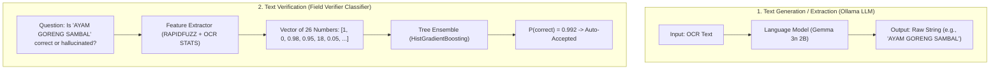
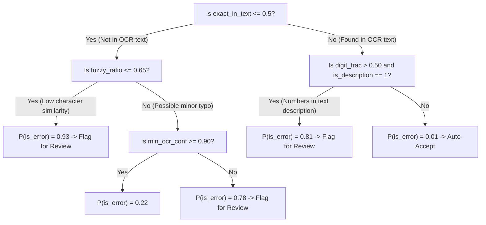

# How Machine Learning Verifies Non-Numerical Text

A common question in document intelligence is:
> **"Machine learning models only understand numbers (vectors of floats). How does the Field Verifier take unstructured text—like item descriptions, merchant names, or payment methods—and decide whether that text is correct without doing math?"**

This document explains the mathematical and engineering foundation of how raw text strings are converted into quantitative verification signals.

---

## 1. The Core Insight: Verification vs Generation

There are two completely different tasks:



The Field Verifier does **not** need to understand the culinary or semantic meaning of *"AYAM GORENG"* (Fried Chicken).  
Instead, it evaluates **objective evidentiary signals**:
1. **Did the LLM fabricate this text out of thin air (hallucination)?**
2. **How closely does this string match the characters that the OCR camera actually saw?**
3. **Did the OCR camera read those characters with high optical confidence or blurry ambiguity?**
4. **Is this text found where this field is typically positioned in a document?**
5. **Does the text structure match its declared field identity?**

---

## 2. Converting Text into Numerical Feature Vectors

When an extraction contains a text field (for example, `description = "ES TEH MANIS"`), the function [`extract_features_for_field()`](file:///R:/DeepWorks/DeepResearch/mrilabs/ml_assignment/src/verifier/features.py#L33-L161) converts that string into numerical features across several dimensions:

### A. String Grounding & Fuzzy Levenshtein Distance
Models often fail by slightly misspelling words or hallucinating modifiers not printed on the receipt. We quantify text grounding using character-level string distance via **RapidFuzz**:

1. **`exact_in_text` (Binary $\{0, 1\}$):**
   Does the exact lowercase substring `"es teh manis"` appear verbatim inside the OCR text?
   $$\text{exact\_in\_text} = \begin{cases} 1 & \text{if } s_{\text{raw}} \subseteq s_{\text{doc}} \\ 0 & \text{otherwise} \end{cases}$$

2. **`fuzzy_ratio` (Continuous $[0.0, 1.0]$):**
   If thermal paper degradation caused OCR typos (e.g., OCR captured `"ES TEH MAN1S"`), exact match fails ($0$). The fuzzy score calculates partial token Levenshtein ratio:
   $$\text{fuzzy\_ratio} = \frac{\text{fuzz.partial\_ratio}(s_{\text{raw}}, s_{\text{doc}})}{100.0}$$
   If the LLM hallucinated `"EXTRA ICE"`, `fuzzy_ratio` drops close to $0.0$.

3. **`n_occurrences` (Integer $\ge 0$):**
   How many times does this text string appear in the document?

---

### B. Perceptual OCR Engine Confidence Mapping
Every character string detected by Docling has a corresponding physical bounding box and an OCR confidence score produced by the neural network:

```python
# Code from src/verifier/features.py
matched_confs: List[float] = []
if ocr_items and raw_lower:
    for item in ocr_items:
        item_text = getattr(item, "text", "") or ""
        conf = getattr(item, "confidence", None)
        # Check if the extracted text overlaps with this physical OCR bounding box
        if conf is not None and (raw_lower in item_text.lower() or item_text.lower() in raw_lower):
            matched_confs.append(float(conf))

if matched_confs:
    mean_ocr_conf = float(np.mean(matched_confs))  # e.g., 0.96
    min_ocr_conf = float(np.min(matched_confs))    # e.g., 0.91
    has_ocr_conf = 1
```

- If an item was clearly printed in bold ink, `mean_ocr_conf` is $\ge 0.95$.
- If an item was smudged, torn, or hallucinated, `mean_ocr_conf` is either low ($\le 0.60$) or missing ($0$).

---

### C. Categorical Identity (One-Hot Encoding)
The model needs to know what *kind* of text this is. In [`src/verifier/train.py`](file:///R:/DeepWorks/DeepResearch/mrilabs/ml_assignment/src/verifier/train.py#L42-L82), categorical labels are transformed using `OneHotEncoder`:

$$\text{field\_name} \rightarrow \begin{bmatrix} \text{is\_description} & \text{is\_vendor} & \text{is\_payment\_method} & \dots \end{bmatrix}$$

This allows the trees to learn field-specific rules (e.g., payment methods are short words like `"cash"`, while descriptions are multi-word phrases).

---

### D. Morphological & Structural Text Properties
Text strings have measurable structural footprints:

1. **`n_chars` (Integer):** Total character count (`len(text)`).
2. **`digit_frac` (Float $[0.0, 1.0]$):**
   $$\text{digit\_frac} = \frac{\text{count of numeric digits}}{\text{total characters}}$$
   - For an item description (`"AYAM GORENG"`), `digit_frac` is $0.0$.
   - If an LLM accidentally dumped a price into a description field (`"15.000"`), `digit_frac` spikes to $0.83$, triggering an anomaly signal.
3. **`relative_position` (Float $[0.0, 1.0]$):**
   Where does the string physically appear in the document text stream?
   $$\text{relative\_position} = \frac{\text{first character index of string}}{\text{total characters in document}}$$
   - Vendor names almost always appear near the top ($0.00 \le \text{pos} \le 0.15$).
   - If an extracted vendor name is found at $\text{pos} = 0.92$ (near the footer), it is almost certainly a hallucination or misclassified payment note.

---

### E. Self-Consistency Agreement (`agree_frac`)
If the document is sampled $k=3$ times at $\text{temperature} = 0.7$:
$$\text{agree\_frac} = \frac{\text{count of sampling passes that generated this exact string}}{k}$$
- If the text is unambiguous, all 3 runs produce `"ES TEH MANIS"` $\rightarrow \text{agree\_frac} = 1.0$.
- If the LLM is guessing, the samples will diverge (`"TEH MANIS"`, `"ES TEH"`, `"TEH HANGAT"`) $\rightarrow \text{agree\_frac} \le 0.33$.

---

## 3. Concrete Example: Real Item vs Hallucinated Item

Let's trace two text extractions through the feature engine:

### Case 1: Legitimate Item Description
- **Extracted Text:** `"NASI GORENG SPESIAL"`
- **Actual OCR Text:** `"... 1 NASI GORENG SPESIAL 35.000 ..."`
- **Feature Vector Produced:**
  | Feature | Value | Explanation |
  | :--- | :--- | :--- |
  | `field_name` | `description` | One-hot encoded |
  | `is_line_item` | `1` | Belongs to line item table |
  | `exact_in_text` | `1` | Verbatim match found in OCR text |
  | `fuzzy_ratio` | `1.00` | 100% token overlap |
  | `mean_ocr_conf` | `0.97` | High optical character confidence |
  | `n_chars` | `19` | Standard description length |
  | `digit_frac` | `0.00` | Pure alphabetic text |
  | `agree_frac` | `1.00` | Consistent across all LLM samples |

$\implies$ **Field Verifier Output:** $P(\text{correct}) = 0.994 \ge 0.85$ $\rightarrow$ **Auto-Accepted**.

---

### Case 2: Hallucinated Modifier (LLM Guess)
- **Extracted Text:** `"EXTRA SAMBAL PEDAS"`
- **Actual OCR Text:** `"... 1 AYAM GORENG 25.000 ..."` *(Waitress scribbled something illegible)*
- **Feature Vector Produced:**
  | Feature | Value | Explanation |
  | :--- | :--- | :--- |
  | `field_name` | `description` | One-hot encoded |
  | `is_line_item` | `1` | Belongs to line item table |
  | `exact_in_text` | `0` | String **never** appears in OCR text! |
  | `fuzzy_ratio` | `0.18` | Negligible character overlap |
  | `mean_ocr_conf` | `0.85` | Default imputed score (no bounding box found) |
  | `has_ocr_conf` | `0` | Missing OCR grounding indicator |
  | `agree_frac` | `0.33` | Only appeared in 1 out of 3 sampling passes |

$\implies$ **Field Verifier Output:** $P(\text{correct}) = 0.082 < 0.85$ $\rightarrow$ **Flagged for Human Review Queue!**

---

## 4. How the Decision Trees Split on These Numbers

Inside the trained [`HistGradientBoostingClassifier`](file:///R:/DeepWorks/DeepResearch/mrilabs/ml_assignment/models/model_card.md), the decision trees learn split thresholds such as:



### Summary
The ML model doesn't need to read English or Indonesian text like a human. By calculating **grounding ratios, OCR confidence bounds, character frequencies, relative positions, and multi-sample consistency**, unstructured text is converted into an informative 26-dimensional fingerprint that tree ensembles can evaluate with over **$97\%$ ROC-AUC**.
