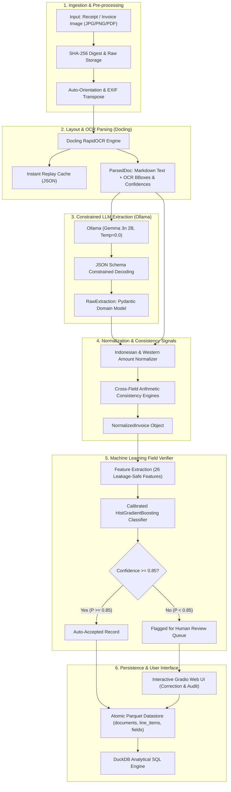

# Complete Technical Documentation & System Notes

Welcome to the technical documentation for the **Invoice & Receipt Processing Pipeline with Field Verifier**. This suite of documentation provides an in-depth breakdown of the entire architecture, dataset lifecycle, data preprocessing, document parsing, LLM information extraction, and the supervised machine learning reliability verifier.

> **Master Technical Report & Task Index:** For an exhaustive, single-file technical report covering every file, function, theoretical concept, IA guideline compliance mapping, and viva voce defense guide, see [`PROJECT_REPORT_AND_CODEBASE_GUIDE.md`](../PROJECT_REPORT_AND_CODEBASE_GUIDE.md).

---

## 📚 Documentation Index

| Module | Document | Description |
| :--- | :--- | :--- |
| **01** | [**System Architecture & Flow**](01_system_architecture_and_flow.md) | Complete end-to-end document lifecycle, component diagrams, data models (`ParsedDoc`, `RawExtraction`, `NormalizedInvoice`), review queue logic, and atomic Parquet storage. |
| **02** | [**Dataset & Data Engineering**](02_dataset_and_data_engineering.md) | In-depth analysis of the CORD-v2 benchmark, image-hash deduplication, cross-split data leakage prevention, and tabular ground truth schemas. |
| **03** | [**Data Preprocessing & Normalization**](03_data_preprocessing_and_normalization.md) | Indonesian financial numeral parsing, unicode cleaning, missing data handling, outlier audits, and cross-field arithmetic validation checks. |
| **04** | [**Docling & RapidOCR Deep Dive**](04_docling_ocr_deep_dive.md) | Comprehensive breakdown of what Docling does, document conversion, image orientation correction, bounding box parsing, token confidence extraction, and caching. |
| **05** | [**Ollama & LLM Extraction Deep Dive**](05_ollama_llm_extraction_deep_dive.md) | Detailed explanation of what Ollama does, local execution of Gemma 3n 2B, Pydantic-driven constrained JSON schema generation, self-consistency sampling, and error recovery. |
| **06** | [**Field Verifier Model Architecture**](06_field_verifier_model_architecture.md) | Supervised ML classifier architecture (HistGradientBoosting + Platt Calibration), Hungarian bipartite alignment, 26 leakage-safe features, grouped CV, and risk-coverage optimization. |
| **07** | [**Text Verification & Feature Encoding**](07_text_verification_and_feature_encoding.md) | Deep dive into how raw text strings (descriptions, merchant names) are vectorized into numerical features using fuzzy Levenshtein distance, OCR confidence, and spatial heuristics. |

---

## 🏛️ High-Level System Architecture

---

## 💡 Key Design Decisions & Core Capabilities

1. **Why Both Docling and Ollama?**
   - **Docling (with RapidOCR):** Acts as the **perceptual and layout engine**. Small language models struggle to accurately read low-resolution, slanted photographic receipt pixels directly. Docling normalizes the document geometry, transcribes character text, and provides word-level bounding boxes and confidence scores.
   - **Ollama (with Gemma 3n 2B):** Acts as the **semantic parser and schema mapper**. It translates unstructured markdown text into a rigid, typed JSON schema without requiring fine-tuning for every receipt template.

2. **Why a Field Verifier Classifier is Required:**
   - Small generative language models are prone to hallucinating missing prices, flipping digits, or dropping negative discounts.
   - LLM generation probabilities (logprobs) are often uncalibrated or inaccessible across local runtimes.
   - The **Field Verifier** bridges this gap: it extracts 26 multi-modal features (OCR token confidence, text fuzzy matching, arithmetic consistency equations) and feeds them into a calibrated tree ensemble that predicts the exact probability that an extracted field is correct ($P(\text{correct})$).

3. **Risk-Controlled Automation:**
   - Instead of binary all-or-nothing automation, the system implements **selective classification (Risk-Coverage optimization)**.
   - Over **96% of fields** exceed the calibrated $0.85$ confidence threshold and are automatically persisted with **99.9% accuracy**.
   - The remaining uncertain fields ($\sim 3.8\%$) are highlighted in an interactive review queue for human sign-off, completely preventing corrupt records from entering financial ledgers.
