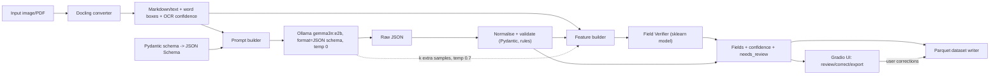

# Implementation Plan: Receipt/Invoice Extraction Pipeline with a Trained Field-Reliability Model

## 0. Honest framing (read first)

The extraction engine is **pre-trained components**: Docling (layout/OCR/text) and Gemma3n-E2B via Ollama (JSON-schema filling). We do **not** train those, and the report must not claim we did. The ML work the assignment grades has to be something we really train and evaluate. Our trained model is:

> **Field Verifier**: a supervised binary classifier. For every field the LLM extracts, it predicts `P(field is correct)`. Fields below a threshold are routed to a "needs review" queue in the UI and flagged in the Parquet output.

**Why this is useful and not decoration:**
- A 2B-effective-parameter model will make mistakes (swapped digits, hallucinated totals, wrong item rows). An LLM's own output has no trustworthy confidence score.
- Without a verifier, the user must check every field. With one, they check only the risky fields.
- It has a clear, measurable payoff: **risk-coverage**, i.e. how much of the data can be auto-accepted at a target accuracy (e.g. 98%).
- It maps to the assignment: imbalanced classification, balancing, feature engineering, baseline vs. 2+ models, tuning, PR-AUC, leakage control.

**Dataset caveat to state in the report:** CORD is *receipts* (Indonesian, photographed), not formal invoices. Ground truth covers only `menu` (line items), `sub_total` and `total` groups. It has **no vendor name, date or invoice number**. So the schema has:
- *Core fields*: evaluated against CORD ground truth and covered by the verifier.
- *Extended fields* (vendor, date, invoice no., currency): extracted and stored, but marked `verified = null` (not evaluated). We say so openly. Stretch goal: hand-label ~30 real invoices to sanity-check these.

---

## 1. Assignment stage mapping

| # | Assignment stage | Applicable? | Where in this plan |
|---|---|---|---|
| 1 | Problem definition | Yes | §2 |
| 2 | Data acquisition | Yes | §3, Task T1 |
| 3 | Data preparation | Yes | §3.2, Task T1 |
| 4 | Preprocessing | Yes (normalisation of amounts/strings, missing, outliers, categoricals, scaling for LR only) | §3.3, T1, T7 |
| 5 | Balancing | Yes: error class is the minority (expected 10–30%, to be measured, not assumed) | §7.4, T7 |
| 6 | EDA | Yes | §7.1, T7 |
| 7 | Feature engineering | Yes: the main modelling lever | §7.2, T7 |
| 8 | Baseline | Yes: majority and rule-based | §7.5, T8 |
| 9 | ML modelling | Yes: LR, Random Forest, gradient boosting compared | §7.5, T8 |
| 10 | Hyperparameter tuning | Yes: RandomizedSearchCV with grouped CV | §7.6, T8 |
| 11 | Validation/evaluation | Yes | §8, T8/T6 |
| 12 | Impact & limitations | Yes | §10, T11 |

Not applicable (and we say so): deep learning. Rationale: the verifier has tabular features on roughly 10–15k rows, where tree ensembles beat neural nets, and DL would add nothing but cost. Fine-tuning Gemma is out of scope for the same reason (compute, time, nothing to defend).

---

## 2. Problem definition

- **Users:** small businesses, accountants and students who have receipts or invoices as images or PDFs and want structured, queryable data.
- **Input:** one image or PDF per document (JPG/PNG/PDF).
- **Output:**
  1. Validated JSON matching the schema in §5.
  2. Rows in a Parquet dataset (§6).
  3. A per-field `confidence` and `needs_review` flag from the Field Verifier.
- **Constraints:** fully local (no cloud API), CPU/modest GPU laptop, Gemma3n-E2B via Ollama, latency target under about 60 s per single-page receipt on the team's machine (measure and report the real figure).
- **Success criteria (decided before running experiments):**
  - Extraction: field-level F1 reported on the CORD test split.
  - Verifier: PR-AUC (error class) must beat the rule-based baseline by a meaningful margin, and risk-coverage must show a real gain. If it doesn't, we report that.

---

## 3. Data

### 3.1 Acquisition
- **Source:** `naver-clova-ix/cord-v2` on Hugging Face. **Licence:** CC-BY-4.0 (confirm on the dataset card and cite in the report). Official splits: 800 train / 100 validation / 100 test.
- Columns: `image` (PIL), `ground_truth` (JSON string containing `gt_parse`, plus `valid_line` OCR boxes).
- **Ownership note:** receipts are from Indonesian shops; the data is public, and no PII beyond shop names is expected. State this.

### 3.2 Preparation (cleaning)
Implemented in `src/data/cord_loader.py` and `src/data/cord_clean.py`. Output is `data/processed/cord_gt.parquet` (one row per field, long format) and `data/processed/cord_docs.parquet` (one row per receipt).

| Check (assignment §4) | Action |
|---|---|
| Record counts before/after | Log in `reports/data_audit.json` |
| Duplicates | Hash images (perceptual hash via `imagehash` + SHA256 of bytes). Remove exact duplicates. Flag near-duplicates **across splits** (leakage) and drop them from train. |
| Schema inconsistencies in `gt_parse` | `menu` may be a dict (single item) or a list. Normalise to a list. `sub_nm`/`sub` (modifiers) are flattened into `modifiers: list[str]`. |
| Format errors | Amount strings like `"16.500"`, `"1,500"`, `"Rp 12.000"`, `"x2"` are parsed by `parse_amount()` (§4.2). Unparseable values are logged and set to null, not guessed. |
| Missing values | Many receipts lack `discount`, `service`, `tax`, `change`. Missing means **absent in the document**, so the representation is null and **not imputed**. The verifier gets an `is_missing_in_gt` view only for analysis. |
| Outliers | Prices: IQR and log-scale review. Cap nothing silently; flag `price > p99.5` or `qty > 50` in EDA and review manually. Decide per case (typo vs. real). |
| Void items | `void_menu` entries are not part of the receipt total; excluded from the item ground truth. |

### 3.3 Preprocessing for modelling
Done in the feature pipeline (§7.2): numeric features unchanged for tree models, `StandardScaler` inside the sklearn `Pipeline` only for Logistic Regression, one-hot for `field_name`/`field_group`. Everything is fitted **inside the CV pipeline** (never on the full data) to avoid leakage.

---

## 4. Technical architecture

### 4.1 Component diagram



### 4.2 Data flow, step by step

1. **Ingest** (`src/pipeline/ingest.py`). Compute `doc_id = sha256(file_bytes)[:16]`. If `doc_id` already exists in the Parquet store, return the existing record (idempotent: no duplicate insertion). Save the original file to `data/raw_uploads/{doc_id}.{ext}`.
2. **Docling parse** (`src/pipeline/parse.py`).
   - Use `DocumentConverter` with `PdfPipelineOptions(do_ocr=True)` (default OCR engine, e.g. RapidOCR/EasyOCR) for images and PDFs. Export `result.document.export_to_markdown()` as `text`.
   - Also keep the word/line text items with bounding boxes and confidence (when the OCR engine reports it) as `ocr_items: list[{text, bbox, conf}]`.
   - **Cache** the result to `data/cache/docling/{doc_id}.json` so the LLM and verifier experiments never re-run OCR.
   - **Ablation (stretch):** SmolDocling-256M VLM pipeline (`--pipeline vlm`, the model in the HF demo) vs. the standard OCR pipeline. Compare on a fixed 100-doc train subset by end-to-end field F1 and runtime. Default to whichever is better *by measurement*.
3. **Prompt + LLM call** (`src/pipeline/extract.py`).
   - Ollama `/api/chat` with `model="gemma3n:e2b"`, `format=InvoiceExtraction.model_json_schema()` (structured outputs), `options={"temperature":0, "num_ctx":8192, "seed":42}`.
   - Note: Ollama serves Gemma3n as **text-only**, so it consumes Docling's text, not the image. The prompt says: extract only what is present; use `null` if absent; copy numbers exactly as printed; do not compute values.
   - Retries: up to 2 on invalid JSON / schema validation failure; then store `status="failed"` with the raw output for debugging.
   - Prompt development is allowed **only on the first 50 train receipts**. Prompt is frozen (`prompts/extract_v1.txt`, git-tagged) before running val/test.
4. **Normalise + validate** (`src/pipeline/normalize.py`).
   - `parse_amount(s, locale_hint)` returns `Decimal` or `None`. Rule for strings with `.`/`,`: if the last separator is followed by exactly 3 digits and there is no other separator, treat it as a thousands separator (IDR style, `16.500` = 16500); if followed by 1–2 digits, it is a decimal. Configurable via `currency_decimals` (IDR = 0).
   - Strings: strip, collapse whitespace, Unicode NFKC.
   - Pydantic validators check types and non-negative amounts.
5. **Consistency checks** (`src/pipeline/checks.py`): produce *signals* (see §7.2), not corrections. We never overwrite the LLM's value with a computed one.
6. **Self-consistency sampling** (optional, config `k_samples=3`): re-run the LLM 3 times at temperature 0.7 and measure per-field agreement with the primary output. Costs 3x latency. Its value is **tested in an ablation**; if it doesn't help the verifier, we turn it off.
7. **Verifier scoring** (`src/verifier/predict.py`): build the feature row per field, call `model.predict_proba`. `needs_review = proba < threshold` (threshold chosen on the validation split, §8).
8. **Persist** to Parquet (§6) and return to the UI.

### 4.3 Repository layout

```
ml_assignment/
  implementation.md
  pyproject.toml / requirements.txt     # pinned versions
  configs/default.yaml                   # model name, seeds, k_samples, threshold, paths
  prompts/extract_v1.txt
  src/
    schema/invoice.py                    # Pydantic models (single source of truth)
    data/cord_loader.py  cord_clean.py
    pipeline/ingest.py parse.py extract.py normalize.py checks.py run.py
    store/parquet_store.py
    labels/align.py  build_labels.py     # match predictions to ground truth
    verifier/features.py train.py predict.py evaluate.py
    app/gradio_app.py
  notebooks/01_eda.ipynb 02_modelling.ipynb   # thin notebooks calling src/
  data/{raw,cache,processed,store}/      # gitignored except small samples
  models/verifier_v1.joblib + model_card.md
  reports/                               # figures, metrics.json, data_audit.json
  tests/
```

Reproducibility: `SEED=42` for numpy, sklearn, the Ollama `seed` option and the splits. Record `pip freeze`, Docling version, the Ollama model digest (`ollama show gemma3n:e2b`) and git commit in `reports/run_manifest.json`.

---

## 5. Schema design

Single source of truth: `src/schema/invoice.py` (Pydantic v2). The LLM-facing schema is deliberately **flat and small**, because small models fill small schemas more reliably. Amounts are requested as **strings exactly as printed** (the LLM does not parse numbers); our code normalises them.

```python
class LineItem(BaseModel):
    description: str | None        # item name as printed
    quantity: str | None           # "2", "1x" -> normalised later
    unit_price: str | None
    line_total: str | None         # price for that line as printed
    modifiers: list[str] = []      # sub-items such as "no ice"

class InvoiceExtraction(BaseModel):          # <- sent to Ollama as JSON Schema
    # extended fields (not in CORD ground truth)
    vendor_name: str | None
    invoice_number: str | None
    invoice_date: str | None       # as printed; ISO conversion is done in code
    currency: str | None
    # core fields (CORD-evaluable)
    line_items: list[LineItem]
    subtotal: str | None
    discount: str | None
    service_charge: str | None
    tax: str | None
    total: str | None
    payment_method: str | None     # cash / card / e-money / other
    amount_paid: str | None
    change: str | None
```

CORD ground-truth mapping used by the label builder:

| Our field | CORD `gt_parse` key |
|---|---|
| line_items[].description | `menu[].nm` |
| quantity | `menu[].cnt` |
| unit_price | `menu[].unitprice` |
| line_total | `menu[].price` |
| subtotal | `sub_total.subtotal_price` |
| discount | `sub_total.discount_price` |
| service_charge | `sub_total.service_price` |
| tax | `sub_total.tax_price` |
| total | `total.total_price` |
| amount_paid | `total.cashprice` / `creditcardprice` / `emoneyprice` (whichever is present) |
| change | `total.changeprice` |

**Normalised record** (`NormalizedInvoice`, produced after step 4) holds `Decimal` amounts, `date`, and a per-field `FieldResult`:

```python
class FieldResult(BaseModel):
    field_path: str                # "total", "line_items[2].line_total"
    raw_value: str | None
    value: Decimal | str | date | None
    grounded: bool                 # value found in OCR text
    confidence: float | None       # verifier P(correct); None for extended fields
    needs_review: bool | None
    verified: bool | None          # None = not evaluable
```

Schema versioning: `schema_version="1.0"` stored in every Parquet row. Changing a column means a new version, and the reader handles the old one.

---

## 6. Parquet storage design

Parquet files are immutable, so "insert" = **write a new part file** into a dataset directory (no read-modify-write). Reads use `pyarrow.dataset` or DuckDB over the directory.

```
data/store/
  documents/part-{doc_id}.parquet
  line_items/part-{doc_id}.parquet
  fields/part-{doc_id}.parquet
```

**`documents`** (one row per document)

| column | type | note |
|---|---|---|
| doc_id | string | sha256 prefix, primary key |
| source_filename | string | |
| ingested_at | timestamp[us, UTC] | |
| schema_version | string | |
| vendor_name, invoice_number | string null | |
| invoice_date | date32 null | |
| currency | string null | |
| subtotal, discount, service_charge, tax, total, amount_paid, change | decimal128(18,2) null | |
| payment_method | string null | |
| n_items | int32 | |
| min_field_confidence | float32 null | |
| needs_review | bool | any core field flagged |
| status | string | ok / failed / corrected |
| llm_model, llm_digest, docling_version, prompt_version, verifier_version | string | provenance |
| extract_seconds | float32 | |

**`line_items`**: `doc_id, item_idx (int32), description, quantity (decimal 10,3), unit_price, line_total (decimal 18,2), modifiers (list<string>), item_confidence (float32), needs_review (bool)`.

**`fields`** (long format, one row per field; this is the verifier's training/inference unit): `doc_id, field_path, raw_value, value_str, grounded, confidence, needs_review, user_corrected (bool), corrected_value`.

**Writer rules** (`src/store/parquet_store.py`):
- `write_document(normalized: NormalizedInvoice) -> None`: build explicit `pa.schema` tables (no type inference), write to a temp file, then `os.replace` into place (atomic).
- Idempotency: if `documents/part-{doc_id}.parquet` exists, skip, or overwrite only when `status` changes (for UI corrections).
- `compact()` merges the part files into one per table (run on demand, since many tiny files are slow).
- `read_all(table) -> pyarrow.Table`/DuckDB view helper.
- Test: round-trip, idempotent re-insert, null handling, Decimal precision.

---

## 7. ML component: Field Verifier

### 7.1 Training data generation
1. Run the frozen pipeline on **all 1000 CORD receipts** (train/val/test) and store the raw outputs in `data/processed/extractions_v1.jsonl`. Time estimate to measure: ~10–40 s per receipt on CPU, so budget a few hours, and run it overnight with checkpoint/resume by `doc_id`.
2. **Align** (`labels/align.py`):
   - Scalar fields: compare normalised prediction with normalised ground truth (amounts equal as `Decimal`; strings with casefold and whitespace collapse).
   - Line items: match predicted items to ground-truth items by Hungarian assignment on `rapidfuzz` name similarity (threshold, e.g. 0.6). Per matched pair, compare each sub-field. Unmatched predicted items get label `incorrect` (hallucinated or split). Ground-truth items never predicted are **recall misses**: not verifier rows, but counted in extraction recall (§8.1).
3. Label: `y = 1` if the field is **wrong**, `0` if correct. (The minority class is the positive class, which is simpler for PR-AUC.) Fields where the ground truth is absent and the prediction is null are correct and **excluded** from training because they carry no extraction decision.
4. Row unit: one extracted non-null field. Expected volume ~1000 receipts x ~12–15 fields = **~10–15k rows** (to be measured and reported before/after filtering).

### 7.2 Features (every one uses only the document text and the LLM output, never the ground truth)

| Group | Feature | Why |
|---|---|---|
| Identity | `field_name` (one-hot), `is_line_item` | error rates differ strongly by field |
| Grounding | `exact_in_text` (normalised value occurs in the Docling text), `n_occurrences`, `max_fuzzy_ratio` (rapidfuzz partial ratio) | hallucinated values rarely appear in the source |
| Grounding (numbers) | `digits_in_text` (digit string present after removing separators) | handles format differences |
| OCR quality | `mean_ocr_conf` and `min_ocr_conf` of the matched token(s) (NaN → imputed with a flag column `has_ocr_conf`) | a misread digit is often a low-confidence token |
| Arithmetic | `items_sum_minus_subtotal` (relative), `subtotal_plus_adj_minus_total` (relative), `qty_x_unit_minus_line_total` (per item), flags for each | the strongest cross-field evidence for numbers |
| Format | `n_chars`, `digit_frac`, `parse_ok`, `looks_like_amount`, `value_is_round` | detects garbage strings |
| Context | `n_items`, `doc_text_len`, `relative_position_of_match` in the text, `item_idx_rel` | long receipts → more errors |
| Consistency (optional) | `agree_frac` over k samples | tested in ablation |

Feature selection: report permutation importance and drop groups only if the validation PR-AUC doesn't decrease (ablation table, one row per group removed).

### 7.3 Splits (leakage control)
- Use the official CORD splits **at receipt level**. All fields from one receipt stay in the same split. Never split rows randomly.
- **train (800):** model fitting plus cross-validation with `StratifiedGroupKFold(n_splits=5, groups=doc_id)`.
- **validation (100):** threshold selection and model choice.
- **test (100):** touched **once**, at the end. The test metrics are the ones reported. (~1.2–1.5k rows; give confidence intervals with a receipt-level bootstrap because the sample is small.)
- Near-duplicate images across splits are removed in T1.

### 7.4 Balancing
1. Measure the error rate per field and overall (EDA). Only apply balancing if the minority class is below roughly 30%, and justify it with data.
2. Candidates compared **inside the CV folds only** (fitted on the training folds, never on validation folds): (a) nothing, (b) `class_weight="balanced"`, (c) SMOTE via `imblearn.pipeline.Pipeline`. Resampling applies to the training folds, and the validation fold remains the natural distribution.
3. Prefer (b) unless (c) shows a measurable gain: SMOTE on mixed one-hot/numeric features is questionable, and the comparison documents that.
4. Evaluation always uses the true class ratio.

### 7.5 Models
- **Baselines (required):**
  - B0: always predict "correct" (majority). Shows why accuracy is useless here.
  - B1: rule baseline: `incorrect` if `not exact_in_text` or the arithmetic check fails; otherwise `correct`. No learning. This is what the ML model must beat.
- **Models:**
  - M1: Logistic Regression (scaled, L2). Interpretable linear reference.
  - M2: Random Forest. Robust to mixed features and NaN-imputed values.
  - M3: HistGradientBoostingClassifier (sklearn; avoids an extra dependency) or LightGBM. Expected to be best on tabular data, to be shown, not assumed.
- Justification text for each (assumptions, why suited) goes into the report.

### 7.6 Tuning
- `RandomizedSearchCV` (n_iter ≈ 40) on the train folds with grouped stratified CV, scoring = `average_precision` (PR-AUC) for the error class.
- Search spaces: LR `C` (log 1e-3..1e2); RF `n_estimators`, `max_depth`, `min_samples_leaf`, `max_features`; HGB `learning_rate`, `max_leaf_nodes`, `l2_regularization`, `max_iter` with early stopping.
- Report the best CV score ± std, then the val score. Show the train vs. CV gap to check overfitting.
- Calibration: `CalibratedClassifierCV(method="isotonic" or "sigmoid")` fitted via CV on the train data; report the Brier score and the reliability curve (the confidence is shown to users, so it must mean something).

---

## 8. Evaluation

### 8.1 Extraction quality (the LLM pipeline, not trained by us)
- Field-level precision/recall/F1 per field on the test split, plus exact-match rate of `total`.
- Line-item F1 on matched items.
- Also report the CORD-style tree-edit-distance accuracy only if time allows (optional).
- Latency per document (median, p95) and failure rate (invalid JSON after retries).

### 8.2 Verifier quality (our trained model)
Metrics, and why they were chosen (the assignment requires the justification):
- **PR-AUC (average precision) on the error class**: the headline metric since errors are the minority.
- Precision, recall, F1 for the error class at the chosen threshold; balanced accuracy; ROC-AUC as a secondary figure; confusion matrix; per-field breakdown.
- **Risk-coverage curve**: rank fields by confidence; for each coverage level (share of fields auto-accepted) plot the error rate of the accepted set. Headline number: *"auto-accepting X% of fields gives Y% accuracy on the accepted set, vs. Z% overall."* Compare with baseline B1 and with random ordering.
- Calibration: Brier score and reliability diagram.
- Threshold choice: on the validation split, pick the lowest review rate such that error recall ≥ 90% (or a user-set target); freeze it, then apply to the test split once.
- Bootstrap 95% CI (receipt-level, 1000 resamples) on the test metrics.

### 8.3 Error analysis
Collect the top false negatives (errors the verifier missed) and false positives; categorise by cause (OCR misread, wrong row, LLM hallucination, ground-truth label noise). Include at least 10 concrete examples with the image, the Docling text, the LLM output and the ground truth. Also state what happens on **unseen** document types (a real invoice, a PDF): the verifier was trained on receipts only, so the report will honestly mark that as a distribution shift and show whatever small check we ran.

---

## 9. Gradio UI (simple, `src/app/gradio_app.py`)

Single `gr.Blocks` app, three tabs:

1. **Extract**
   - `gr.File` upload (image/PDF) -> "Run" button.
   - Outputs: `gr.Image` preview, `gr.Code` (JSON), a `gr.Dataframe` of the line items with a `needs_review` column, and a fields table with confidence, with low-confidence rows highlighted (`gr.Dataframe(styler=...)` or a flag column).
   - Progress via `gr.Progress` (Docling -> LLM -> verifier -> save).
   - Editable dataframe; "Save corrections" button writes `user_corrected=True`, `status="corrected"`. These corrections are also future labelled data, and we mention this as future work.
2. **Dataset**: a table view of `documents` read from Parquet through DuckDB, a "Download parquet" button, and a simple filter by `needs_review`.
3. **About/Metrics**: show `reports/metrics.json`, the risk-coverage plot and the model card.

The UI contains no logic: it calls `pipeline.run.process_document(path) -> NormalizedInvoice`, so every part can be tested without a browser. Design reference only: the HF SmolDocling demo (upload, then view the converted document).

---

## 10. Impact and limitations (for the report)
- **Benefit:** review effort limited to flagged fields; local processing means no data leaves the machine; structured Parquet is directly analysable (DuckDB, pandas).
- **Limitations to state:** receipts (not invoices) as training data; Indonesian formatting; one language; the verifier does not catch *omitted* items (recall errors); Gemma3n-E2B sees text only, so OCR errors propagate; the test set is small (100 receipts), so the CIs are wide; the extended fields are unevaluated.
- **Future work:** use UI corrections for retraining, fine-tune the extractor, evaluate on a labelled real-invoice set, add Hungarian/line-level layout features from the word boxes.

---

## 11. Tasks (assignable)

Interface contracts are fixed first (T0), so everybody can work in parallel against stubs and sample fixtures. Effort is in person-days (rough).

| ID | Task | Depends on | Effort | Owner |
|---|---|---|---|---|
| T0 | Repo skeleton, env, config, **schema + contracts** | none | 0.5 | |
| T1 | CORD acquisition, audit, cleaning, GT long-format | T0 | 1.5 | |
| T2 | Docling parsing + cache (+ SmolDocling ablation) | T0 | 1.5 | |
| T3 | Ollama extraction, prompt, retries, batch runner | T0, T2 | 2 | |
| T4 | Normalisation, validation, consistency checks | T0 | 1.5 | |
| T5 | Parquet store | T0 | 1 | |
| T6 | Label alignment (pred vs. GT) + extraction metrics | T1, T4 | 2 | |
| T7 | EDA, features, balancing study | T3, T6 | 2.5 | |
| T8 | Baselines, models, tuning, calibration, evaluation | T7 | 3 | |
| T9 | Gradio UI | T0 (stubs), T5, T8 final | 1.5 | |
| T10 | Integration, end-to-end test, run manifest | all | 1 | |
| T11 | Report/slides, model card, AI-use log | T8 | 2 | |

### T0: Skeleton and contracts
- Create the layout in §4.3, `requirements.txt` with pinned versions (docling, ollama, pydantic>=2, pyarrow, duckdb, pandas, scikit-learn, imbalanced-learn, rapidfuzz, gradio, datasets, imagehash, matplotlib), `configs/default.yaml`.
- Write `src/schema/invoice.py` exactly as §5, plus the function **signatures** shared by tasks:
  - `parse_document(path) -> ParsedDoc{doc_id, text, ocr_items}`
  - `extract(parsed, k_samples) -> RawExtraction{primary, samples[]}`
  - `normalize(raw) -> NormalizedInvoice`
  - `build_features(parsed, normalized, raw) -> DataFrame`
  - `store.write_document(normalized)`
- Commit 3–5 hand-made JSON fixtures in `tests/fixtures/` so others can test without running the models.
- **Done when:** `pytest` passes on the schema round-trip, and `ollama pull gemma3n:e2b` works on the team machines.

### T1: CORD data
- Download via `datasets`, implement the cleaning table in §3.2, write `cord_gt.parquet`, `cord_docs.parquet`, `reports/data_audit.json` (counts before/after, duplicates found, missing-rate per field, outlier list).
- **Done when:** the audit report exists; no `doc_id` is shared across splits; `parse_amount` unit tests cover ≥ 15 formats.

### T2: Docling parsing
- Implement `parse_document` with caching and the ocr_items extraction (including confidence, if available; document what the engine really offers), and measure runtime per doc.
- Ablation vs. SmolDocling on 100 train docs: text-token recall of GT values (does each GT total/price string appear in the text?) and seconds per doc.
- **Done when:** all 1000 CORD images are parsed and cached; the ablation table is committed with the decision.

### T3: LLM extraction
- Implement the prompt, the Ollama call with `format=schema`, retries, resume-able batch runner (`python -m src.pipeline.run --split train`), k-sample mode.
- Track failure rate, latency, token counts. Prompt dev only on the first 50 train docs; freeze and tag.
- **Done when:** `extractions_v1.jsonl` covers all 1000 docs, with failure rate reported.

### T4: Normalisation and checks
- `parse_amount`, string/date normalisation, Pydantic validation, `checks.py` producing the arithmetic signals of §7.2 (each as a pure function with tests).
- **Done when:** unit tests pass on fixtures including edge cases (missing subtotal, negative discount, 2-decimal vs. 0-decimal currencies).

### T5: Parquet store
- Implement the three tables, atomic writes, idempotency, `compact()`, readers (§6).
- **Done when:** tests for round-trip, re-insert, null handling, and Decimal precision pass, and a DuckDB `SELECT` over the store works.

### T6: Alignment and labels
- Implement `align.py` (Hungarian matching, comparison rules), `build_labels.py` → `labels_v1.parquet` (`doc_id, split, field_path, y_wrong`), and extraction metrics (§8.1).
- Spot-check 30 alignments manually and record the label-noise rate in the report.
- **Done when:** label file exists, with the class ratio printed per split.

### T7: EDA, features, balancing
- Notebook `01_eda.ipynb`: error rate by field/length/number of items, class distribution, correlation among features, outliers; each plot gets one written "decision it influenced".
- `features.py` per §7.2 with the feature-group ablation, and the balancing comparison of §7.4 (inside CV).
- **Done when:** the feature table `features_v1.parquet` is reproducible from raw caches with one command; leakage test: a unit test asserts that no feature function receives GT.

### T8: Models
- Baselines B0/B1, models M1–M3, tuning per §7.6, calibration, threshold selection on val, single test evaluation with bootstrap CIs, risk-coverage and reliability plots, error analysis (§8.3), `verifier_v1.joblib` and `model_card.md`.
- **Done when:** `reports/metrics.json` is generated by one script; the test split is evaluated exactly once (log the timestamp/commit).

### T9: Gradio UI
- Implement the three tabs in §9 against `process_document`; initially use fixtures/stubs so work starts on day one.
- **Done when:** upload → table with flagged fields → saved to Parquet → visible in the Dataset tab, on a clean machine from the README steps.

### T10: Integration
- End-to-end test on 5 unseen images (including 1 real invoice PDF and 1 of poor quality); timing; README with run commands; `run_manifest.json`.

### T11: Report and records
- Report organised by the 12 assignment stages, each answering what / why / how / what changed / validated (§3 of the guidelines).
- Maintain `docs/ai_usage_log.md` listing datasets, libraries and the places where AI assistance was used; every member must be able to explain their own task's code.
- Do **not** report numbers that were not produced by the scripts.

---

## 12. Risks and mitigations

| Risk | Mitigation |
|---|---|
| Gemma3n-E2B is slow/weak on long receipts | Truncate nothing silently; set `num_ctx`; measure; if the failure rate is above ~10%, split long receipts by regions and report |
| Few errors, so very imbalanced labels | Measure first; use PR-AUC; if there are fewer than ~800 error rows, simplify models and say so |
| CV scores optimistic through receipt leakage | Group-based splits only; unit test that groups never cross folds |
| Label noise (CORD annotation quirks, e.g. item name variants) | Normalised matching, a manual audit of 30 cases, and an estimate of the noise ceiling |
| Overnight batch crashes | Resume by `doc_id`; append-only JSONL |
| Test set reused for tuning | Single evaluation script that refuses to run twice without `--force`; log it |
| Ollama tag or vision support differs by version | Pin the Ollama version; the plan only relies on text input and structured outputs |
